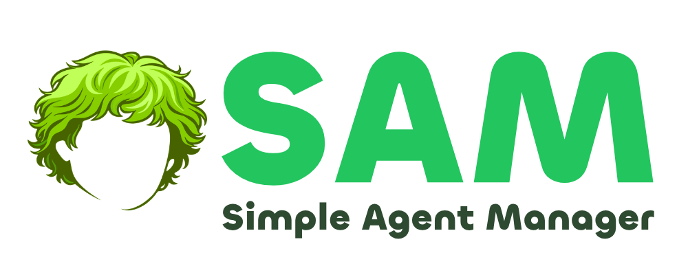
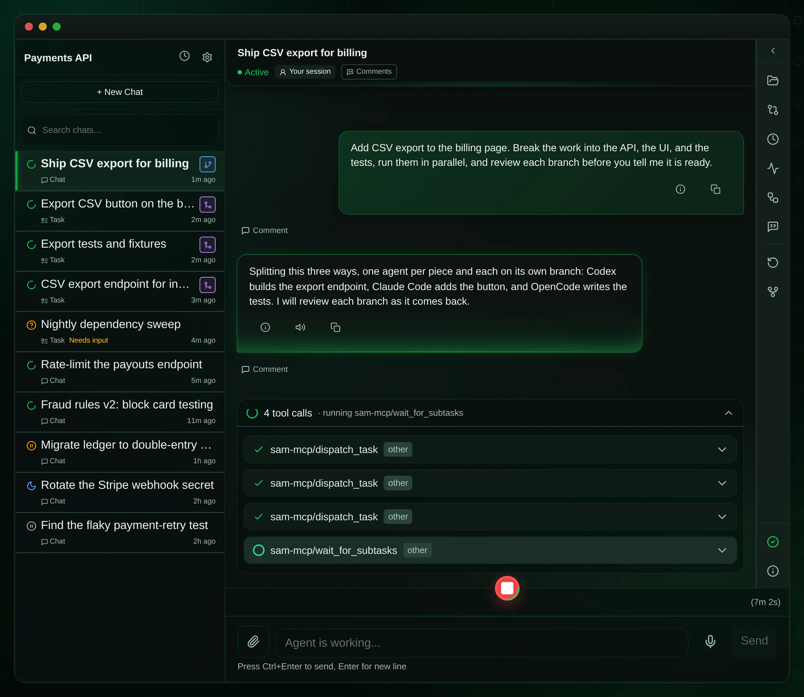
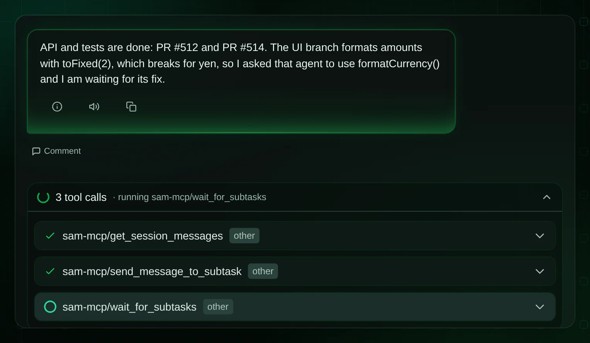
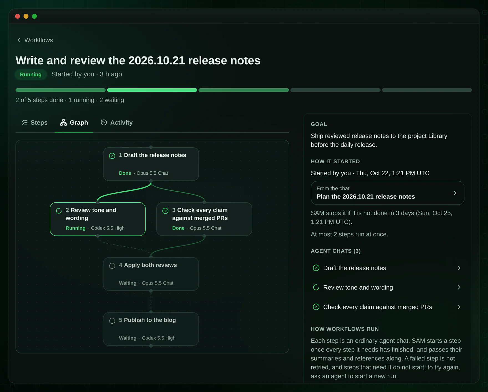
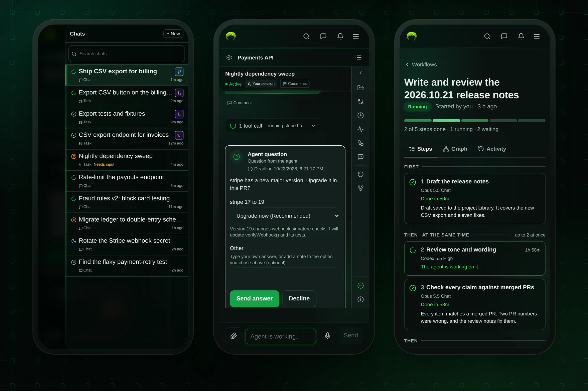
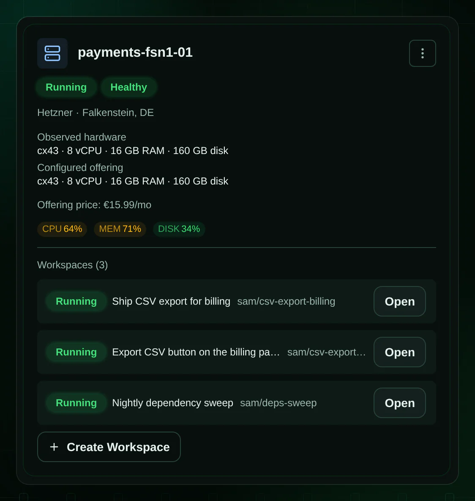
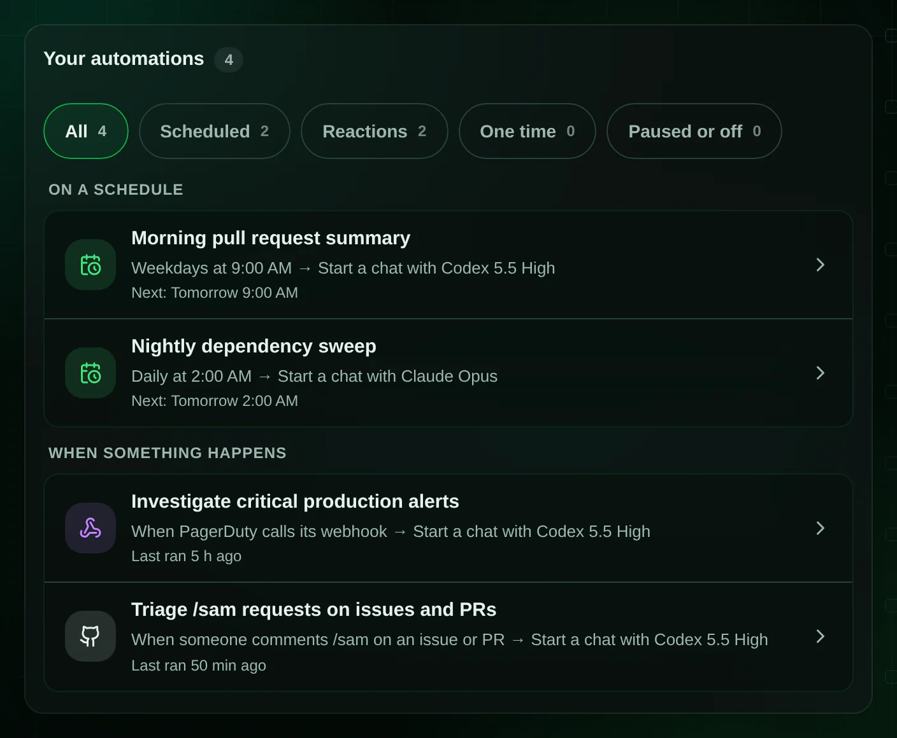

<p align="center">
  <picture>
    <source media="(prefers-color-scheme: dark)" srcset="assets/images/sam-banner-dark.png" />
    
  </picture>
</p>

<h3 align="center">Run a fleet of coding agents on your own cloud.</h3>

<p align="center">
  Every task gets its own agent and dev environment, on machines you own.<br />
  Agents can start helper agents, message them, and review what they send back.<br />
  Mix Claude Code, Codex, and other agents, and steer the whole fleet from your browser or phone.
</p>

<p align="center">
  <a href="https://simple-agent-manager.org">Website</a> &bull;
  <a href="https://simple-agent-manager.org/docs/">Docs</a> &bull;
  <a href="https://simple-agent-manager.org/docs/guides/self-hosting/">Deploy your own</a>
</p>

<p align="center">
  <a href="LICENSE"></a>
  <a href="https://app.codspeed.io/raphaeltm/simple-agent-manager?utm_source=badge"></a>
</p>

<p align="center">
  
  <br />
  <sub>The real SAM interface with a sample project.</sub>
</p>

## Built for more than a few agents

Running a few agents in terminal tabs works until your laptop becomes the bottleneck. They compete for ports, Docker, and memory. Your laptop has to stay awake. And each one stops to ask you something the moment you step away.

SAM moves the fleet off your laptop.

- **A workspace for every task.** On VMs in your cloud account, each agent gets its own dev container, built from your repo's `.devcontainer` by default, with Docker, git, and its own branch. Several agents share a VM when they fit, and idle VMs shut down. For quick jobs, Instant sessions start in seconds on Cloudflare Containers, with no VM provider needed.
- **Agents that run agents.** An agent can start helpers, send them instructions, wait for them, and stop them. Give a lead agent a big job and it splits the work, hands out the pieces, and reviews what comes back.
- **The agents you already use.** Claude Code, Codex, Gemini CLI, Mistral Vibe, OpenCode, and Amp, side by side in one project. Save an agent, model, and effort level as a profile and pick one per task, so Claude Code can plan while Codex writes the code. Use API keys or your Claude and ChatGPT subscriptions.
- **Everything visible, from anywhere.** Every message and tool call streams into the project chat and stays there. The chat list shows which agents are working, finished, or waiting on you. Turn on push notifications to hear when a task finishes or an agent asks for your input.
- **Work that starts without you.** Schedules, GitHub events, and webhooks start agents: a nightly dependency sweep, a pass over every new issue, a first look at every production alert.
- **Your accounts, your bill.** SAM runs on your Cloudflare account. VMs run in your Hetzner, Scaleway, GCP, Vultr, UpCloud, DigitalOcean, or Infomaniak account, at their prices. Open source under AGPL-3.0.

## Agents that run agents

Give one agent the whole job:

> Add CSV export to the billing page. Break the work into the API, the UI, and the tests, run them in parallel, and review each branch before you tell me it is ready.

That is the conversation in the screenshot above. The lead agent starts three helpers, each in its own workspace on its own branch. Half an hour later two of them are done, and the lead has found a bug in the third and sent it back:

<p align="center">
  
</p>

The lead does this with tools SAM gives its agents:

| Tool                             | What the agent does with it                                                      |
| -------------------------------- | -------------------------------------------------------------------------------- |
| `dispatch_task`                  | Start a helper with a brief, a profile, and a branch                             |
| `send_message_to_subtask`        | Send a running helper new instructions                                           |
| `get_session_messages`           | Read a helper's conversation                                                     |
| `wait_for_subtasks`              | Pause until its helpers finish or a deadline passes. SAM wakes it, so no polling |
| `stop_subtask` / `retry_subtask` | Stop or retry a helper it started                                                |
| `start_workflow_run`             | Hand SAM a plan of steps that depend on each other                               |

Agents in the same project can message each other, so a helper can report back or ask the lead a question. Your deployment's settings cap how deep and how wide agents can fan out.

### Plans with dependencies

For work in stages, an agent can hand SAM a workflow, such as "draft the release notes, have two agents review them at the same time, then apply both reviews". SAM starts each agent step once the steps before it finish, can wait for an event like a CI result between steps, and shows everyone in the project how the plan is going.

<p align="center">
  
</p>

## Your fleet from your phone

SAM works as well on a phone as at a desk. See which agents are working, finished, or waiting on you, answer the one that has a question, and follow a workflow step by step.

<p align="center">
  
</p>

## Machines you own, work that starts itself

<table>
  <tr>
    <td width="50%" valign="top">
      
    </td>
    <td width="50%" valign="top">
      
    </td>
  </tr>
  <tr>
    <td valign="top"><b>Your VMs, packed.</b> Several agents share a VM when there is room. See each machine's provider, size, price, and load.</td>
    <td valign="top"><b>Automation.</b> Start agents on a schedule, from GitHub events, or from any webhook.</td>
  </tr>
</table>

Sessions sleep when they go idle and wake when you reply, with the full history kept. Teammates can follow each other's agents, comment on any message, and share a chat for a set time. SAM tells every new session to load the project's knowledge and rules first. See [what's in SAM](https://simple-agent-manager.org/docs/overview/).

## How it works

| Part              | What it does                                                      | Built on                                              |
| ----------------- | ----------------------------------------------------------------- | ----------------------------------------------------- |
| **Control plane** | API, auth, scheduling, chat history, agent-to-agent messaging     | Cloudflare Workers, D1, Durable Objects, KV, R2       |
| **Nodes**         | VMs that run workspaces. Several agents can share one VM          | Your cloud account, a Go agent on each VM, Docker     |
| **Workspaces**    | One dev container per task, with the agent, your repo, and Docker | Your repo's `.devcontainer`, or a fast prebuilt image |
| **Instant**       | Containers for quick work when you don't need a VM                | Cloudflare Containers                                 |

The control plane runs on Cloudflare Workers, so there is no control-plane VM to maintain. VMs are created when agents need them and shut down after they sit idle. Read the [architecture overview](https://simple-agent-manager.org/docs/architecture/overview/) for the details.

## Deploy your own

You need:

- A [Cloudflare account](https://dash.cloudflare.com/sign-up) on the Workers Paid plan ($5 a month), with a domain on Cloudflare
- A [GitHub App](https://simple-agent-manager.org/docs/guides/self-hosting/#github-setup) for sign-in and repository access
- A cloud provider account for VMs (optional if you only use Instant sessions)

SAM deploys from GitHub Actions in your fork. The [self-hosting guide](https://simple-agent-manager.org/docs/guides/self-hosting/) walks through every step.

## Develop

```bash
pnpm install && pnpm build && pnpm test
```

See the [local development guide](https://simple-agent-manager.org/docs/guides/local-development/) to run SAM on your machine.

## Learn more

- [Docs](https://simple-agent-manager.org/docs/): agents, workflows, automation, and teams
- [Self-hosting guide](https://simple-agent-manager.org/docs/guides/self-hosting/): deploy your own instance
- [Security model](https://simple-agent-manager.org/docs/architecture/security/): how credentials are encrypted and isolated
- [Blog](https://simple-agent-manager.org/blog/): what we are building and why

## License

[AGPL-3.0](LICENSE)
