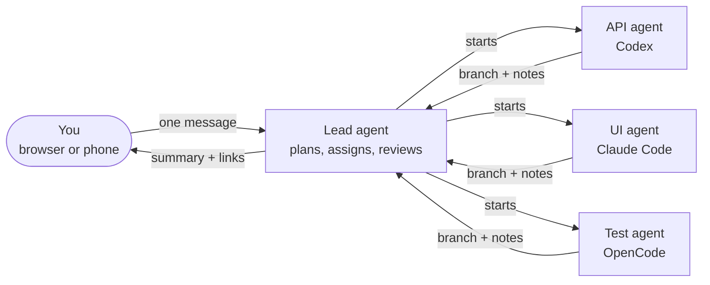

<p align="center">
  
</p>

<h3 align="center">Run a fleet of coding agents on your own cloud.</h3>

<p align="center">
  Every task gets its own agent and its own dev environment, on machines in your cloud account.<br />
  Agents can start other agents, message them, and check their work.<br />
  You follow along, steer, and answer questions from your browser or your phone.
</p>

<p align="center">
  <a href="https://simple-agent-manager.org">Website</a> &bull;
  <a href="https://simple-agent-manager.org/docs/">Docs</a> &bull;
  <a href="https://simple-agent-manager.org/docs/guides/self-hosting/">Deploy your own</a>
</p>

<p align="center">
  <a href="LICENSE"></a>
  <a href="https://app.codspeed.io/raphaeltm/simple-agent-manager?utm_source=badge"></a>
</p>

<p align="center">
  
</p>

## Built for more than a few agents

Running a couple of agents in terminal tabs works fine. At ten, it falls apart. They fight over ports, Docker, and memory. Your laptop has to stay awake. Each one stops to ask a question while you are away, and nobody is keeping them on track.

SAM moves the fleet off your laptop.

- **A real machine for every task.** Each agent runs in its own dev container, built from your repo's `.devcontainer`, on a VM in your own cloud account. Full Linux, Docker, git, and its own branch. Agents share a VM when they fit, and idle machines shut down.
- **Agents that run agents.** Any agent can start more agents, send them messages, wait for them, and stop them. Hand a lead agent a big job and it can split the work, assign the pieces, and review what comes back.
- **The agent you already use.** Claude Code, Codex, Gemini CLI, Mistral Vibe, OpenCode, and Amp, side by side in one project. Save an agent, model, and effort level as a profile and pick one per task. Use API keys or your Claude and ChatGPT subscriptions.
- **Everything visible, from anywhere.** Every message and tool call streams into a project chat and stays there. Your phone tells you when an agent finishes or needs you, and you can answer, redirect, or stop it from there.
- **Work that starts without you.** Schedules, GitHub events, and webhooks can start agents. Run a nightly dependency sweep or put an agent on every new issue.
- **Your accounts, your bill.** SAM runs on your Cloudflare account. VMs run in your Hetzner, Scaleway, GCP, Vultr, UpCloud, DigitalOcean, or Infomaniak account, at their prices. Open source under AGPL-3.0.

## Agents that run agents

Give one agent the whole job:

> Add CSV export to the billing page. Split it into the API, the UI, and the tests. Run them in parallel, review each branch, and tell me when it's ready.



Each helper gets its own workspace and branch. The lead agent drives them with tools SAM gives every agent:

| Tool                                       | What the agent can do with it                                                             |
| ------------------------------------------ | ----------------------------------------------------------------------------------------- |
| `dispatch_task`                            | Start another agent with a brief, a profile, and a branch                                 |
| `send_message_to_subtask`                  | Give a running agent new instructions                                                     |
| `wait_for_subtasks`                        | Go to sleep until its helpers finish, then wake up with their results                     |
| `get_session_messages`                     | Read exactly what a helper did                                                            |
| `stop_subtask` / `retry_subtask`           | Stop a helper that went off track, or try again                                           |
| `start_workflow_run`                       | Hand SAM a plan with dependencies. SAM starts each step when it is ready                  |

A lead agent doesn't have to sit and poll. It can go to sleep until its helpers finish, and SAM wakes it with their results. Any agent in a project can message any other, so helpers can report back or ask the lead a question. Deployment settings cap how deep and how wide agents can fan out.

## A quick tour

<table>
  <tr>
    <td width="50%" valign="top">
      
      <p><b>Workflows.</b> An agent plans the steps and their dependencies. SAM runs each step as a separate agent, and everyone can follow progress.</p>
    </td>
    <td width="50%" valign="top">
      
      <p><b>Infrastructure.</b> See every VM and the workspaces packed onto it, across providers.</p>
    </td>
  </tr>
  <tr>
    <td width="50%" valign="top">
      
      <p><b>Automation.</b> Start agents on a schedule, from GitHub events, or from any webhook.</p>
    </td>
    <td width="50%" valign="top">
      
      <p><b>On your phone.</b> Answer the agent that is waiting on you, from wherever you are.</p>
    </td>
  </tr>
</table>

Also in the box: Instant sessions on Cloudflare Containers that start in seconds with no cloud account, sessions that sleep when idle and wake when you reply, shared projects where your team can follow each other's agents and comment on their messages, and a project knowledge base every agent reads.

## How it works

| Part              | What it does                                                   | Built on                                               |
| ----------------- | -------------------------------------------------------------- | ------------------------------------------------------ |
| **Control plane** | API, auth, scheduling, chat history, agent-to-agent messaging  | Cloudflare Workers, D1, Durable Objects, KV, R2        |
| **Nodes**         | VMs that run workspaces. Several agents can share one VM       | Your cloud account, a Go agent on each VM, Docker      |
| **Workspaces**    | One dev container per task, with the agent, your repo, and Docker | Your repo's `.devcontainer`, or a fast prebuilt image |
| **Instant**       | Containers for quick work when you don't need a VM             | Cloudflare Containers                                  |

The control plane is serverless, so there are no servers to run. VMs are created when agents need them and shut down after they go idle. Read the [architecture overview](https://simple-agent-manager.org/docs/architecture/overview/) for the details.

## Deploy your own

SAM deploys from GitHub Actions in your fork. You need:

- A [Cloudflare account](https://dash.cloudflare.com/sign-up) on the Workers Paid plan ($5 a month), with a domain on Cloudflare
- A [GitHub App](https://simple-agent-manager.org/docs/guides/self-hosting/#github-setup) for sign-in and repository access
- A cloud provider account for VMs (optional if you only use Instant sessions)

Fork the repo, add the secrets to a `production` environment, and run the **Deploy Production** workflow. It creates the infrastructure, deploys SAM, and checks that it is healthy. The [self-hosting guide](https://simple-agent-manager.org/docs/guides/self-hosting/) walks through every step, and the **Update Self-Hosted Instance** workflow keeps your fork current.

## Develop

```bash
pnpm install     # install dependencies
pnpm build       # build all packages (shared > providers > cloud-init > api / web)
pnpm test        # run tests
pnpm typecheck   # type check
pnpm lint        # lint
```

```
apps/
  api/          Cloudflare Worker API (Hono)
  web/          Control plane UI (React + Vite)
  www/          Website, blog, and docs (Astro + Starlight)
packages/
  vm-agent/     Go agent on each VM: containers, terminals, agent sessions
  providers/    Cloud provider integrations
  shared/       Shared types and utilities
  ui/           Design system
```

See the [local development guide](https://simple-agent-manager.org/docs/guides/local-development/) to run SAM on your machine.

## Learn more

- [Docs](https://simple-agent-manager.org/docs/): guides for agents, workflows, automation, and teams
- [Self-hosting guide](https://simple-agent-manager.org/docs/guides/self-hosting/): deploy your own instance
- [Security model](https://simple-agent-manager.org/docs/architecture/security/): how credentials are encrypted and isolated
- [Blog](https://simple-agent-manager.org/blog/): what we are building and why

## License

[AGPL-3.0](LICENSE)
