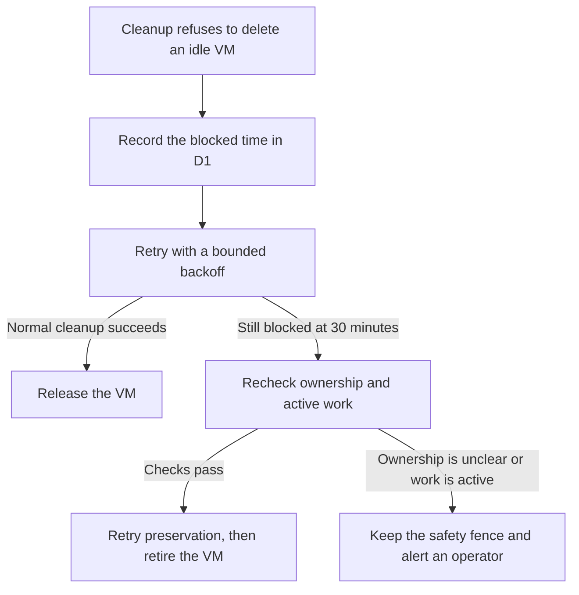

Cloud cleanup has two ways to go wrong: delete a machine that still holds active work, or keep paying for a machine because a safety check never clears. SAM now puts a 30-minute deadline on repeated cleanup refusals, then tries a separate retirement path that checks who owns the VM and whether any workspace is still active.

This is a useful pattern for any scheduled cleanup job: retries need a limit, and the limit must not erase the safety checks that protect real work.

## Why a refused deletion can last forever

SAM runs coding agents on virtual machines in a user's cloud account. When a machine becomes idle, a scheduled Cloudflare Worker asks the cloud provider to remove it. Before deleting it, SAM checks that the VM still belongs to the expected account and that its workspace data can be preserved.

Those checks are important. But older workspaces can lack the proof that today's cleanup expects. If cleanup simply refuses in that case, the VM can remain stopped in SAM's records while still existing at the provider. A retry timer can make that worse: an hour-long backoff would push past a 30-minute cleanup deadline.

## Put a bound on retries

SAM now records when a managed workspace VM first became blocked. Its normal retry delay is capped by the remaining time before the 30-minute deadline:

```typescript title="apps/api/src/scheduled/node-cleanup/cleanup-refusal.ts"
const backoff = new Date(
  Date.parse(nowIso) +
    Math.min(
      failureBackoffMs,
      warnAfterMs,
      Math.max(0, Date.parse(blockedSince) + blockedRetirementMs - Date.parse(nowIso))
    )
).toISOString();
```

The `Math.min()` matters: even if a normal failure would wait an hour, the retry cannot sleep past the retirement deadline. The default is 30 minutes, and the value can be configured by the installation operator.

After the deadline, a separate scheduled sweep checks the VM's provider instance and runtime identity again. It also confirms that no workspace is running, starting, recovering, or being claimed for warm reuse. If those checks pass, SAM retries preservation and retires the VM.



The blocked timestamp lives in Cloudflare D1, SAM's SQL database. The scheduled Worker uses it to make progress across separate cron runs, instead of relying on one long-running process to stay alive.

## A deadline does not mean “delete at any cost”

Thirty minutes is the point where SAM takes a different cleanup path, not permission to ignore ownership. The retirement code still requires a known provider instance and runtime incarnation, a recognized credential source, and no active workspace or conflicting warm-placement claim. It checks those conditions again immediately before destruction so that a change during cleanup cannot slip through.

If SAM cannot establish that authority, or sees active work, it keeps the safety fence and writes an operator-visible error with the provider and VM identifiers. If it does retire a VM whose workspace state could not be fully preserved, it records which sources were affected and sends recovery notices. The cleanup path does not silently discard the evidence or pretend that the workspace can resume normally.

The implementation is in [the stranded VM sweep](https://github.com/raphaeltm/simple-agent-manager/blob/main/apps/api/src/scheduled/node-cleanup/stranded-node-retirement.ts) and [the bounded retirement authority](https://github.com/raphaeltm/simple-agent-manager/blob/main/apps/api/src/services/bounded-stranded-retirement-authority.ts). It shipped in [PR #2478](https://github.com/raphaeltm/simple-agent-manager/pull/2478).

## Give every safety guard an outcome

This change came from a broader reliability lesson: a guard that can refuse work forever is also a lifecycle policy, even if it was written only to prevent unsafe deletion. For scheduled cleanup, define what happens after repeated refusals: preserve and retry, retire under a bounded authority, or raise a visible alert that someone can act on.

If you maintain a cleanup job, ask what state it leaves behind when a guard never clears. Make the retry deadline explicit, recheck the identity and activity that justify deletion, and make unresolved cases visible to an operator.

---

_Source: [PR #2478](https://github.com/raphaeltm/simple-agent-manager/pull/2478) and the [SAM repository](https://github.com/raphaeltm/simple-agent-manager)._
