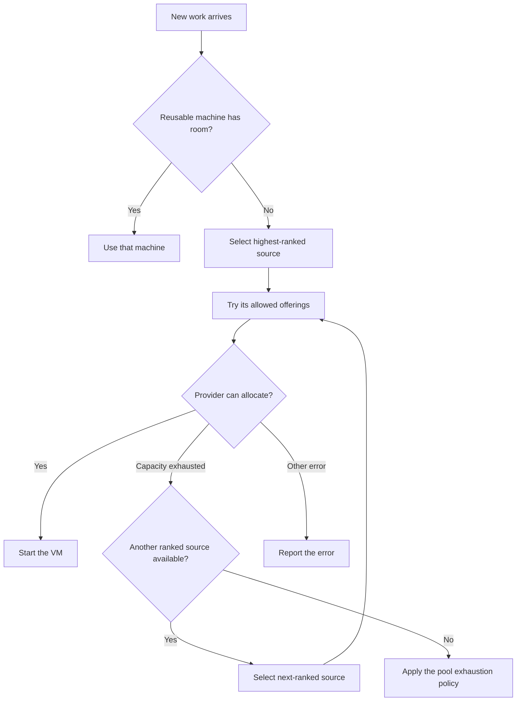

A cloud pool should be able to follow your priorities without wasting machines or getting stuck when a provider runs short. SAM can now reuse capacity that is already running, prefer one cloud account when it needs a new VM, and try the next ranked source when capacity runs out. Its Google Cloud catalog also comes from Google's current machine and pricing APIs instead of a small table of guesses.

This is useful beyond SAM: multi-cloud scheduling gets easier to reason about when **reuse, preference, and fallback are separate decisions**.

## Reuse before buying

Suppose a pool has Google Cloud first and Hetzner second. A new VM should normally come from Google Cloud. But if a warm Hetzner machine already has enough room, starting another machine would waste time and money. SAM checks for reusable machines before it considers provider order, so it uses the warm Hetzner node first.

Provider order only affects **new** machines. Within the preferred source, the pool's placement strategy still chooses among allowed offerings. For example, `smallest-fit` favors the smallest machine that meets the workload's resource needs; `pack` favors larger offerings.



Fallback is deliberate and bounded. The pool's `fallback-chain` exhaustion policy tries the preferred source's allowed machine choices, then moves to the next ranked source when capacity is unavailable. SAM keeps the same pool, workload requirements, runtime, and any explicit location constraint throughout. A permission or configuration error is not treated as a capacity shortage, and it does not silently send work to a different cloud account. See the implementation in [`node-provisioning-exhaustion.ts`](https://github.com/raphaeltm/simple-agent-manager/blob/main/apps/api/src/durable-objects/task-runner/node-provisioning-exhaustion.ts) and the [compute pool guide](/docs/guides/compute-pools/#provider-order).

## Google Cloud availability and prices come from Google

Hardcoded machine catalogs go stale. Google adds zones, changes availability, and publishes prices that vary by region. SAM now asks Compute Engine which configured machine types are available in each zone, and reads public on-demand prices from the Cloud Billing Catalog API.

Google prices a VM's CPU and memory separately. SAM combines those two rates for each machine type and region:

```typescript title="packages/providers/src/gcp-catalog.ts"
return billedVcpus * prices.coreHourly + (type.memoryMb / 1024) * prices.ramGibHourly;
```

The [`gcp-catalog.ts` implementation](https://github.com/raphaeltm/simple-agent-manager/blob/main/packages/providers/src/gcp-catalog.ts) uses the machine's billed vCPU count, which matters for shared-core types. If SAM cannot identify a price confidently, it marks that price unavailable rather than guessing. These are Google's list prices; discounts, credits, and the boot disk are not included. The price data is refreshed in the background and cached, so placing work does not wait for a long catalog download. More detail is in the [Google Cloud guide](/docs/guides/google-cloud/#machine-types-zones-and-prices).

The same live catalog includes zones Google reports for the configured machine types. If a zone cannot be read, SAM treats the response as incomplete and keeps the last known offerings rather than interpreting a partial response as proof that machines disappeared.

## A preference with guardrails

Provider order is a small rule with a useful boundary: it determines **where SAM tries to buy next**, not which work is allowed to run. Existing capacity remains reusable, and each alternative still has to satisfy the pool's requirements. That lets an operator express a preference such as “use my Google Cloud credits first, then Hetzner” without turning a temporary stockout into a failed task or weakening the pool's constraints.

The new order is stored on the compute pool and can be changed through the pool update API. A project or agent profile that explicitly pins a provider continues to act as a hard limit. If you operate a self-hosted installation with more than one cloud account, the [compute pool guide](/docs/guides/compute-pools/) explains how the settings fit together.

---

_Source: [SAM on GitHub](https://github.com/raphaeltm/simple-agent-manager). SAM is open source. This post follows the code and conversations behind the work shipped this week._
