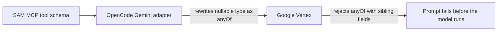

A coding agent can fail before an AI model sees the user's request. We traced one such failure to a subtle mismatch: a schema that was valid JSON Schema became invalid for Google Gemini after another tool rewrote it. The fix taught us a useful lesson for anyone connecting tools to multiple model providers: validate the schema that reaches the provider, not just the schema you wrote.

## One field could stop every tool

SAM exposes project actions to coding agents through the **Model Context Protocol (MCP)**. Each action comes with a JSON Schema description of its inputs. OpenCode forwards those tool descriptions to the model provider, which uses them to decide what tools it can call and with what arguments.

In this case, an OpenCode session using Gemini failed while starting a prompt. Google Vertex rejected a field in SAM's `create_agent_profile` tool, so the model never got a chance to answer. The field allowed either a runtime name or `null` (where `null` means “inherit the default”):

```typescript
{
  type: ['string', 'null'],
  enum: ['vm', 'cf-container', null],
  description: 'Execution runtime, or null to inherit the default.',
}
```

That shape is valid JSON Schema. The trouble was what happened next. OpenCode's Gemini adapter rewrites arrays of types as `anyOf` alternatives. It kept the other fields alongside the new `anyOf`, but Vertex requires `anyOf` to be the only key on that schema node. One incompatible field made Vertex reject the whole tool declaration, which stopped every prompt using that Gemini model.



## Keep nullability, change the shape

We changed nullable fields to use an `anyOf` that contains both accepted cases: the normal value and `null`. The `anyOf` is now the only field on that schema node, so the adapter has no siblings to carry along:

```typescript title="apps/api/src/routes/mcp/tool-definitions-shared-fields.ts"
export function nullableMcpProperty<const T extends Record<string, unknown>>(schema: T) {
  return { anyOf: [schema, { type: 'null' }] } as const;
}
```

For example, the runtime field can describe its regular values and its nullable case separately:

```typescript
{
  anyOf: [
    { type: 'string', enum: ['vm', 'cf-container'], description: 'Execution runtime.' },
    { type: 'null' },
  ],
}
```

That keeps the meaning intact: an agent can still pass `null` to inherit or clear a setting. The handler still decides which values are accepted; the schema tells the model how to form its request.

## Test the transformed schema

The regression test walks every MCP tool definition, then checks each one both before and after a small test implementation of OpenCode's Gemini schema transformation. It catches unsupported JSON Schema features, type arrays, non-string enum values, and `anyOf` nodes with sibling fields.

Testing the transformed shape matters because SAM doesn't control every step between its tool definitions and the provider. A schema can pass a general JSON Schema check and still fail after a client adapter translates it into a provider-specific format.

The broader pattern applies to any system that adapts schemas for multiple APIs: test the full path through the transformations you rely on. When a request fails before reaching the model, preserve a redacted explanation in diagnostics too; the original error named the rejected schema field, while the generic prompt failure did not.

The fix and regression coverage shipped in [PR #2483](https://github.com/raphaeltm/simple-agent-manager/pull/2483). The implementation lives in [SAM's MCP tool field definitions](https://github.com/raphaeltm/simple-agent-manager/blob/main/apps/api/src/routes/mcp/tool-definitions-shared-fields.ts) and [Gemini compatibility tests](https://github.com/raphaeltm/simple-agent-manager/blob/main/apps/api/tests/unit/routes/mcp-tool-schema-gemini-compat.test.ts).

As model providers and agent clients evolve, compatibility depends on every layer agreeing on the same shape. Tests at those boundaries turn an opaque provider error into a concrete rule we can keep enforcing.

---

_Source: [PR #2483](https://github.com/raphaeltm/simple-agent-manager/pull/2483) and the [SAM repository](https://github.com/raphaeltm/simple-agent-manager)._
