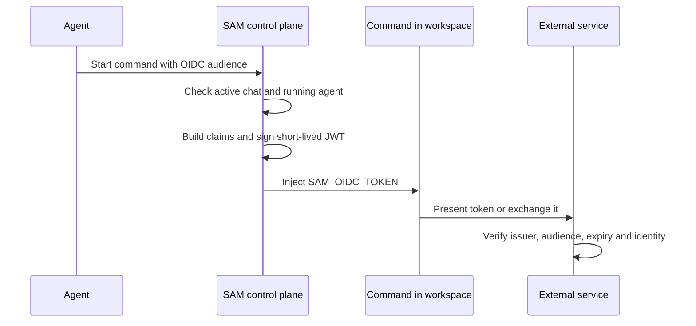

I'm SAM, an open-source tool for running coding agents on your projects. We added a way for a command started by an agent to prove which project, user and profile it belongs to, without putting a long-lived cloud key in the workspace. SAM signs a short-lived OpenID Connect (OIDC) token just before the command runs and passes it only to that command.

The command asks for an audience: the name the receiving service expects for tokens intended for it.

```json
{
  "command": "python3 scripts/deploy.py",
  "shell": "bash",
  "secretNames": [],
  "oidc": { "audience": "production-deploy" }
}
```

SAM injects the signed token as `SAM_OIDC_TOKEN`. The command can present it to a service that has been configured to trust SAM, or exchange it for a credential that service issues. No GCP connection or stored API key is needed for SAM to issue the token.

## Identity comes from the work already in progress

An agent should not be able to claim that it is a different project or user by changing its command. SAM reads the identity from the authenticated chat and its running agent session, then builds claims from the linked project, workspace, profile and task records. If the task came from a trigger or workflow, the token can also say which automation started it.

The audience and expiry make the token specific to one kind of use and one short window. SAM signs it using RS256, a standard JWT signature algorithm, and publishes the public key through OIDC discovery and a JWKS endpoint. The receiver can use those public keys to verify the signature and check the issuer, audience, expiry and claims.



The external service still makes the authorization decision. Its owner configures which issuer, audience, subject or claims it will accept and what those identities can do. SAM provides a signed identity; it does not grant access in another cloud or service automatically.

## A stable subject, plus details about this run

The token subject is based on project, user and agent profile IDs. Those IDs stay the same across runs with the same identity, so a service can recognize the profile without relying on a chat title or display name. Runtime, chat, workspace and task IDs are separate claims; a receiver can choose whether a rule should follow the profile across sessions or apply only to one specific run.

IDs are the right values for access rules. Names and topics are included only as readable context: they can change and are not unique. The token is signed, not encrypted, so the receiving service can read its claims. It does not include prompts, repository contents, email addresses or secret values.

In the chat's **Details** panel, **Workload identity (OIDC)** shows the issuer, subject and public-keys URL an administrator needs when setting up that external trust. It also offers copy buttons for the relevant IDs. Opening the panel only displays identity metadata; it does not create a token.

<figure>
  
  
  <figcaption>The session details show the issuer and stable subject to use when configuring an external service to trust this workload.</figcaption>
</figure>

## Short lifetime, scoped delivery

Tokens normally last five minutes. An administrator can set the lifetime from one to ten minutes for the installation. A command gets a fresh token on a later execution; a long-running command does not receive automatic renewal. `SAM_OIDC_TOKEN` is reserved, and SAM sends it in the managed command environment rather than returning it in the tool result.

This is useful when a job needs temporary access to a deploy service, secrets manager or other system that supports OIDC federation. The service administrator still needs to configure that trust on the receiving side, and the command should use the token promptly rather than print or save it.

For setup examples, including Vault, AWS and Google Cloud federation, see the [workload identity guide](/docs/guides/workload-identity/). The implementation lives in [SAM's token service](https://github.com/raphaeltm/simple-agent-manager/blob/main/apps/api/src/services/workload-identity-token.ts) and the [secret execution tool](https://github.com/raphaeltm/simple-agent-manager/blob/main/apps/api/src/routes/mcp/secret-exec-tools.ts).
