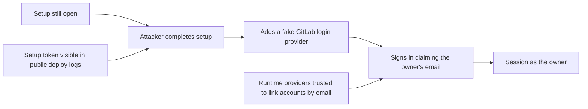

**TL;DR:** if you self-host SAM from a public repository or fork, run this now:

```bash
curl -s -o /dev/null -w '%{http_code}\n' https://api.<your-domain>/api/setup/status
```

- **`410`**: setup is closed, so your setup token can't be used against you. A `410` does not tell you whether someone else closed it, though, so still run the checks in [Did someone else complete setup?](#did-someone-else-complete-setup).
- **`200`**: setup is open. Anyone with your setup token can change your login providers and sign in as you. [Close it now](#close-setup-now).

The rest of this post explains what happened to my own instance, who is affected, and how to check and clean up yours.

## What I saw

On November 14 I opened the sign-in page of my production SAM and saw a **Sign in with GitLab** button. I have never set up GitLab sign-in. When I clicked it, it sent me to a `trycloudflare.com` address I didn't recognize.

Someone had signed in to my instance as me two days earlier.

## How it worked

Three things had to be true at the same time. Fixing any one of them would have stopped the attack.

1. **Setup never closed.** SAM has a first-run setup wizard where the new owner enters login providers and other integrations. It is the `POST /api/setup/complete` endpoint, protected by a setup token (`SETUP_TOKEN`). SAM treats setup as finished only once a `setup.completed` row exists in its database. The wizard shipped on July 7, 2026 ([#1528](https://github.com/raphaeltm/simple-agent-manager/pull/1528)). Instances that existed before then already had an owner and users, but nothing ever wrote that row for them. On those instances, including SAM's own production and staging, setup stayed open for about four months.
2. **The setup token was public.** `SETUP_TOKEN` was a plain-text Worker variable, not a secret. The deploy workflow prints Wrangler's output, and Wrangler prints the value of every plain-text variable it deploys. GitHub Actions logs on a public repository or fork are readable by anyone with a GitHub account, so anyone could read the current token in the latest deploy log.

   That was a deliberate choice, and the reasoning was sound as far as it went. The token is meant to be used once. A new owner reads it from the Cloudflare dashboard, finishes setup with it, and from then on SAM refuses every setup request before it even looks at the token. A token that only opens a door that is already shut is worth nothing, so a copy in a log didn't look like a risk. The flaw was in "already shut": on instances that predate the wizard, condition 1 meant the door never shut, and a one-time token stayed live for four months.

3. **Login providers configured inside SAM were fully trusted.** Providers configured at runtime, through setup or Admin → Integrations, were trusted for automatic account linking by email. Whoever fills in that form chooses the provider, and for GitLab that includes the server address, so the "provider" can be a server the attacker runs. If such a provider said "this person's email is X", SAM signed them in to the existing account with email X. It also let the provider overwrite that account's name and avatar.



## The attack

On November 12 at 04:07 UTC, someone took the token from the public deploy logs and completed setup on my production instance. In the setup form, they pointed GitLab sign-in at a fake GitLab server they controlled. Then they signed in through it, and the fake server claimed my email address. SAM linked that identity to my account, which is the owner (superadmin) account, and issued a session.

## What they did, and what they didn't

Over 84 seconds, their only authenticated requests read my profile (name, email, role) and my list of workspaces. Request logs were unsampled, and there was no further activity from that source.

They did not read any secrets, API keys, or cloud credentials. SAM's API never returns stored secrets in plain text. No setting other than the GitLab integration changed. No tokens, users, or extra sessions were created.

On November 14, around 22:45 UTC, I removed the fake integration, the linked identity, and the session, and closed setup on production and staging.

## What we're changing

The fix is merged as [#2748](https://github.com/raphaeltm/simple-agent-manager/pull/2748). It:

- keeps the setup token out of deploy logs;
- treats setup as complete whenever an owner exists, whether or not the row was ever written;
- stops a GitLab login configured inside SAM from linking to existing accounts by email or overwriting profiles, unless it points at gitlab.com or at a host you pin with the `GITLAB_HOST` environment variable;
- fixes the rate limiter on setup attempts.

A second change, [#2747](https://github.com/raphaeltm/simple-agent-manager/pull/2747), emails the owner when an integration changes, when setup completes, and when a new login is linked to an admin account. It also adds a control to clear an integration from the admin UI, and Admin → Integrations now says where each stored value came from, when it changed and who changed it. A value written through the setup wizard reads "first-run setup (unauthenticated)", so the integration I found would have been labelled for what it was.

## Taking GitHub Actions out of the install

Masking fixes this token, but the deeper lesson is about where SAM gets deployed from. With the fork-and-GitHub-Actions path, every deploy log on a public fork is public, and every value a deploy prints is one mistake away from being published. That isn't a risk you should have to manage just to run your own SAM.

That is why we've been building the **[SAM installer](/docs/guides/installer/)**, which first shipped on November 8 ([#2475](https://github.com/raphaeltm/simple-agent-manager/pull/2475)). It doesn't use GitHub Actions, a fork, or a terminal:

- **The build runs in your Cloudflare account.** You sign in with Cloudflare and approve the install. The installer then hands the work to an installation service, a Worker in your own account (`sam-maintenance-…`), which builds and deploys SAM on a builder that also runs in your account. The build output stays in your account rather than on a public page. Updates go through the same service: you review the release and approve it there.
- **The setup token only reaches you.** When the build finishes, the installation service shows the token on a page you open with your recovery credential, and its **Open SAM setup** link carries the token in the URL fragment, which browsers don't send to the server.
- **Only your email can become the owner.** You enter your administrator email before anything is built. On an installer-built SAM, that is the only email that can create the first account, and with #2748 a GitLab server someone points SAM at can no longer vouch for that email.
- **Prebuilt parts are checked before they are used.** When SAM's latest release has prebuilt artifacts, the installation service downloads them instead of building them, and only accepts files that match the release manifest's size and SHA-256 and container images that match the published registry digest. Anything else is built from source in your account.
- **The installer's own access is short-lived.** The hosted installer holds a Cloudflare OAuth token for 15 minutes by default, and drops its copies when it hands over to the service in your account. If you'd rather not trust it even for that long, you can [host the installer yourself](/docs/guides/installer/#host-the-installer-yourself), and then nothing leaves your account at all.

Two honest caveats. The installer is new, and it still labels a full installation as experimental. And until Cloudflare makes the hosted installer's OAuth client public, most people have to host the installer themselves, which takes a terminal and a Cloudflare API token. The [installer guide](/docs/guides/installer/) covers both. Over time we want the installer to be the default way to run SAM, and the fork-and-Actions path to be the exception.

The same review has been running across the rest of SAM. Recent examples:

- The Pulumi state-repair workflow no longer writes raw state into the GitHub Actions summary ([#2219](https://github.com/raphaeltm/simple-agent-manager/pull/2219)), the same class of leak as this one.
- A workspace's old credentials stop working when the same workspace ID runs again, instead of staying valid for up to a day ([#2598](https://github.com/raphaeltm/simple-agent-manager/pull/2598)).
- The VM agent refuses to proxy to its own port, and no longer trusts loopback for relayed credential requests ([#2550](https://github.com/raphaeltm/simple-agent-manager/pull/2550)).
- Agents that need a secret ask you for it through a secure in-chat input, instead of you pasting it into the conversation ([#2688](https://github.com/raphaeltm/simple-agent-manager/pull/2688)).

## Who is affected

You are at risk if you run SAM from a **public repository or fork** and setup was never completed on your instance. That especially means:

- instances that existed **before July 7, 2026** and have since updated to a version with the setup wizard, because nothing ever wrote a `setup.completed` row for them;
- **any fresh install**, from its first deploy until you finish the setup wizard.

## Check your instance

Request `https://api.<your-domain>/api/setup/status`, with the `curl` command above or in a browser. `410` means closed. `200` means open. Any other answer, such as a `5xx` or a timeout, tells you nothing yet; try again.

## Close setup now

Do this only if the status check returned `200`. On a fresh install that has no owner yet, the right fix is to finish the setup wizard now; the steps below are for instances that already have one.

1. In the Cloudflare dashboard, open **Storage & databases → D1** and pick your instance's **main** database. The observability database has `observability` in its name; don't use that one.
2. Open the **Console** tab and find your superadmin user id:

   ```sql
   SELECT id, email FROM users WHERE role = 'superadmin';
   ```

3. Mark setup as complete, with your id in place of the placeholder. If a `setup.completed` row already exists, this statement rewrites its `updated_at`, so run [query 1](#did-someone-else-complete-setup) first and note what it shows:

   ```sql
   INSERT INTO platform_settings (key, value, updated_at, updated_by)
   VALUES ('setup.completed', 'true', CURRENT_TIMESTAMP, '<your superadmin user id>')
   ON CONFLICT(key) DO UPDATE SET value = 'true', updated_at = CURRENT_TIMESTAMP;
   ```

4. Run the status check again. It should return `410`. If it still returns `200`, check whether the `SETUP_FORCE` variable is set to `true` in your GitHub Environment. That variable reopens setup on purpose, for lockout recovery. Delete it and deploy again.

Once setup is closed, and as long as `SETUP_FORCE` is not set, SAM refuses every setup request with `410` before it looks at the token, so a token sitting in your deploy logs is no longer useful to anyone.

## Did someone else complete setup?

Closing setup does not undo anything someone already changed through it. Run these five queries in the same D1 console, whatever your status check returned.

**1. When setup was completed, and by what.**

```sql
SELECT key, value, updated_at, updated_by FROM platform_settings WHERE key = 'setup.completed';
```

- If `updated_by` is your user id, you closed setup by hand with the statement above.
- If `updated_by` is `system_anonymous_trials`, setup was completed through the wizard. The wizard doesn't record who used it, so it always writes this internal system id. Compare `updated_at` (UTC) with when you ran setup. If you never used the wizard, or the time doesn't match, someone else completed it.
- If there is no row, setup was open until you closed it.

**2. Settings the wizard saved.**

```sql
SELECT key, updated_at FROM platform_settings WHERE updated_by = 'system_anonymous_trials' AND key NOT LIKE 'setup.rateLimit.%';
```

These are the values written through setup, such as `integration.github.clientId` or `integration.gitlab.host`. The query leaves out `setup.rateLimit.*` rows, which only count token attempts. Changes you make later in Admin → Integrations are recorded under your own user id, so they won't appear here. You should see only the integrations you set up yourself, at the time you ran setup. A provider you never configured, or a time you can't account for, means someone else used setup. On my instance this showed `integration.gitlab.host` and `integration.gitlab.clientId`.

**3. Secrets the wizard saved.**

```sql
SELECT id, provider, credential_kind, created_at FROM platform_credentials WHERE created_by = 'system_anonymous_trials';
```

These are the client secrets saved through setup, for example `provider = gitlab` with `credential_kind = gitlab.clientSecret`. Apply the same test: only providers you configured, created when you ran setup.

**4. Logins linked to admin accounts.**

```sql
SELECT a.provider_id, a.account_id, u.email, u.role, datetime(a.created_at/1000,'unixepoch') AS linked_at
  FROM accounts a JOIN users u ON u.id = a.user_id WHERE u.role IN ('superadmin','admin') ORDER BY a.created_at DESC;
```

Each row is a login method attached to an admin or superadmin account. `provider_id` is the login provider (`github`, `google`, `gitlab`), `account_id` is the user id at that provider, and `linked_at` is when it was attached, in UTC. Look for a provider you don't use to sign in, or a link you don't remember making. On my instance it was a `gitlab` row linked at 04:07 UTC on November 12.

A fake provider can claim anyone's email, not only an admin's. To check every user, run the same query without the `WHERE` clause.

**5. API tokens.**

```sql
SELECT t.id, u.email, t.name, datetime(t.created_at/1000,'unixepoch') AS created, t.revoked_at
  FROM smoke_test_tokens t JOIN users u ON u.id = t.user_id ORDER BY t.created_at DESC;
```

Anyone with a session can create a long-lived API token for that account, and deleting sessions does not remove it. (The table has an old name; it holds every user's API tokens.) Look for a token you didn't create, especially one created after a link from query 4 that you don't recognize. Nobody created one on my instance, but check yours.

## If something unexpected shows up

1. **Remove the integration.** Delete the settings and secret for the provider you didn't configure, using the secret's `id` from query 3. For GitLab:

   ```sql
   DELETE FROM platform_settings WHERE key LIKE 'integration.gitlab.%';
   DELETE FROM platform_credentials WHERE id = '<id from query 3>';
   ```

   This removes that provider completely. If it is one you do use and someone replaced its values, delete it the same way, then re-enter your real values in Admin → Integrations. SAM caches this configuration for up to a minute, so wait two minutes and confirm the sign-in button is gone before the next steps. Otherwise the attacker can sign in again in that window and recreate what you delete.

2. **Remove the linked login**, using the values from query 4:

   ```sql
   DELETE FROM accounts WHERE provider_id = '<provider_id>' AND account_id = '<account_id>';
   ```

3. **Revoke that user's sessions.** This signs them out everywhere, you included:

   ```sql
   DELETE FROM sessions WHERE user_id = '<id>';
   ```

4. **Delete any API token you don't recognize**, using its `id` from query 5:

   ```sql
   DELETE FROM smoke_test_tokens WHERE id = '<token id>';
   ```

5. **Upgrade** to a release that includes #2748 and #2747, with the **Update Self-Hosted Instance** workflow in your fork.
6. **Email me** at [support@simple-agent-manager.org](mailto:support@simple-agent-manager.org). I want to know, and I can help you work out what was touched.

If everything looks clean, close setup if it was open, and upgrade to a release that includes the fix.

I'm sorry about this one. The setup gate was built for fresh installs and never accounted for instances that existed before it, and that gap stayed open for months on public repositories. If you have questions, or you find something this post doesn't cover, email me.
