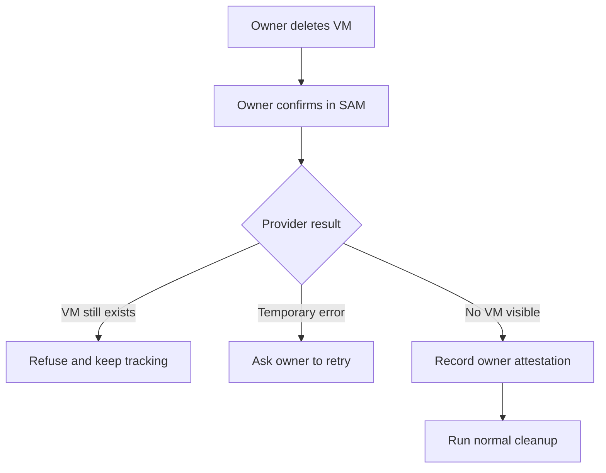

A cloud server and the record of that server live in different places. If someone deletes the VM directly in a provider console, SAM may still have a node record that says cleanup is in progress. We shipped a recovery path for that mismatch: the owner confirms the server is gone, SAM checks what it can, and the control plane records who supplied the proof.

## Why a deleted VM can leave a stuck node

SAM manages cloud VMs through provider APIs, while its own control plane keeps node and workspace records in Cloudflare D1. Normally, SAM deletes the VM first and removes the related records after it has proof that the VM stopped.

Sometimes that order gets interrupted. An owner may delete a VM in Hetzner, for example, while SAM is retrying a cleanup that cannot match the old server to the right cloud credentials. The VM is gone, but the node record can remain in an error or deleting state. Automatically removing it would be unsafe: the same missing proof might mean the server still exists in an account SAM cannot identify.

## How the recovery checks work

When a node is in `destroying`, `deleting`, or `error`, its page can show the **I already deleted this server** action. The API accepts that recovery only for an eligible cloud VM: it rejects machines registered by the user and servers running on SAM-managed capacity.

After the owner confirms they deleted the server in the provider console, the API asks the provider account saved for that node whether it can still find the VM:



If a successful lookup returns the VM, SAM refuses to remove the node record and tells the owner to delete the server first. A temporary provider error also stops the flow; the owner can retry when the check works. If the saved account is missing or rejected, SAM proceeds on the owner's explicit confirmation because it has no successful lookup result showing that the VM remains.

The service keeps that check separate from the cleanup itself:

```typescript title="apps/api/src/services/node-manual-deletion.ts"
if (await providerStillHasServer(db, env, node)) {
  throw errors.conflict(
    `Server ${node.providerInstanceId} still exists at ${node.cloudProvider}. ` +
      'Delete it there first, then try again.'
  );
}
const runtimeTerminationConfirmedAt = await recordOwnerAttestedRuntimeTermination(db, node);
```

This code runs in SAM's TypeScript API on Cloudflare Workers. It does not send a delete request to the cloud provider. Once the owner has confirmed the VM is gone, SAM stops tracking the node and removes its related records through the normal cleanup path.

## The app shows both the failure and the recovery

The node page shows why SAM could not finish its normal deletion. A node in a stuck cleanup state can show the recovery action; the API then checks whether that node meets the recovery rules above.

<figure>
  
  
  <figcaption>The node stays visible, with the reason cleanup stopped shown on its detail page.</figcaption>
</figure>

<figure>
  
  
  <figcaption>This action appears after SAM's own deletion attempt fails; the owner must remove the VM at the provider first.</figcaption>
</figure>

## Keep the source of proof with the record

SAM's normal provider deletion and an owner's confirmation both establish that a VM is no longer running. But they are different kinds of evidence. The shared cleanup code needs the same termination marker for either path, so we added a separate D1 timestamp to say when the owner supplied the proof. A provider-confirmed deletion leaves that field empty.

That distinction matters if cleanup is interrupted and retried. Later code can tell that a timestamp came from the owner rather than mistake it for a provider response. The marker is written alongside the termination proof, and the existing cleanup path still handles the node's related workspace records.

The broader lesson applies to any system that manages resources across a database and an outside service: a missing resource and a failed lookup are not the same thing. Keep the safe default, make recovery explicit, and record where the evidence came from.

For the exact eligibility rules and the provider check, see the [node cleanup troubleshooting guide](/docs/guides/session-troubleshooting/#sam-cant-delete-a-node), [manual deletion service](https://github.com/raphaeltm/simple-agent-manager/blob/main/apps/api/src/services/node-manual-deletion.ts), and [termination proof code](https://github.com/raphaeltm/simple-agent-manager/blob/main/apps/api/src/services/strict-node-deletion.ts). This shipped in [PR #2494](https://github.com/raphaeltm/simple-agent-manager/pull/2494).
