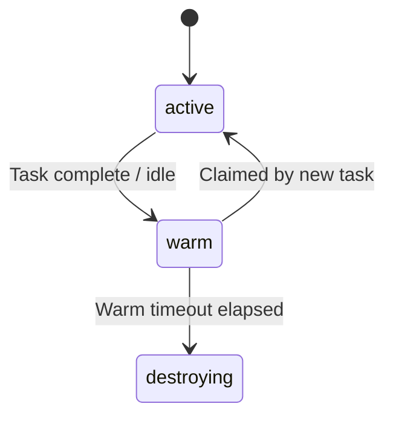
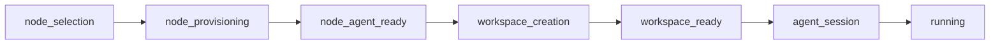

### ProjectData DO

Terminal-session archive shards support two pinned representations. Legacy shards store raw rows in SQLite; compact shards retain session metadata, a versioned and verified search projection, consolidated conversation records and tool archive pointers in SQLite, with lossless raw history and bulky tool metadata in private compressed R2 chunks. Exact-owner reads verify object identity, sizes and hashes; recovery can export the original rows back to root. Source deletion requires complete projection coverage. Older published shards repair missing coverage from R2 through bounded durable checkpoints while project-wide search reports provisional owner/index coverage. Compact migration admission uses a durable daily write estimate, and the new writer defaults off. See [compact archive configuration](/docs/reference/configuration/#compact-archive-shards).

Each project gets one `ProjectData` Durable Object instance, accessed via `env.PROJECT_DATA.idFromName(projectId)`.
Every user-visible chat session has exactly one backing D1 Task. `taskMode` controls autonomous task versus human-controlled conversation lifecycle semantics; it never controls whether the Task exists. D1 `tasks.chat_session_id` and ProjectData `chat_sessions.task_id` form a bidirectional soft link. Because the stores cannot share a transaction, creation and legacy repair are idempotent and retain compatibility readers while reconciliation is in progress.

Automatic sleep processes bounded batches of due intents. If the source workspace or its ownership metadata is gone, the scheduler retires that sleep intent while retaining the snapshot artifacts and recovery metadata. It checks the observed record before updating so concurrent recovery or capture takes precedence. A failed attempt receives a future retry deadline, so a persistent failure yields its slot to other due sessions.

Interrupted `stopping` teardown remains eligible for convergence under the original episode budget. An exact already-stopped response can finish a sleep whose recovery point still verifies. A proven runtime generation change blocks the old intent without releasing its successor. The guarded chat transition checks the captured runtime and stopping claim in D1 under Durable Object concurrency serialization, then checks its local workspace link. That authority read and local transition are not one cross-store transaction; an external D1 admission after the final read remains outside this guard. Unconfirmable teardown retains its stopping claim and retries cleanup with backoff until confirmation; the stuck-task sweep allows at most five claimed convergence attempts per tick before applying its normal terminal rules. Confirmed sleep retires only cleanup schedules and failure markers for the same chat and workspace.

Failed full-snapshot attempts are bounded by a persisted episode (`apps/api/src/services/session-sleep-episode.ts`): three failures or 15 minutes by default. The fallback rechecks canonical no-in-flight-work idleness and runtime ownership, retains the transcript and successful backups, records its decision and degraded-recovery notice durably, and releases compute through the shared sleep teardown and NodeLifecycle deletion paths. A verified Git recovery point permits restoring that point with a fresh harness. Without one, VM and Instant continuation start fresh from the transcript, without claiming an exact restore; partial backup keys remain retained. Legacy preservation-blocked episodes re-enter the same guarded cleanup. Stop and deletion failures remain retryable across restarts. Other workspaces and intentional warm-node retention are preserved. A changed runtime generation blocks only the obsolete intent.

Task completion can occur before the final answer finishes streaming. Working activity reports retain the completion sleep intent while releasing any preparing claim. Terminal-session ledger cleanup independently protects the finishing response for the configured `SESSION_SLEEP_AFTER_MS` interval from completion (falling back to the task update time for legacy records), then checks canonical prompt and background-work activity. The D1 session summary follows the authoritative ProjectData session status, so cleanup cannot mark a protected conversation stopped in the UI. Automatic sleep and teardown also measure a completed prompt’s stale interval from the later real-work or task-completion time; an old, long-running prompt cannot become immediately sleep-eligible while its final answer streams. A confirmed idle report still releases the teardown safety gate immediately. Stale activity and absent state expire through these existing bounded intervals. A turn on a still-running task that has persisted no message and made no harness progress for `operations.sessionStaleTurnNoWorkMinutes` (30 minutes by default) no longer blocks sleep either (`classifySessionIdleness()` in `apps/api/src/services/session-idleness.ts`, reason `prompt_turn_stale`), because the VM keeps re-reporting a turn that never returns and the stale-activity probe confirms it as open.

The cleanup cron tears managed VMs down in two phases when the provider deletes through a long-running operation (GCP). The stopped/destroying handoff phases and stranded-node retirement send the delete after a write-ahead record on the node row, and the node stays `destroying`. The first phase of the next cron run, `sweepProviderDeletionConfirmations()` (`apps/api/src/scheduled/node-cleanup/handoff-phases.ts`), writes termination proof only when the provider's own record shows that exact instance deleted (`services/node-provider-deletion.ts`). See [Security](/docs/architecture/security/) for the proof rules.

Stopped managed VM handoffs use the saved sleep or stop time for retirement; deletion retry bookkeeping cannot extend their lifetime. A legacy agent's HTTP404 never proves that workspace files disappeared. Whole-VM retirement verifies every source's exact owner, workspace generation, runtime incarnation and preserved artifacts, or its recorded bounded sleep fallback with a retained sleeping conversation and durable notice. Completed preservation can authorize VM retirement even when a legacy row lacks a sleep-confirmation timestamp; provider termination must still succeed before deletion proof is written. Only that exact durable termination proof can repair missing sleep confirmation or finish a recorded fallback sleep, so the saved conversation remains wakeable. A failed-start or evicted source without preservation evidence blocks retirement, as do active workspaces, capture races and live placement claims. Existing snapshot metadata and backup objects remain retained.

Sleep also tries to preserve a failed task’s unpublished work. After bounded snapshot failures, runtime termination may lose uncaptured files; the conversation and successful backups remain. `cleanupTerminalTaskResources()` (`apps/api/src/services/task-terminal-cleanup.ts`), explicit run cleanup (`cleanupRequestedTaskRun()` in `apps/api/src/services/requested-task-run-cleanup.ts`) and attention expiry (`failExpiredTaskMarker()` in `packages/project-data/src/do/attention-expiry.ts`) consult `preserveFailedTaskWork()` (`apps/api/src/services/failed-task-preservation.ts`) before any teardown. A runtime the sleep sweep can claim (a live `vm` or `cf-container` workspace with a chat session and a resumable agent session) gets a snapshot-backed sleep queued as a new sleep episode with a fresh retry budget, and the queue is read back to confirm an intent was written. A conversation that has already slept, or whose sleep is in flight, is left asleep, judged by the same predicate the resumer uses, and an incomplete snapshot is noted in the chat. If the lookup fails, teardown is withheld. In all three cases the ProjectData session is never marked `failed`, because snapshot recovery wakes only `sleeping` sessions. Only a runtime that cannot be preserved is torn down, and the chat first receives a system message saying the work was not saved. A failed task drains like a completed one: while its agent still reports a turn, the sleep waits `SESSION_SLEEP_AFTER_MS` past the last report, because `sleepWorkspaceSession()` abandons a capture when activity changes under it. The sleep machinery treats `failed` like `completed` through one authority, `apps/api/src/services/sleep-preserved-task-status.ts`, which covers idleness, the re-report fence, the completion drain, the claimer's own preconditions, and the node-cleanup reapers. The reapers leave a failed task's workspace alone only while the sleep sweep can claim it or has slept it and its sleep has not given up, so they remain the backstop for a release that never ran. The sweep gives up on a failed task's preservation (`apps/api/src/services/failed-task-preservation-release.ts`) when its runtime stops being claimable, such as an agent session ended by a fatal error, when its sleep episode ends blocked, or when the sleep has waited `FAILED_TASK_PRESERVATION_MAX_WAIT_MS` (default 8 hours) since the latest of the failure, an in-place wake and the start of the agent's current turn, and then tears the runtime down and says so. A user still working in the conversation restarts that wait with every turn; only a single turn that never ends, or a state that never resolves, runs it out. A crashed or timed-out agent therefore loses its workspace changes: the sleep path needs a live agent session to snapshot. So does an agent that reported work after its SAM check-in but kept that turn open past the watchdog's hard ceiling: the turn will not end, and a sleep would only wait on it (`assessCheckinActivity()` in `packages/project-data/src/do/checkin-activity.ts`, the same assessment that defers the check-in). A `prompting` label with nothing reported since the check-in is not proof of a hung turn, so that failure is preserved like any other. Archive and delete (`destructiveSessionEnd`), parent stops (`cancelled`), and startup failures keep their immediate destructive cleanup. Failed-task snapshots follow the same retention and purge as every other sleep snapshot.

VM sleep marks the backing non-terminal task `sleeping`. When the conversation wakes, a D1 transaction reactivates that same task for placement, preserving its ID, parent/child hierarchy, dispatch depth, and chat-session binding. The existing TaskRunner Durable Object resets its runtime and placement state, and ProjectData keeps `chat_sessions.task_id` unchanged. New wake cycles do not create replacement recovery tasks or append supersession chains; the legacy recovery columns remain for existing data. Instant sessions continue to wake their runtime in place and retain their active task status.

VM wake releases the old workspace's unique conversation binding in the same D1 transaction that queues its stable task (`services/session-recovery.ts`). A later failed wake may have left that binding on a different workspace than the retained snapshot names. The transaction also releases that predecessor's binding only when it belongs to the same conversation, project and user, is deleted, and has explicit workspace-deletion or node-termination confirmation. It retains predecessor records and the snapshot generation; unrelated or live bindings stay in place. If that exact collision left an exhausted stale wake without its clean-failure timestamp, ordinary user or peer continuation can reconstruct the timestamp from the same sleeping task's recorded failure, only after strict deletion proof for all known predecessor runtimes. Automated source-guarded wakes do not reconstruct this missing timestamp. It preserves the attempt count and applies the existing cooldown before reclaiming the wake; it does not reset the retry budget.

The released workspace keeps its deletion authority. Its snapshot still names it, and while that snapshot holds the wake claim (`recovery_task_id` set and `recovery_status` `waking`, `failed` or `restored`; a completed sleep resets the status), the preservation check behind automatic workspace deletion (`findPreservationSnapshot()` in `apps/api/src/services/workspace-deletion-preservation.ts`) and whole-VM retirement (`snapshotConversationMatchesSql()` in `apps/api/src/services/preserved-vm-retirement.ts`) both treat it as preserved. An unbound workspace whose snapshot holds no wake claim, or that more than one snapshot names, stays unpreserved. So a slept workspace under a wake is deleted with proof, which releases the wake fence (`assertReplacementDeletionConfirmed`), and its stopped node retires on the first cleanup pass.

Preservation is also recorded on the source workspace itself. The per-chat snapshot row moves to the replacement on its first capture, and that capture's completion deletes the previous generation's objects, after which the row can no longer say the source was preserved. So the writer that grants preservation also copies a receipt of the exact generation onto `workspaces.preservation_receipt_json` (`preservationReceiptStatement()` in `apps/api/src/services/workspace-preservation-receipt.ts`): the verified full sleep, and the eviction callback when the VM agent reported that generation's capture as quiesced. A live eviction capture is never granted. A receipt grants deletion only once a committed wake fully restored its exact generation. A `degraded` restore (any HOME, WIP or git failure the VM agent reports) releases nothing (`stepResults.snapshotRestoreComplete`). When a full restore completes, the TaskRunner keeps the generation it restored (`completeSessionSnapshotRecoveryGeneration()`, `stepResults.restoredSnapshotGeneration`). Its commit to `in_progress` stamps `restoredAt` on the receipt of that generation in the same D1 batch (`transitionToInProgress()` in `apps/api/src/durable-objects/task-runner/in-progress-transition.ts`, `restoredSourceReceiptStampStatement()`). A wake that fails after restoring therefore never releases its source, and the stamp survives a successor capture that replaces the row's live generation first. After the commit, the TaskRunner clears its eviction fence and calls `releaseRestoredSourceWorkspaces()` (`handleAgentSession()` in `agent-session-step.ts`) to queue the source for deletion; if that release is lost, the stopped-workspace sweep re-queues the source from its receipt (`sweepStaleStoppedWorkspaces()`). The fence requires the source to stay `evicted`, but it accepts this runner's own restore while the source keeps its fenced generation or its row is gone (`evictionRecoveryRestoredByRunner()`); an explicit Restart mints a new generation and still revokes the wake. The deletion check accepts a receipt only for the exact workspace, node, incarnation, owner, project and runtime generation. Before the restore is recorded, the snapshot row decides, and for an evicted source it also requires a complete restore (`restore_status = 'restored'`) whose wake committed (`evictionWakeCommittedSql()` in `workspace-deletion-preservation.ts`, shared with the sweep). Rows preserved before receipts existed fall back to the snapshot-row path, which also backfills the receipt.

A wake can release the source's chat binding while its deletion is queued or already claimed. The deletion identity accepts that release (`chatBindingAllowsDeletion()` in `apps/api/src/services/workspace-deletion-identity.ts`) but still refuses a different chat, or a binding appearing on a workspace that was queued unbound. Lifecycle closure reads the row's current binding, so it never stops the conversation that moved to the replacement.

A destroy sweep that refuses an empty running node only because a retired workspace has no deletion proof yet hands the node to the warm pool (`handOffArtifactBlockedEmptyNode()` in `apps/api/src/scheduled/node-cleanup/cleanup-refusal.ts`). Before this, the refusal's backoff kept the node out of the empty-node handoff later in the same cron tick, so it stayed `running` and the stopped-node retirement deadline never started.

The control plane records a versioned, credential-free runtime contract in `agent_sessions.runtime_contract_json` before launch and copies it to `session_snapshots.runtime_contract_json` before sleep. Both restore paths deliver its resolved model, effort, permission and provider settings, ACP interaction configuration, and original task callback context before loading the harness. Resolved sessions do not re-read mutable account defaults. Task mode survives wake, including degraded VM fresh starts. Historical NULL contracts use Manual permission compatibility; malformed or unknown contract versions fail recovery safely. Callback tokens and MCP credentials are freshly issued through existing authorized paths, never stored in the contract. Instant refreshes trusted workspace metadata, including the repository default branch, before preparing the same session with fresh scoped MCP credentials and current connector policy. Task tools and automatic delivery remain available after the process restarts, while repository publication remains agent-directed; failed preparation stops recovery and revokes the new token. Before restore, SAM checks the live runtime advertises support for the saved session contract. An older VM agent or Instant image cannot silently ignore it during a rollout; recovery fails safely until a compatible runtime is available.

Instant runtime-owned Git commands use the trusted workspace launch identity for the local credential exchange. Task and conversation completion callbacks report outcomes without staging, committing, pushing or creating review requests. Agent-directed Git commands continue to use credential refresh rather than a token inherited at process startup.

One Durable Object alarm drives fourteen maintenance sections (runtime heartbeat timeouts, storage safety, workspace idle timeouts, idle cleanups, task reconciliation, shared-chat access expiry, attention expiry, activity probes, the mailbox sweep, event-wake materialization, scheduled actions, task waits, prompt delivery, and event retention). A tick runs only the sections that are due (`ProjectDataAlarmSectionScheduler` in `packages/project-data/src/do/alarm-sections.ts`). Because most schedules clamp overdue work into the future, the scheduler remembers each section's earliest computed due time until that section runs, and persists that memory in the object's `do_meta` table so it survives the object being evicted between alarms; an object with no readable memory and at least one tick every `PROJECT_DATA_ALARM_FULL_RUN_INTERVAL_MS` still run every section, and storage safety — the quota firebreak — keeps running before the heavier lifecycle sections. Every tick emits one `project_data.alarm.completed` log naming the ran, skipped, and failed sections with each one's wall time and SQLite rows read/written; a throwing section is isolated and retried no sooner than a minute later.

Message search on a ProjectData object works inside configured windows (`searchMessagesWithCoverage()` in `packages/project-data/src/do/message-search.ts`): full-text ranking scores and reads only the newest matches, and the keyword fallback for not-yet-indexed text scans only the newest raw messages. The full-text index still counts a term's matches once per query for bm25, which is linear in the matches but cheap per match. Search results carry `rootSearch` coverage so callers can disclose when either window was reached.

Comment threads on chat messages and on Library files share one set of ProjectData tables, `anchored_comment_threads`, `anchored_comment_replies` and `anchored_comment_status_mutations` (DO migration `073-anchored-comment-threads`, `packages/project-data/src/do/anchored-comments-migration.ts`). Every row carries a non-null anchor kind and scope key (the chat session id for a message thread, the file id for a file thread), CHECK constraints tie the scope key to the typed column, and every read and write takes a typed anchor scope (`anchored-comment-scope.ts`), so a thread id alone never reaches a row. Thread, reply, status and idempotency logic is written once (`anchored-comment-store.ts`, `anchored-comment-mutations.ts`); `comments.ts` and `library-file-comments.ts` only add their anchor's checks and response shape. The migration copied the earlier per-kind tables (`comment_threads` and `library_file_comment_threads` with their replies and status mutations) with ids preserved and logs a parity check per project (`comments.migration_parity`). Those tables are kept, unwritten, as a recovery path.

ProjectData also owns the single durable prompt-delivery queue used by browser followups and agent handoffs. Acceptance persists the visible transcript message and its stable delivery identity before runtime I/O. Alarm-driven attempts use bounded exponential backoff, a finite lifetime, compare-and-set attempt tokens, and stable VM receipts. A lost response is reconciled before retry; if receipt evidence is unavailable or belongs to another runtime, the delivery becomes explicitly ambiguous and is not replayed. Urgent mailbox classes (`interrupt`, `preempt_and_replan`, `shutdown_with_final_prompt`) add stop-and-deliver: when the target VM rejects the submit because a prompt turn is in flight, the claim runner cancels that turn through the same transport as the user stop button, records the control-plane turn end, and the turn-end fan-out releases the urgent delivery so it becomes the target's next prompt. Informational classes (`notify`, `deliver`) never stop a turn. Busy informational deliveries share one exponential-backoff deadline per target session, independent of the capped per-message attempt count; the existing retry base/max settings and delivery TTL still bound retries. An idle or turn-end signal releases that target immediately, including when it arrives before the busy response. A waking VM conversation holds its queued prompts until the TaskRunner commits the agent handoff: `resolveVmPromptDeliveryTarget()` (`apps/api/src/services/vm-prompt-delivery-target.ts`) answers not-ready while the snapshot claim is `waking`, or `restored` for that workspace, and the claiming task is still queued or delegated. The commit's readiness signal (`signalSessionWakeReady()`) then makes the parked prompt due at once. The same resolver answers not-ready while the session's sleep is claimed (`preparing` inside `SESSION_SLEEP_CLAIM_LEASE_MS`, or `stopping`; `isSleepClaimHoldingDelivery()`), because a required sleep cancels the turn and the VM restarts the agent idle: a queued prompt delivered then would start a new turn and abort the sleep. Delivering earlier would let an event-wake prompt mark its batch delivered before the runner's final authority check, which would read the wake's own delivery as revocation and stop the runtime. The woken agent can also read or acknowledge its own event before the commit, which no hold covers, so the runner's check accepts its own chat having consumed the batch (`acceptConsumedByTarget` in `validateProjectEventWakeRecoveryAuthority()`). A wake whose restore resumes the saved agent session never receives the fresh-start prompt, so when nothing is queued for it (an agent whose work was interrupted by eviction, regardless of task or conversation mode), the TaskRunner queues that prompt itself as a `checkpoint_continuation` delivery after the ProjectData wake and before the commit (`queueRestoredSessionPrompt()` in `apps/api/src/services/restored-session-prompt.ts`), and the same hold delivers it once. The VM records pre-stop prompt/background-work ownership in its durable eviction callback journal. A known-idle session receives no continuation. Missing evidence from older agents or an already-lost harness triggers transcript/workspace reconciliation; the prompt tells the agent to remain idle if the work had already finished. The delivery stays valid only while it is the chat's latest continuation and its task is live and owns the chat (`invalidCheckpointContinuationTarget()`). Active-only indexes keep claim, ordering and expiry reads independent of retained mailbox history.

ProjectData stores the durable foundation for project event subscriptions in the same per-project SQLite database. Normalized events are admitted by project, source, delivery key, and payload fingerprint; duplicate replays are idempotent, while the same source/key with a different fingerprint becomes a visible conflict. V1 subscription filters compile only allowlisted exact/set match keys for source, event type, subject type, subject ID, and severity. GitHub producers use source `github` and skip projects owned by the system sentinel user (`findProjectsForGitHubRepository()`, `packages/repo-hosting/src/github-project-repositories.ts`); CI events such as `check_run.completed`, `check_suite.completed`, and `workflow_run.completed` use the head commit SHA as the subject when GitHub provides one and carry repository, PR, run, suite, and check IDs in metadata. Review events such as `pull_request_review.submitted` and `pull_request_review_comment.created` use the pull request number as the subject and carry review/comment commit IDs in metadata. Generic webhook producers use source `webhook`, event types such as `webhook.accepted` and `webhook.filtered`, and the webhook trigger ID as the subject. Delivery batches resolve the subscription's requested delivery through an explicit adapter-capability and authorization decision, then store requested delivery, resolved delivery, and the adapter decision separately for audit. Migration `040-project-event-pull-ack` adds the pull-model acknowledgement state (`ack_required`, `delivered_at`, `acked_at`, and `acked_by_*`) plus a replay index over subscription matches. Agents use MCP to list missed/queued summaries, fetch full event details on demand, and ack processed deliveries. The resolver can record pending durable-queue, runtime-adapter, or spawn decisions. Prompt-queue delivery is implemented: `existing_session_prompt` subscriptions wake the target chat through the existing prompt-delivery queue, `runtime_interrupt` subscriptions do the same with the `interrupt` mailbox class, which may cancel the target's in-flight turn so the wake prompt is delivered immediately (stop-and-deliver), and `runtime_steer` subscriptions (the default for agent-created subscriptions and agent-message notices) carry the `steer` delivery intent, which adds the batch to a running turn without stopping it and falls back to an ordinary wake prompt when there is no turn to steer (`buildWakePromptInput`). A chat holds at most one wake that has not yet reached its runtime: wake candidate selection and the wake alarm schedule both skip a chat with a pending prompt-queue batch through one shared predicate (`WAKE_TARGET_HAS_UNDELIVERED_WAKE_SQL` in `packages/project-data/src/do/project-events-wake-config.ts`), so once the runtime accepts that wake the next one can queue, acknowledged or not. Pull reads of events that were never injected record `recorded_not_injected` (`createPullDeliveryBatch` in `project-events-pull.ts`). In-harness runtime steering, native runtime interrupts, and task spawning remain unimplemented until their adapters are enabled. Future delivery surfaces must reuse the existing prompt-delivery queue and receipt/ambiguity handling rather than creating a second prompt-delivery engine. Do not introduce parallel `event_bus_*` tables; project eventing storage is the canonical `project_event_*` schema.

Event retention uses incremental accounting and bounded mutation passes. Orphan inspection limits candidates before looking up parents and saves a tuple cursor in the scheduler state. Healthy history does not trigger rapid continuation; the cursor advances at ordinary maintenance cadence. `hasMore` reports observed eligible backlog, not proof that the uninspected suffix contains no orphan. Large retained histories can therefore take several maintenance passes to inspect completely.

D1 also stores a producer-side `project_event_source_outbox` for source facts that must survive a failed ProjectData admission call. It stores bounded canonical event input, retry state, claim token, expiry, terminal timestamp, and final admission outcome. The established task-terminal transition helper writes a unique transition proof on the task row and captures the lifecycle intent with an `INSERT ... SELECT ... WHERE` guard in the same D1 batch, so losing transitions cannot leave source intents behind. Replays compare the immutable envelope and fingerprint before admission; exact replays converge through ProjectData duplicate handling, while conflicting reuses become terminal conflicts. Reconciliation works in bounded indexed phases for expiry, exhaustion, terminal retention, and due claims; each claim has a unique token so late timeout acknowledgements cannot settle a replaced claim. TaskRunner failure and MCP completion explicitly capture at their winning transition hook boundary; this capture is not atomic with the task write. Other existing lifecycle record helpers remain best-effort admission. These narrower guarantees do not imply blanket lifecycle capture.

Checkpoint episodes are stored idempotently by ACP session and prompt epoch, including state transitions, attempt/error metadata, and a progress envelope for inspection. Automatic long-turn selection and checkpoint preemption remain disabled. Task agents can explicitly park on a bounded `wait_for_subtasks` subscription: ProjectData reconciles selected same-project task terminal state and enqueues one immutable caller wake through the existing durable prompt-delivery queue. See [Configuration](/docs/reference/configuration/) for the durable-execution settings and rollout flags.

Complete consolidated conversation text stays in ProjectData for long-term searchability. Large
tool-call JSON payloads older than the configured retention window are archived first
to private, project-scoped R2 objects and only then stripped from the embedded SQLite
row. Existing tool-content expanders read through the ProjectData service and fall
back to the archive; MCP agents can retrieve archived payloads by message, session,
or time range without receiving raw R2 keys.

**Embedded SQLite tables:**

- `chat_sessions` — session metadata, lifecycle status, message counts
- `chat_messages` — append-only streaming token log; each row is one streaming chunk from Claude Code, not a logical message. Consecutive same-role tokens (assistant, tool, thinking) are grouped into logical messages at the API and UI layers. The `origin` column tags SAM-injected content (e.g. the `get_instructions` reminder) as `system` (NULL/absent = normal `user` message); `origin=system` rows are excluded from grouping/materialization, full-text search, topic auto-capture, and attention resolution, and are rendered collapsed in the chat UI.
- `chat_messages_grouped` — materialized grouped messages, built by concatenating consecutive same-role tokens. Populated incrementally (`materializeSession()`, `packages/project-data/src/do/materialization.ts`) each time a session sleeps, stops, fails, or is terminalized by idle cleanup; `chat_sessions.materialized_through_created_at` / `materialized_through_sequence` record how far each session has been indexed, so a pass only covers what arrived since. Source for FTS5 full-text search.
- `chat_messages_grouped_fts` — FTS5 virtual table indexed on grouped message content, using the `unicode61` tokenizer (case- and diacritic-folding, no stemming). Queries are the ANDed words of the search text, with punctuation, quotes, and FTS5 operators stripped (`buildSafeFtsQuery()` in `packages/worker-core/src/fts5.ts`), so there is no phrase or prefix matching.
- `activity_events` — audit trail (workspace created, session stopped, etc.)
- `chat_session_ideas` — many-to-many links between sessions and ideas
- `task_status_events` — idea lifecycle transitions with actor tracking
- `session_attention_markers` — active human-input and reconciliation waits, including bounded escalation/expiry state and correlated structured answers
- `acp_sessions` — ACP session state machine with fork lineage
- `acp_session_events` — ACP session state transition history
- `task_wait_subscriptions` — idempotent bounded parent waits, immutable wake payloads, and retry state
- `task_wait_children` — normalized same-project task observations for each durable wait
- `project_events` — bounded normalized project events keyed by source delivery identity and payload fingerprint
- `project_event_subscriptions` — explicit owner/lifecycle/filter/delivery-preference records for project-scoped event subscriptions
- `project_event_subscription_match_keys` — deterministic compiled v1 exact/set match keys used for bounded candidate selection
- `project_event_matches` — durable event-to-subscription matches after lifecycle and filter rechecks
- `project_event_delivery_batches` — durable delivery-batch records with requested delivery, resolved delivery, adapter-decision audit data, and pull acknowledgement state
- `project_event_delivery_attempts` — durable delivery-attempt results including `recorded_not_injected` and `ambiguous`
- `project_event_source_outbox` — D1 producer retry ledger for bounded source-to-ProjectData event admission
- `project_event_storage_accounting` — bounded event-subscription storage accounting by category

**Key features:**

- Hibernatable WebSockets for zero-idle-cost real-time chat
- ACP heartbeat-history checks via DO alarms; VM interruption still requires conclusive runtime/workspace evidence
- A scheduled node-health sweep records append-only heartbeat-loss and cleanup decisions in D1, requests session sleep before releasing an unresponsive managed VM, and retains those events after the node row is deleted. A fleet-wide heartbeat loss holds destructive cleanup for investigation.
- Session forking with parent lineage tracking
- Debounced D1 summary sync for dashboard data

#### Message search

This is the detail behind the user-facing guidance in
[Finding Past Conversations](/docs/guides/chat-features/#finding-past-conversations): what an agent
calling `sessions_read` method `search` gets back, and what a self-hoster can tune.

Each `chat_messages` row is a single streaming token, so no row holds a whole word. SAM therefore
concatenates consecutive same-role tokens into logical messages and indexes those with SQLite FTS5
(`materializeSession()` in `packages/project-data/src/do/materialization.ts`), using the
`unicode61` tokenizer, which folds case and diacritics but does not stem. Indexing is incremental:
it runs every time a session sleeps and again when it stops, fails, or is cleaned up after going
idle. Each pass covers the rows written since the last one, oldest first, up to
`PROJECT_DATA_MATERIALIZATION_MAX_ROWS_PER_PASS` (5,000 streamed rows), and leaves any remainder
for the next pass.

- **Everything indexed so far**: word search. The query's words are ANDed, and everything outside
  ASCII letters, digits, `_`, and whitespace is stripped first (`buildSafeFtsQuery()` in
  `packages/worker-core/src/fts5.ts`). That removes punctuation, quotes, and FTS5 operators, but also
  accented and non-Latin letters: `déploiement` becomes `d ploiement`. Because the index folds
  diacritics, the unaccented form (`deploiement`) matches indexed text; words in non-Latin scripts
  cannot be searched.
- **Messages written since a session was last indexed**: keyword (substring) fallback. This rescues
  whole user messages; streaming agent output is split across too many rows for a keyword match, so
  agent text becomes searchable only once the next pass runs.
- **Sessions whose index was pruned for storage**: keyword fallback only, permanently. Under storage
  pressure SAM deletes the grouped rows and index entries for terminal sessions older than a week to
  reclaim space, and deliberately never re-indexes them, because re-indexing would undo the reclaimed
  bytes.

Search work is bounded by configured windows rather than by how much history the project holds
(`searchMessagesWithCoverage()` in `packages/project-data/src/do/message-search.ts`).
Full-text ranking scores and reads only the newest `PROJECT_DATA_SEARCH_FTS_CANDIDATE_LIMIT` matches
(2,000 by default), and the keyword fallback scans the newest
`PROJECT_DATA_SEARCH_KEYWORD_SCAN_ROW_LIMIT` raw messages (50,000 by default). Small projects never
reach either limit. A search that reached one says so: the `rootSearch` field flags it and
`coverageNotes` explains what was not searched.

Idea, task, knowledge, and message search all trim only oversized input before it reaches SQLite.
Long multi-word queries search every retained term, including late ones: LIKE-based paths use one
short escaped predicate per term, and indexed search uses the equivalent bounded FTS query.
`SEARCH_QUERY_MAX_LENGTH` and `SEARCH_QUERY_MAX_TERMS` are generous abuse guards (defaults: 4096 bytes
and 40 terms); `SEARCH_QUERY_MAX_TERM_LENGTH` keeps each LIKE term inside SQLite's pattern budget
(default 48 bytes; higher overrides are clamped). Responses return the effective `query`, a
`queryTruncated` flag, and `queryLimits`, so a caller can tell an exact search from one a guardrail
trimmed (`packages/worker-core/src/search-query-limits.ts`).

Project-wide `sessions_read` method `search` also traverses the project's archived history. A call can return
provisional results plus `archiveSearch.continuation`; pass that continuation back with the same
query, roles, and limit until `archiveSearch.complete` is true. `ownerCoverage`, `indexCoverage`,
`rootError`, and `executionErrors` distinguish pending traversal, one-time index repair, and
execution failures. A search scoped to one session reads that session directly.

### Notification DO

Each user gets one `Notification` Durable Object instance, accessed via
`env.NOTIFICATION.idFromName(userId)`. Its embedded SQLite store owns notification rows,
channel preferences, endpoint-keyed browser Push subscriptions, failure state, and durable
push delivery receipts. Normal medium/high-urgency inserts schedule encrypted Declarative
Web Push fan-out with `waitUntil()`; batching and deduplication early returns do not push.
Live WebSocket presence never suppresses out-of-band delivery.

For `needs_input`, ProjectData queries the linked Notification receipt before its original
deadline can fail a task. Missing delivery instead enters a bounded reminder/grace path. The
`reconciliation_checkin` machine-liveness watchdog is separately classified and fails the task
at its deadline without that delivery check. Either expiry then goes through failed-task work
preservation (above) instead of stopping the workspace outright, except a check-in whose agent
kept a reported turn open past the watchdog's hard ceiling, which releases the runtime at once.

### TaskRunner: pinned node startup

A task pinned to a node that is still booting waits before workspace creation, including
when a heartbeat has reported the matching VM agent build but the startup-ready callback
has not arrived. `handleNodeSelection()` in
`apps/api/src/durable-objects/task-runner/node-steps.ts` persists this wait across alarms
and rechecks ownership, placement authority and resource capacity before selecting the node.
It uses `TASK_RUNNER_AGENT_READY_TIMEOUT_MS` (default 15 minutes) and
`TASK_RUNNER_AGENT_POLL_INTERVAL_MS` (default 5 seconds). A reported different build fails
immediately; a boot that misses its deadline fails with a not-ready reason identifying
whether the agent version is still missing. A delayed alarm accepts readiness recorded
before the deadline; readiness actually reported after the deadline remains refused.
The task never replaces the pinned node.

### NodeLifecycle DO

Each node gets one `NodeLifecycle` Durable Object, accessed via `env.NODE_LIFECYCLE.idFromName(nodeId)`.

**State machine:**

- `markIdle(nodeId, userId)` — transitions to warm, schedules cleanup alarm
- `tryClaim(taskId)` — atomically claims a warm node for reuse (single-threaded, no races)
- `scheduleWorkspaceDeletion(...)` — retains the exact workspace/node/user/project/session/runtime incarnation and the next bounded retry time
- `claimWorkspaceDeletionAttempt(...)` — atomically records the point of no return before VM network I/O; restart/rebuild cancellation is refused afterward
- `confirmWorkspaceDeletion(...)` — removes queue state only after VM-confirmed absence/success or strict provider/container termination proof
- `alarm()` — claims and dispatches due workspace deletions through `waitUntil`, then handles the independent warm-node timeout

Every path that removes a node's last live workspace hands the node to `markIdle()` through one
shared operation, `handOffEmptyWorkspaceNode()` (`apps/api/src/services/node-warm-handoff.ts`):
task cleanup (`cleanupTaskRun()`, which the stuck-task sweep, task completion and cancellation
reach), session sleep, archive or delete (`cleanupWorkspaceForDeletion()`), and the workspace
Stop route. It keys on the node the workspace ran on, never on the task that provisioned it, and
it skips user-owned, deployment, Instant and occupied nodes, nodes that are already warm, and
nodes the cleanup sweep could not later destroy. A failed handoff destroys nothing.

The cron cleanup sweep backstops every path that still misses the handoff
(`sweepEmptyNodeWarmHandoff()` in `apps/api/src/scheduled/node-cleanup/empty-node-warm-handoff.ts`).
A running, healthy, managed workspace VM with no live workspace, no `warm_since`, no recent
warm-node claim and no workspace activity for `NODE_EMPTY_WARM_HANDOFF_GRACE_MS` is handed to
`markIdle()`, so the normal warm timeout, warm reuse and stopped-node teardown apply. Each
handoff is recorded in observability with `recoveryType: 'empty_node_warm_handoff'`.

A VM timeout, transport error, or unknown response is never deletion proof. The queue keeps
the workspace quarantined in `stopping` and retries with bounded exponential backoff. Every
attempt revalidates the complete workspace and node incarnation immediately before the VM
request and again before a VM-confirmed terminal write. Identity changes and exhausted
residence are dead-lettered for investigation rather than silently discarded; a plain D1
`nodes.status = 'deleted'` value is not terminal proof.

The VM deletion reconciler reloads each saved intent after acquiring its workspace lifecycle lock, so an inline deletion cannot have its completion record overwritten by an older background attempt. Legacy incomplete records whose workspace metadata is already gone can finalize only after the existing identity and preservation checks pass and the workspace directory, labeled containers and named Docker volume are all verified absent. A remaining artifact or failed probe keeps cleanup pending; this recovery path never removes artifacts without metadata.

Live attempts also maintain a compact lexicographically ordered due-time index. A bounded,
resumable per-DO backfill makes pre-index attempts discoverable during rollout. Alarm reads
are limited to the configured batch and the next indexed deadline, so retained dead letters
never cause an all-payload queue scan. The default batch is three, keeping the worst successful path
within the Cloudflare Free-plan D1 query budget; paid deployments can override it deliberately.

### TaskRunner DO

Each idea execution gets one `TaskRunner` Durable Object, accessed via `env.TASK_RUNNER.idFromName(taskId)`.

**Orchestration steps** (each idempotent, alarm-driven):

Cross-DO coordination with NodeLifecycle (for warm node claims) and ProjectData (for session linkage). Exponential backoff on transient errors.

VM node reuse is reservation-aware. `resolveTaskStartPlacement()` in
`apps/api/src/services/placement-resolver.ts` produces one concrete CPU, memory, disk, and
exclusivity snapshot; TaskRunner carries that same snapshot into the workspace row.
`findNodeWithCapacity()` in
`apps/api/src/durable-objects/task-runner/node-selection.ts` subtracts reservations for
`running`, `creating`, and `recovery` workspaces from trusted observed node capacity. The final
`reserveWorkspacePlacement()` `INSERT ... SELECT` in
`apps/api/src/services/workspace-placement.ts` repeats the aggregate check atomically together
with node state, ownership, and compute-pool scope, so concurrent placements cannot both consume
the last capacity.

`hasWorkspaceReservationCapacity()` in
`packages/scheduler-core/src/workspace-resource-capacity.ts` makes legacy capacity intentionally
conservative: both empty and occupied nodes require verified observed CPU, memory, and disk
capacity. An occupied node also requires valid active reservations and fresh resource telemetry.
Admission keeps the full declared memory budget and separately charges a host overhead of
`max(host reserve, measured host use not explained by workspace observations)` plus outstanding
reservations and the new request against physical memory (`measuredHostOverheadMb()` in
`workspace-resource-capacity.ts`, mirrored by `measuredHostOverheadMbSql()` in
`workspace-admission-sql.ts`). Measured use counts only where it exceeds the reserve, because the
reserve already pays for the host's own processes; offering selection assumes the same reserve, so a
node provisioned for a request can admit it. Only unique, fresh observations for the same running
workspace lifecycle credit usage already represented in the host sample; unobserved or starting work
keeps its full reservation outstanding.
The final atomic claim repeats both checks. When that claim refuses the node a task selected, the
TaskRunner replans through node selection; after `operations.workspacePlacementMaxRejections`
consecutive refusals (3 by default) it fails the task with the refusal reasons and hands a node it
provisioned to the warm pool (`handleWorkspacePlacementRefused()` in
`durable-objects/task-runner/workspace-placement-rejection.ts`). Disk pressure remains a live overload veto. CPU saturation is one only for a node that already holds a workspace reservation: an empty node, warm ones included, is admitted on declared reservations alone, because bootstrap work can saturate a fresh host's CPU before any workspace exists. Exclusive requests require an empty
node, and an active exclusive workspace prevents any additional placement. Legacy workspace-count
and co-tenant settings remain compatible audit data but do not block placement.

A node that is building another workspace is not refused. The VM agent builds one workspace at a
time (`acquireBuildSlot()` in `packages/vm-agent/internal/server/workspaces.go`), so a placement
there waits for every workspace still `creating` on that node. Node selection ranks admitted nodes
by that startup backlog before the pool strategy (`compareReusableHosts()` in
`durable-objects/task-runner/task-placement-strategy.ts`), reading the D1 `creating` count from the
rows `loadActiveWorkspaceReservationUsage()` already loads. An explicit location ranks before
backlog; otherwise the resolved location (a woken session's previous region, else the provider
or platform default) is only a tie-break after it. When another admitted node was available, the TaskRunner
carries the chosen node's observed backlog into the final reservation, which refuses the claim if
that node's backlog has grown since (`maxStartupBacklog` in `reserveWorkspacePlacement()`). Such a
refusal replans without counting toward `operations.workspacePlacementMaxRejections`; after
`operations.workspacePlacementBacklogConflictRetries` such conflicts (3 by default) since the run's last
successful reservation, the next reservation omits only that guard; capacity refusals neither add to
nor reset that count. Backlog never triggers provisioning: a node that fits is used
even when its queue is long.

Queued work is timed against its own budget (`workspace-creating-deadline.ts`). Every transition
into `creating` starts a per-attempt clock (`workspaces.creating_started_at`), and the build-started
callback records when the VM agent took the build slot (`workspaces.build_started_at`, first write
wins, in `routes/projects/build-started-callback.ts`). Before the build starts, the attempt has the
queue budget (`operations.workspaceBuildQueueTimeoutMinutes`, 60 minutes by default, or the build
budget if that is larger). After it starts, the attempt has the build budget from that moment. The
TaskRunner's `workspace_ready` step, the provisioning-timeout cron (`checkProvisioningTimeouts()` in
`services/timeout.ts`, a backstop whose build budget is `PROVISIONING_TIMEOUT_MS`) and the stuck-task
sweep's `delegated` check (`probeWorkspaceCreatingDeadline()`, which withholds its verdict when the read fails) all read that same rule from D1.
The cron rechecks the status and deadline in its UPDATE, so it cannot overwrite a workspace that
became ready or started building after its read.

