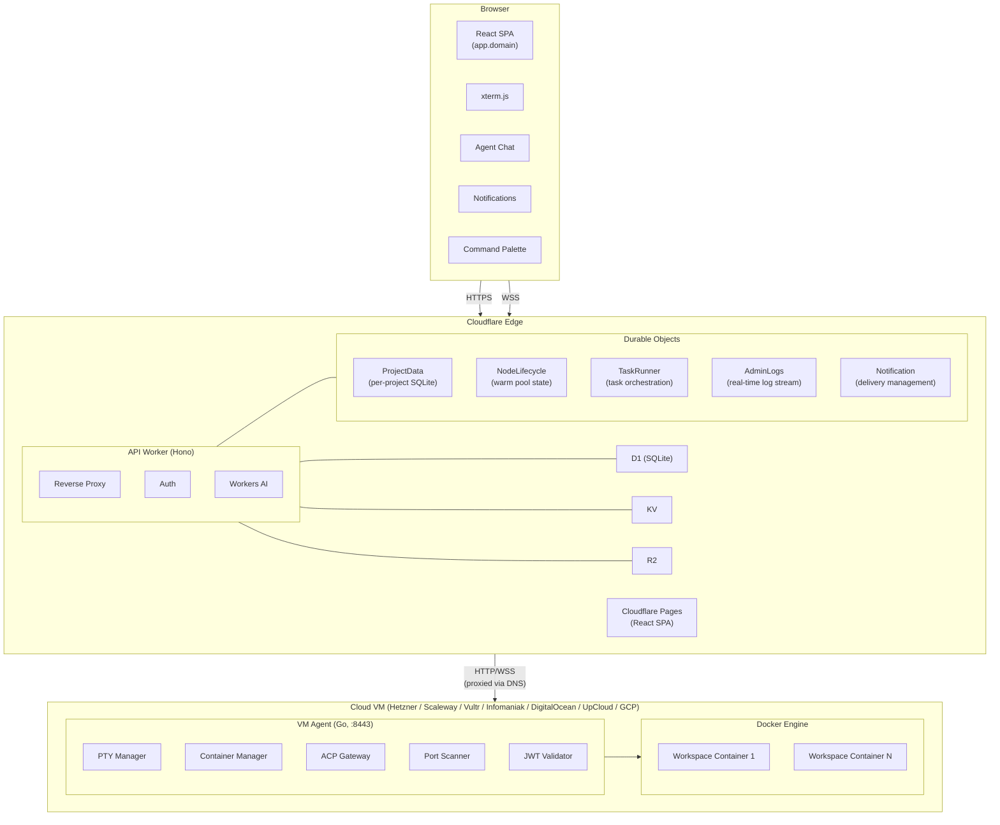
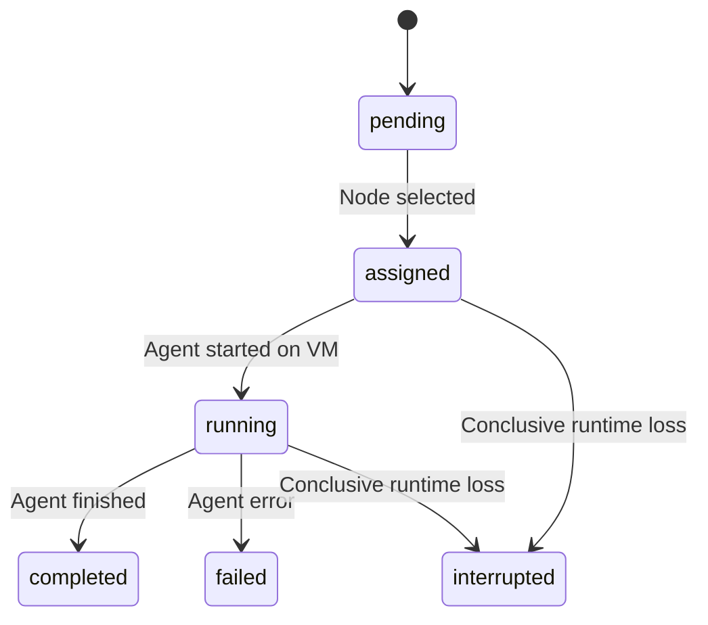
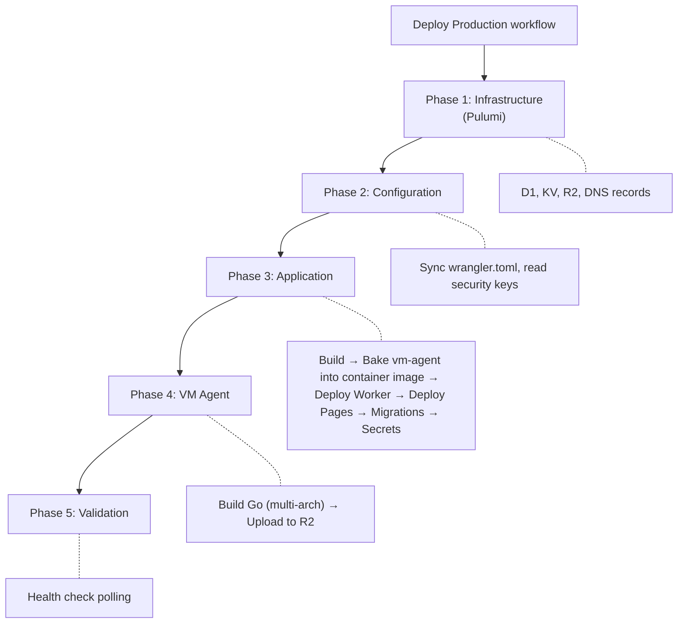

SAM is a serverless platform for ephemeral AI coding environments. The architecture splits into three layers: **edge** (Cloudflare), **compute** (cloud VMs — Hetzner, Scaleway, Vultr, Infomaniak, DigitalOcean, UpCloud, or GCP), and **external services** (GitHub, DNS).

For instant sessions, SAM can also run one standalone vm-agent in a raw Cloudflare Container. The deployment workflow builds the Linux vm-agent from the deployment commit, records its version and SHA-256 digest, and bakes it into the container image before Wrangler deploys the Worker. Cloudflare Worker deployment versions therefore provide the matching image/Worker rollback boundary. The image contains only SAM runtime tooling: project, profile, and skill files, environment variables, and secrets remain outside the image and are fetched and applied when the ACP session starts.

The optional [SAM account assistant](/docs/architecture/sam-account-assistant/) keeps canonical private history in a per-user `SamSession` Durable Object and delegates repository work into visible project tasks.

## High-Level Architecture



## Request Routing

Every request to `*.domain` passes through the same Cloudflare Worker. The `Host` header determines routing:

| Pattern                                     | Destination             | How                                                                              |
| ------------------------------------------- | ----------------------- | -------------------------------------------------------------------------------- |
| `app.{domain}`                              | Cloudflare Pages        | Worker proxies to `{project}.pages.dev`                                          |
| `api.{domain}`                              | Worker API routes       | Direct handling by Hono router                                                   |
| `ws-{id}.{domain}`                          | VM Agent on port 8443   | Worker proxies via `{nodeId}.vm.{domain}` backend hostname                       |
| `ws-{id}--{port}.{domain}`                  | Workspace port proxy    | Worker proxies to dev server running on `{port}`                                 |
| `r{N}-{service}-{port}-{env}.apps.{domain}` | Deployment public route | DNS-only A record points at the deployment node; node-local Caddy terminates TLS |
| `*.{domain}` (other)                        | 404                     | No matching route                                                                |

:::note[Why backend hostnames?]
Cloudflare Workers can't fetch IP addresses directly (Error 1003). Node backend DNS records (`{nodeId}.vm.{domain}` → VM IP) are created so the Worker can proxy through hostnames, with `*.vm.{domain}` excluded from the Worker route.
:::

Deployment public routes do not pass through the Worker proxy. The API derives a
stable hostname and loopback host port for each public route in a release,
creates the SAM-owned DNS-only A record, and sends those route targets inside
the signed deployment apply payload. The deployment node's Caddy instance then
terminates TLS and reverse-proxies to `127.0.0.1:{hostPort}`. User-owned custom
subdomains reuse the same signed route-target path after DNS verification, but
SAM does not create those user DNS records.

## Control Plane — API Worker

The API Worker (`apps/api/`) is a Hono application handling:

- **Authentication** — GitHub, Google, and GitLab OAuth via BetterAuth
- **Resource management** — CRUD for nodes, workspaces, projects, ideas
- **Reverse proxy** — workspace subdomain, port traffic, and file proxy to VMs
- **Durable Objects** — per-project data, node lifecycle, idea orchestration, notifications
- **Workers AI** — idea title generation, voice transcription, text-to-speech, and the models agents call with `run_ai_model`
- **MCP server** — project-aware tools for running agents
- **Cron triggers** — provisioning timeout checks, warm node cleanup, orphan detection

### Key Route Groups

| Route                   | Purpose                                                                        |
| ----------------------- | ------------------------------------------------------------------------------ |
| `/api/auth/*`           | GitHub OAuth sign-in/out, sessions                                             |
| `/api/nodes/*`          | Node CRUD, lifecycle, health callbacks                                         |
| `/api/workspaces/*`     | Workspace CRUD, lifecycle, boot logs, agent sessions                           |
| `/api/projects/*`       | Project CRUD, runtime config, ideas, chat sessions, file proxy                 |
| `/api/credentials/*`    | Cloud provider + agent API key management                                      |
| `/api/notifications/*`  | Notification list, preferences, WebSocket, and Web Push subscriptions          |
| `/api/tasks/*`          | Idea submission, lifecycle, status updates                                     |
| `/api/github/*`         | GitHub App installations, repos                                                |
| `/api/terminal/token`   | Workspace JWT for WebSocket auth                                               |
| `/api/agent/*`          | VM Agent binary download (VM/cloud-init path; container image has it baked in) |
| `/api/bootstrap/:token` | One-time credential injection                                                  |
| `/api/admin/*`          | Admin dashboard, error logs, real-time log stream                              |
| `/api/tts/*`            | Text-to-speech synthesis                                                       |
| `/api/transcribe`       | Voice-to-text transcription                                                    |

## Data Layer — Hybrid D1 + Durable Objects

SAM uses a hybrid storage model: **D1** for cross-project queries and **Durable Objects** for write-heavy, project-scoped data.

### D1 (Cross-Project Queries)

| Binding                  | Purpose                                                                              |
| ------------------------ | ------------------------------------------------------------------------------------ |
| `DATABASE`               | Users, projects, nodes, workspaces, ideas, credentials, diagnostic incident metadata |
| `OBSERVABILITY_DATABASE` | Error storage for admin dashboard                                                    |

D1 stores platform-level data that needs to be queried across projects (e.g., "show all my ideas" on the dashboard).

#### Read replication and request-scoped sessions

A D1 database has one writable primary, pinned to the region it was created in, while the API
Worker runs at whichever Cloudflare edge location the user reaches. When those are on different
continents, each D1 round trip costs a wide-area hop, and a single API request issues several
queries in sequence — which is where the latency of a request like `GET /api/projects/:id/tasks`
came from, not from the database itself.

Deployments therefore enable D1 **read replication** by default (`read_replication.mode = "auto"`,
applied idempotently by `scripts/deploy/configure-d1-read-replication.sh`; an operator can set
`D1_READ_REPLICATION_MODE=disabled` to remove replicas) and the Worker `fetch` handler
runs every request against a single D1 **session** per database
(`apps/api/src/lib/d1-session.ts`, `withRequestScopedD1Bindings`). The session is anchored
`first-primary`: its first query goes to the primary, and every later query in that request may
be served by any replica that has caught up to the bookmark the first query returned. A request
therefore pays one long round trip instead of one per query, while still observing a snapshot at
least as fresh as its own start — so no write that completed before the request began can be
missed, and writes in a session always go to the primary and are visible to later reads in the
same session. (It does not promise that a write landing _during_ the request is visible to that
request's later queries; that is the ordinary two-non-atomic-reads race, unchanged by this and
now with a shorter window.)

Scheduled cron sweeps and Durable Objects deliberately keep the unsessioned binding, so
reaper, resumer and terminal-verdict paths read exactly what they read before. `D1_SESSION_MODE`
(`first-primary` by default, `disabled` to opt out) is the operator kill switch. Queries that do
not open a session are always served by the primary, so enabling replication alone changes
nothing.

Before a deploy applies D1 migrations, SAM records per-table counts and a time-travel recovery timestamp. Post-migration comparison runs only for databases whose `d1_migrations` ledger advanced. Business tables use zero decrease tolerance; code-reviewed retention/expiry tables use a configurable percentage limit (50% by default), preserving catastrophic-wipe detection without treating routine telemetry churn as migration damage. Configuration may narrow that reviewed table set but cannot add arbitrary tables to it.

### Durable Objects (Per-Project Data)

| Binding                         | Scope       | Purpose                                                                                                    |
| ------------------------------- | ----------- | ---------------------------------------------------------------------------------------------------------- |
| `PROJECT_DATA`                  | Per project | Chat sessions, messages, activity events, ACP sessions (embedded SQLite)                                   |
| `NODE_LIFECYCLE`                | Per node    | Warm pool state plus durable proof-bearing workspace deletion retries                                      |
| `TASK_RUNNER`                   | Per task    | Multi-step task execution orchestration via alarm callbacks                                                |
| `ADMIN_LOGS`                    | Singleton   | Real-time log broadcast to admin WebSocket clients                                                         |
| `NOTIFICATION`                  | Per user    | Notification delivery and state management                                                                 |
| `PROJECT_ORCHESTRATOR`          | Per project | Project-scoped agent orchestration                                                                         |
| `PROJECT_AGENT`                 | Per project | AI technical-lead session for a project                                                                    |
| `SAM_SESSION`                   | Per user    | SAM agent conversation session state                                                                       |
| `CODEX_REFRESH_LOCK`            | Per user    | Serializes Codex OAuth token refresh of the account each run was seeded with (prevents 429 rotation races) |
| `GITHUB_USER_ACCESS_TOKEN_LOCK` | Per user    | Serializes GitHub OAuth user-token refresh                                                                 |
| `GITLAB_USER_ACCESS_TOKEN_LOCK` | Per user    | Serializes GitLab OAuth user-token refresh                                                                 |
| `AI_TOKEN_BUDGET_COUNTER`       | Per user    | Atomic AI token budget accounting                                                                          |

The retired anonymous-trial classes (`TrialCounter`, `TrialEventBus`, `TrialOrchestrator`) are still exported as unbound tombstones (`apps/api/src/durable-objects/retired-trial.ts`), because Cloudflare refuses a deploy that drops a class an existing namespace depends on unless a storage-deleting `deleted_classes` migration is added.

### Why Hybrid?

D1 handles reads well but has write contention under high concurrency. Chat messages and activity events generate high-frequency writes that would overwhelm D1. Durable Objects provide single-threaded SQLite access per project, eliminating contention while keeping data co-located.

Summary data flows back from DOs to D1 via debounced sync (e.g., `last_activity_at`, `active_session_count` on the projects table).

### Other Bindings

| Service        | Binding | Purpose                                                                                                                                          |
| -------------- | ------- | ------------------------------------------------------------------------------------------------------------------------------------------------ |
| **KV**         | `KV`    | Auth sessions, bootstrap tokens, boot logs, MCP tokens                                                                                           |
| **R2**         | `R2`    | VM Agent binaries, private diagnostic artifacts, session snapshots, compose image artifacts, TTS audio cache, ProjectData archived tool payloads |
| **Workers AI** | `AI`    | Idea title generation, transcription, TTS, agent model calls (`run_ai_model`)                                                                    |

### API error diagnostics

The global API error handler persists server failures with a request ID. Snapshot capture attempts that lose a race with sleep teardown or another capture return `409 CONFLICT`, and idle callbacks skip capture once teardown is claimed. These expected conflicts do not create API error rows.

Wrapped D1 query failures retain an allowlisted `context.causeCode`, including recognized SQLite codes and `D1_OVERLOADED`, `D1_NETWORK`, or `D1_TIMEOUT`. Unknown causes do not expose their text. The failed query's SQL, parameters, and stack are omitted from persisted rows. Workspace deletion quarantine rows retain `context.reason` and `context.attemptCount`; raw deletion error payloads remain excluded. TaskRunner mismatch diagnostics re-read the task after the probe so a completed handoff does not warn from an outdated scan result.

### VM diagnostic incident flow

VM Agent errors and their automatic evidence remain inside one SAM installation. The agent first persists a stable incident ID and error in its local SQLite outbox, then posts the error batch using the node callback JWT. The Worker creates primary-D1 incident metadata before strictly acknowledging the observability-D1 error row. Diagnostic incidents are deduplicated by redacted signature and deployment: the first occurrence owns the incident/artifact rows, while later repeats record occurrence count and last-seen time without creating more R2 objects. The VM registers a bounded redacted manifest/preview, claims a time-bounded D1 upload lease, streams the gzip archive into a deterministic private R2 key, and retries safely after restarts. The same lease prevents scheduled reconciliation or a failed-evidence report from racing a live upload. A scheduled reconciler repairs partial D1/R2 state, fails stale unleased uploads, expires metadata, and deletes retained objects in bounded batches.

Superadmin error queries batch-join incident summaries without exposing object keys. The UI downloads bytes only through an authenticated Worker proxy, while the diagnosis agent can read only the redacted D1 preview. There is no cross-installation intake or transport in this flow.

### Compose image artifact retention

Compose-publish releases may store docker-save archives in R2 under
`compose-image-artifacts/`. Those objects are durable while any surviving
`deployment_releases.manifest` references them. The scheduled release-retention path
(`apps/api/src/scheduled/d1-retention.ts:runDeploymentReleaseRetention()`) reconciles
only provably stale `created`/`applying` compose releases to terminal `failed` using
D1-observed deployment-node state and recent release-event activity as the lease. It
does not call the deployment node or inspect R2. Terminal release retention then prunes
old releases outside the observed-applied/newest rollback window, and
`packages/app-deployment/src/scheduled/compose-image-artifact-cleanup.ts:runComposeImageArtifactCleanup()`
deletes only old compose artifacts that are no longer referenced by any remaining valid
release manifest.

## Agent Configuration Layers

Agent behavior is assembled from several override layers rather than a single global setting:

- **Composable credentials** — reusable credential rows (`cc_credentials`) and configuration/attachment rows (`cc_configurations`, `cc_attachments`) can be layered per project and per profile, resolved **skill → profile → project → platform**.
- **Agent profiles** — named, reusable agent configurations (agent type, model, runtime, env, files) selected per chat or per task/trigger.
- **Skills** — a first-class override layer that further specializes a profile for a specific task type.
- **Provider modes** — each agent runs in one of three auth modes: `user-api-key` (the user's own key), `oauth` (a subscription token such as Claude Max), or `sam` (the platform-managed AI proxy, opt-in). See [Agent Authentication](/docs/guides/agents/).

### Agent Bootstrap Payload (`get_instructions`)

Every agent session begins by calling the SAM MCP `get_instructions` tool
(`handleGetInstructions()` in `apps/api/src/routes/mcp/instruction-tools.ts`), which returns
the task/session context, the project record, a mode-specific `instructions[]` array, and the
project's stored knowledge and policies.

Knowledge and policies are delivered as **rendered markdown only** — `knowledgeDirectives` and
`policyDirectives`, produced by `formatKnowledgeDirectives()` and `formatPolicyDirectives()` after
the size budgets described in [Inject modes and size budgets](#inject-modes-and-size-budgets).
Each field is omitted entirely when there is nothing to render; a failed Durable Object read
also degrades to "omitted" rather than erroring the bootstrap.

There is deliberately **no second structured copy** of this data. The payload previously also
carried `knowledgeContext` and `policyContext` arrays holding byte-identical observation and
policy bodies. Nothing consumed them, and on a mature project they accounted for roughly half
the payload (~166K → ~81K characters, about 21k tokens per session bootstrap), so they were
removed. Callers that need machine-readable records should use the dedicated tools —
`policies_read` method `list` / `policies_read` method `get`, and `knowledge_read` method `search` / `knowledge_read` method `list` — rather than
parsing the bootstrap payload.

Because `policies_write` method `update` and `policies_write` method `remove` resolve rows by exact id (`updatePolicy()` and
`removePolicy()` in `packages/project-data/src/do/policies.ts` use `WHERE id = ?`),
each rendered policy line carries its **full, untruncated** id:

```text
### Rules (MUST follow)
- **Call get_instructions first** (id: 7d24e435-0153-44a6-a532-1244510d9e25): Agents must load SAM context before starting work.
```

A policy may also carry a **shelf life**. `policies_write` method `add` and `policies_write` method `update` accept an optional
`expiresAt` (epoch milliseconds) and a `scope` of either `always` (a standing project policy,
the default) or `task` (a one-shot policy captured for a specific piece of work). A
`task`-scoped policy must set `expiresAt`, enforced at every write boundary by
`validatePolicyLifecycle()` in `packages/shared/src/constants/policies.ts` — which is what
stops a constraint captured for one workflow from being injected forever. When a policy has an
expiry, `formatPolicyLifecycle()` (`packages/shared/src/policy-directive-format.ts`) renders it inline between the title and the id:

```text
- **Use profile X for the reliability wave** (task-scoped, expires 2026-09-30) (id: d55af478-5234-4178-8f9c-47dfd5647de2): ...
- **Prefer Valibot for runtime validation** (expires 2026-12-01) (id: 56b02cb5-71aa-46bd-9ea1-858aaa5551ec): ...
```

Expiry is evaluated at **read time** in `getActivePolicies()`
(`packages/project-data/src/do/policies.ts`) — `active = 1 AND (expires_at IS NULL
OR expires_at > ?)`. There is no sweep or cron: a lapsed policy simply stops being selected. The
row is deliberately retained and stays `active`, so `policies_read` method `get`, `policies_read` method `list`, and the
Policies tab can still show a human that the policy existed and when it stopped applying. A
policy with no `expiresAt` never expires, which is the behaviour of every policy created before
lifecycle controls existed.

#### Inject modes and size budgets

Every policy has an **inject mode** (`project_policies.inject_mode`, ProjectData DO migration
`080-policy-inject-mode`):

- `pinned` — injected in full into every session. This is the default for every existing policy
  and every new one, so the policy text a session receives does not change until a project admin
  unpins a policy. Pinned policies are never trimmed by any budget.
- `on_demand` — always listed by title, category and id in a disclosed index at the end of
  `policyDirectives`, and injected in full only when it matches the session's task.
  `selectPolicies()` (`apps/api/src/routes/mcp/instruction-budget.ts`) scores each on-demand
  policy by distinctive words it shares with the task title, description, session topic and
  idea title (2 per title word, 1 per body word; a word in more than a fifth of the project's
  policies, and in more than one, does not count), ranks by score, category, recency and id, caps each category, and
  fills the `instructions.onDemandPolicyMaxChars` budget (policy lines only) without cutting a
  policy part-way.

```text
### On-demand policies (3): 1 shown in full above because they match this task, 2 listed here by title only
These still apply. Before you act in an area one of them covers, call `policies_read` method `get` with its id and follow it. Rules and constraints among them are binding.
- **Daily journal posts stay technical** (preference, id: 215c8350-b530-4065-a444-52b9e080770b)
```

`policies_write` method `add` and method `update` accept `injectMode`; an update that omits it
leaves the mode unchanged. In the app, **Agent context → Policies** shows each policy's mode and
the characters it adds to every session, and lets a project admin pin or unpin it.

Knowledge keeps its ranking (`getAllHighConfidenceKnowledge()`) and gets a size budget on top:
`fitKnowledge()` drops the lowest-ranked observations until the block fits
`instructions.knowledgeMaxChars`, keeps the entity index, and the index says how many were left
out.

`applyInstructionBudgets()` then checks the serialized payload against
`instructions.totalMaxChars` (default 120,000). When it is over, knowledge is trimmed first and
on-demand policy text second. When pinned policies, the task and the indexes exceed it by
themselves, only those are sent, `instructions[]` gains one line saying so, and
`mcp.get_instructions.required_over_budget` is logged; a lower budget therefore never produces a
larger payload. Claude Code saves a tool result over about 50,000 characters to a file (measured
on staging2: 59,820 characters spilled), so inline delivery needs a total of about 48,000 and
enough policies on demand. Every call logs
`mcp.get_instructions.size` with the section sizes and counts. If the budget pass throws,
`renderWithinBudgets()` (`instruction-payload.ts`) falls back to the unbudgeted rendering. Mission child tasks (`dispatch-description.ts`) still inherit every active policy in full,
whatever its inject mode. The five budgets are admin settings: see [Admin settings](/docs/guides/admin-settings/#agent-instructions).

Knowledge observations do **not** currently carry their `observationId` in this payload, so
`knowledge_write` method `update`, `knowledge_write` method `remove`, and `knowledge_write` method `confirm` need an id obtained from
`knowledge_read` method `search` or `knowledge_read` method `list` first.

## Durable Objects Deep Dive

The [Durable Object architecture](/docs/architecture/durable-objects/) covers storage and lifecycle details:

### ProjectData DO

[ProjectData storage and transcript search](/docs/architecture/durable-objects/#projectdata-do) live in one SQLite-backed object per project, with verified archive shards for terminal sessions.

#### Message search

[Message search](/docs/architecture/durable-objects/#message-search) uses grouped transcript materialization and FTS5.

### Notification DO

[Notifications](/docs/architecture/durable-objects/#notification-do) use per-user objects for connected browser delivery.

### TaskRunner: pinned node startup

[Pinned startup](/docs/architecture/durable-objects/#taskrunner-pinned-node-startup) coordinates placement with the selected node.

### NodeLifecycle DO

[Node lifecycle](/docs/architecture/durable-objects/#nodelifecycle-do) owns provisioning, retirement and cleanup.

### TaskRunner DO

[TaskRunner](/docs/architecture/durable-objects/#taskrunner-do) coordinates task execution and workspace startup.

## ACP Session Lifecycle

Agent sessions are managed by the ProjectData DO with this state machine:



**Heartbeat detection**: VM agent session heartbeats are durable ProjectData history. For VM-backed sessions, stale, missing, timed-out, or unobservable ProjectData ACP heartbeat rows are treated as suspect/unknown and do not by themselves prove runtime death. Terminalization requires explicit terminal session evidence, terminal owning workspace/node state, or another authoritative runtime signal. The `ACP_SESSION_DETECTION_WINDOW_MS` setting still bounds stale-session detection, but the ProjectData alarm defers VM session interruption when the only evidence is stale ProjectData heartbeat data.

Node-refreshed ACP heartbeats show node reachability, not whether this task's agent host is running. Suspect-task and idle-cleanup adapters inspect the exact host through the VM agent's existing session endpoint: a running host preserves liveness, a stopped host does not, and unavailable inspection remains inconclusive.

**Session forking**: Sessions track `parentSessionId` and `forkDepth` for lineage. Fork depth is limited to 10 (`ACP_SESSION_MAX_FORK_DEPTH`).

## VM Agent

The VM Agent (`packages/vm-agent/`) is a Go binary running on each node:

| Subsystem         | Package                   | Responsibility                                                  |
| ----------------- | ------------------------- | --------------------------------------------------------------- |
| PTY Manager       | `internal/pty/`           | Terminal multiplexing, ring buffer replay                       |
| Container Manager | `internal/container/`     | Docker exec, devcontainer CLI                                   |
| ACP Gateway       | `internal/acp/`           | Agent protocol, streaming responses, notification serialization |
| Port Scanner      | `internal/ports/`         | Auto-detect listening ports, build proxy URLs                   |
| JWT Validator     | `internal/auth/`          | Validates workspace JWTs via JWKS endpoint                      |
| Persistence       | `internal/persistence/`   | SQLite tab/session storage                                      |
| Boot Logger       | `internal/bootlog/`       | Reports provisioning progress                                   |
| Message Reporter  | `internal/messagereport/` | Outbox-based message relay to control plane                     |

## Deployment Pipeline



CI runs lint, typecheck, tests, and build on pull requests and on canonical-repository `main` pushes. In the canonical repository, Deploy Production runs after successful `main` CI. After entering the serialized deployment queue it reads the current `main` tip and deploys that tip only when the tip has its own successful `main` push CI run and is not already the latest production deployment (`validateAutomaticProductionDispatch()` in `scripts/deploy/validate-production-dispatch.ts`). Main CI runs overlap and can finish out of order, so the completed CI run only wakes the gate: when the tip's CI has not succeeded yet, the run ends without deploying and the tip's own CI completion deploys it. In self-host forks, `main` push CI is intentionally skipped, so operators update their instance by manually running **Deploy Production** against the exact commit SHA from the fork's synced `main` branch. The production GitHub Environment must separately restrict deployments to the selected `main` branch so other refs cannot access its secrets with modified workflow code.

## Key Design Decisions

| Decision                             | Rationale                                                                                                                                                                                                                                         |
| ------------------------------------ | ------------------------------------------------------------------------------------------------------------------------------------------------------------------------------------------------------------------------------------------------- |
| Single Worker as API + reverse proxy | Simplifies infrastructure — one Worker handles everything                                                                                                                                                                                         |
| Hybrid D1 + Durable Objects          | D1 for cross-project reads, DOs for high-throughput project-scoped writes                                                                                                                                                                         |
| BYOC + platform-credential fallback  | Users/self-hosters may bring their own cloud tokens; projects may attach compute credentials; an installation administrator may also enable a platform credential so users can provision with zero config (resolution: project → user → platform) |
| Callback-driven provisioning         | VMs POST `/ready` when bootstrapped — no polling                                                                                                                                                                                                  |
| Dynamic DNS per workspace            | Instant subdomain resolution; cleaned up on stop                                                                                                                                                                                                  |
| Alarm-driven execution orchestration | Idempotent steps with exponential backoff; no long-running processes                                                                                                                                                                              |
| No credentials in cloud-init         | Bootstrap tokens for secure credential injection                                                                                                                                                                                                  |
| Multi-provider abstraction           | Unified VM size/lifecycle API across Hetzner, Scaleway, Vultr, Infomaniak, DigitalOcean, UpCloud, and GCP                                                                                                                                         |
