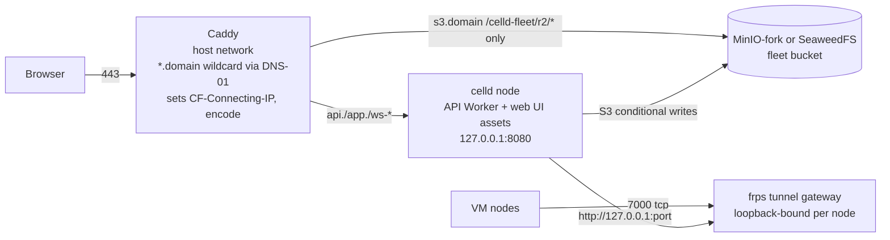

# Track C: one-box operations proof for a celld-hosted control plane

Self-host spike, 2026-11-10. Task `01M72NPC1VRA3TVNKNW8ZY6S0M`, branch `sam/self-host-spike-track-zy6s0m`.
Background: idea `01M72M9AEB933ZY8269D376DKC`. Throwaway research; nothing here is a supported install path.

## Verdict: GO WITH CONDITIONS

One box can run a real celld node (production mode, `--bucket`) against a local
S3-compatible store, behind Caddy, with acceptable latency, zero acknowledged-write loss on
`kill -9`, a working backup and restore, and an in-place upgrade. A self-hoster could live
with it **if** SAM accepts these conditions:

1. **Secrets live in the bucket in plaintext.** celld has no secret mechanism for real
   nodes (item 3). The bucket credential becomes the root secret of the install. Acceptable
   for a single-operator box; it must be stated plainly in self-host docs.
2. **The object store is MinIO-fork or SeaweedFS, which celld does not qualify for production.**
   Both passed celld's own storage test; Garage failed it (item 1). SAM would be shipping on
   an unqualified store, or must require an external qualified bucket (S3, R2, GCS, Tigris, Azure).
3. **Epoch GC must be on** (`CELLD_LTX_RETENTION_SECS`), or the bucket grows on every cell
   activation (item 7).
4. **SAM's Instant runtime does not work on the same box as shipped** (item 8): celld's
   container fence rejects all traffic from containers to the host, so the in-container
   vm-agent cannot reach `api.<domain>` on that host. The first self-host release should ship
   without Instant, or SAM must change how Instant containers talk to the control plane.
5. Two SAM code changes are needed regardless: presigned uploads must presign against the
   operator's bucket with a prefix-scoped credential (item 6), and the web UI should move into
   the API Worker's `assets` binding (item 5). Track B's WebSocket finding (a fetched `101`
   cannot be returned to the browser on celld) also applies to this layout.

Time spent: about 3 hours of the half-day box. Everything numbered 1 to 8 was attempted.

## Test setup (verified)

- Box: this SAM workspace, 2 vCPU, 3.8 GB RAM, Docker 29.9.3, x86_64. Every component shared it,
  including the load generator, so the latency numbers are conservative.
- celld v0.6.2 binary from the GitHub release (sha256 `0c9ef440…aceac`), v0.6.3 for the upgrade test
  (`eb0a8158…7eb75`), and `ghcr.io/denoland/celld:v0.6.3` for compose.
- Test Worker: `worker/src/index.js`. It has a SQLite Durable Object with a self-rearming 15 s alarm
  and a hibernatable WebSocket, plus D1, KV, R2, a `* * * * *` cron, a secrets probe that
  reports lengths only, a header echo and an R2 list.
- Scripts: `scripts/` (start stores, run node, deploy, crash test, backup, restore, hot backup,
  presign tests, web hosting test). Raw outputs: `results/`.

---

## 1. Real node with a local bucket

**Verified by running.**

Storage qualification test: `celld diagnose --bucket s3://B --endpoint URL` runs four
conditional writes (create, reject-create, update, reject-stale). Every node also runs this
test at boot and refuses to serve if it fails (`docs/guarantees.md`, "The storage test").

| Store | Version | Result | Evidence |
|---|---|---|---|
| MinIO (community fork `pgsty/minio`) | RELEASE.2026-08-04 | **PASS** all four checks | `results/diagnose-minio.txt` |
| SeaweedFS | `chrislusf/seaweedfs:latest` (2026-11-08) | **PASS** all four checks | `results/diagnose-seaweedfs.txt` |
| Garage | v2.5.0 | **FAIL**: "the store overwrote an object although the write was conditional on that object being absent; the store accepts If-Match / If-None-Match and does not enforce it" | `results/diagnose-garage.txt` |

- The real node also passed the boot-time ranged-read check on MinIO. SeaweedFS passed
  `diagnose`, but I did not run a full node or the crash test on it.
- **Packaging problem:** `minio/minio` no longer exists on Docker Hub, `quay.io/minio/minio`
  returns 401, and `dl.min.io` was unreachable from here. MinIO stopped shipping community
  binaries and images. The only working image was Pigsty's fork `pgsty/minio`. A self-host
  recipe should treat SeaweedFS as at least as viable and pin images by digest.
- `celld docs`: MinIO "passes the storage test but is not qualified for production". Neither
  MinIO nor SeaweedFS is on celld's qualified list (S3, R2, GCS, Tigris, Azure).

The Worker deployed with `celld deploy` and every binding worked: DO write and alarm, D1
(`celld d1 migrations apply` applied `0001_init.sql`), KV, R2 with metadata, and cron.

Install and deploy recipe:
- `celld deploy` needs `esbuild` on PATH (`tools/package.json`).
- A deploy takes 0.16 s for a small Worker and 1.1 s with 9 MB of SPA assets. A redeploy with
  unchanged assets takes 0.3 s. The running node picks up the new version in about 5 s with no restart.
- `celld d1 migrations apply DB PROJECTDIR` needs a **running** node. With none it fails with
  "no node leases in the bucket". It talks to the node's internal listener, so in compose I ran
  it in a throwaway container sharing the celld container's network namespace. The first
  attempt, seconds after the node started, still said "no node leases". A retry with an
  explicit `--endpoint` worked. I did not isolate which of the two fixed it.
- `celld dev` has no way to apply D1 migrations (the CLI needs `--bucket`). The test Worker has
  a `/d1/init` route as a workaround.
- `assets.directory` must be inside the project directory, as `main` must be (Track A found the same).
- "A fleet runs one application" (`docs/limitations.md`). SAM's web UI therefore rides in the
  API Worker (item 5). Separate apps need separate bucket prefixes. I ran a second fleet at
  `s3://celld-fleet/ctr` for the container test.

## 2. Latency and durability

**Verified by running.** Load came from `tools/load.mjs` on the same 2-vCPU box. Each write
uses a unique key, and acknowledged keys are logged only after an HTTP 200.

| Mode | Op | Concurrency | writes/s | p50 ms | p99 ms | max ms |
|---|---|---|---|---|---|---|
| real node + local MinIO | DO write | 1 | 100 | 9.5 | 20.8 | 120 |
| real node + local MinIO | D1 write | 1 | 97 | 9.8 | 21.0 | 68 |
| real node + local MinIO | DO write | 8 | 329 | 22.6 | 47.8 | 89 |
| real node + local MinIO | D1 write | 8 | 393 | 18.4 | 43.2 | 70 |
| `celld dev` | DO write | 1 | 89 | 10.7 | 23.1 | 83 |
| `celld dev` | D1 write | 1 | 87 | 10.9 | 23.8 | 82 |
| `celld dev` | DO write | 8 | 272 | 15.1 | 265.9 | 1345 |
| `celld dev` | D1 write | 8 | 343 | 21.5 | 50.1 | 201 |

A single node with a local bucket performs like `celld dev`. The roughly 90 ms per write that
celld quotes for a single node comes from bucket round-trip time to a remote bucket. With the
bucket on the same box, a write costs about 10 ms.

**kill -9 mid-load** (`scripts/crash-test.sh`, 8 DO writers across 4 objects plus 4 D1 writers, kill at about 12 s):

| Run | Acked DO | Acked D1 | **Missing acked writes** | Process up → healthy | kill → first DO write |
|---|---|---|---|---|---|
| default node id | 6,355 | 3,128 | **0** | 1.0 s | 10.96 s |
| fixed `CELLD_NODE` | 6,188 | 2,822 | **0** | 10.4 s | 10.95 s |
| after epoch GC (item 7) | n/a (state fingerprint) | | **identical state** | | |

- Recovery takes about one lease lifetime (`CELLD_TTL_MS`, default 10 s), and a fixed node id
  does not shorten it. Shortening the TTL is possible but I did not test it.
- The supervisor must retry. Restarting immediately after `kill -9` failed once with
  `bind --listen 127.0.0.1:8080: Address already in use` (`results/crash-minio-immediate.txt`).
  celld's docs already require "restart without an attempt limit, at least one lease lifetime apart".
- **Alarms resume, but they can be late.** After about 5 minutes of downtime, the overdue alarm fired once
  immediately at boot. In the `kill -9` run, an alarm that came due 3 s after the kill fired
  35 s late, about 25 s after the node was serving again. That timing matches the orphan-alarm
  waker scan (`CELLD_WAKER_TICK_MS`, documented at 60 s).
- **Cron resumes** and runs exactly **one** missed occurrence after downtime. After about 5
  minutes down it ran 12:42 and skipped 12:43 to 12:46, as the docs say. SAM's cron sweeps
  must tolerate skipped ticks; Track A saw the 5-minute sweep fire normally.
- A graceful SIGTERM takes 15.5 s on a single node. `POST /shutdown?handoff=preserve` on the
  internal listener stops it in 0.8 s, but total restart downtime is still about 10 s (the lease
  TTL) (`results/restart-handoff-preserve.txt`).

**Memory (verified):**

| Process | Idle | Under load |
|---|---|---|
| celld node, test Worker | 87 MB RSS (23 MiB cgroup in compose) | 120 to 126 MB RSS |
| MinIO (pgsty) | 275 to 330 MiB | about the same |
| SeaweedFS (`weed server`, all-in-one) | 41 MiB | not measured |
| Caddy | 17 to 61 MiB | n/a |

The SAM Worker itself is far larger: Track A measured a 29.4 MB bundle. I did not measure
celld memory with the SAM Worker loaded. That is an open question for sizing.

## 3. Secrets and config

**Verified by running and in source (`crates/celld/env_vars.rs`, `crates/celld/deploy.rs`, tag v0.6.2).**

- **Real nodes have no secret mechanism.** `celld deploy` deliberately supplies no variable
  overrides: "`celld deploy` supplies none, so a local credential cannot reach a fleet"
  (`deploy.rs:204-207`). `.dev.vars`, `.env` and `.env.local` are read only by `celld dev`.
- `CELLD_VAR_<NAME>` and `CELLD_VARS_FILE` were **removed**. A node started with either refuses
  to boot with "set `vars` in the Wrangler config" (`env_vars.rs`, `REMOVED` and `REMOVED_PREFIX`).
- So the only way to supply production secrets is to put them in the config's `vars` at deploy
  time. They become `plain_text` bindings. **I found them in plaintext in
  `s3://<bucket>/deploy/<worker>/<version>/manifest.json`** (`tools/s3.mjs grep`).
- Recipe that works (`scripts/deploy.sh` and `tools/render-config.mjs`): render `wrangler.json`
  from a template, merge a root-only dotenv secrets file into `vars` (with umask 077), run
  `celld deploy`, then delete the rendered file. I deployed 21 secrets this way, including a
  multi-line 2048-bit RSA PEM, and the Worker saw all of them with their correct lengths.
- Per-deployment vars work the same way: `deploy.sh SECRETS KEY=VALUE ...` merges plain vars.
  SAM's generated `[env.*]` sections would be replaced by one rendered `wrangler.json` for each
  install. SAM already generates its config with `sync-wrangler-config.ts`, and Track A has a
  JSON generator.
- Consequence: anyone who can read the bucket can read every Worker secret. celld's docs
  already say "the fleet bucket controls the fleet" (`docs/security.md`). For one box this is
  the same trust boundary as the disk. Keep the bucket credential out of the Worker. Never hand
  the fleet credential to browsers or nodes; see item 6 for the scoped credential.
- Old deploy manifests, with old secret values, stay in the bucket. Rotating a secret means
  redeploying and then deleting `deploy/<worker>/<old-version>/`. I did not test whether celld
  ever garbage-collects those.

## 4. TLS ingress

**Verified by running** (`caddy/Caddyfile`, `results/caddy-ingress.txt`, `results/compose-smoke.txt`).

- Caddy with one `*.onebox.test` site and `tls internal` issued a wildcard certificate
  (SAN `DNS:*.onebox.test`). `api.`, `app-assets.`, `ws-01abc.` and `ws-01abc--3000.` all
  reached the one Worker, and `app.` was served from disk.
- **WebSocket upgrade through Caddy works.** `wss://ws-01abc.onebox.test/do/ws` reached a
  hibernatable Durable Object socket, and three echoes plus a close with code 1000 came back,
  also with `encode zstd gzip` on. Caveat from Track B: SAM proxies node WebSockets by returning
  a fetched `101`, which celld breaks. That needs a Worker-side WebSocket bridge, whatever the ingress.
- `CELLD_TRUST_FORWARDED_HEADERS=1`: `request.url` became `https://api.onebox.test/headers`.
  Without it, it was `http://api.onebox.test/headers`. Caddy's `{host}` drops a non-default
  port, so a non-443 listener loses the port in `request.url`. That does not matter in production.
- **`CF-Connecting-IP`:** `header_up CF-Connecting-IP {remote_host}` overwrites any value the
  client sends. With a spoofed `CF-Connecting-IP: 6.6.6.6` (and spoofed `X-Forwarded-For` and
  `True-Client-IP`), the Worker saw the real peer: `172.18.0.5` from a separate container and
  `172.17.0.4` from the host's eth0 address. `True-Client-IP` and `CF-Ray` are stripped.
- **Docker networking matters.** With Caddy on Docker-published ports, the Worker saw the
  Docker gateway (`172.21.0.1`) instead of the client, which would put every client in one
  rate-limit bucket. With `network_mode: host` it saw the real address (`172.18.0.3`). The
  compose draft uses host networking for Caddy.
- celld never compresses responses (`docs/services/static-assets.md`). `encode zstd gzip` in
  Caddy cut the largest JS chunk from 473 KB to 107 KB.

**Certificates for a self-hoster (inferred; not run against a public CA):**
- SAM needs `api.`, `app.`, `ws-<id>.` and `ws-<id>--<port>.`. All are single labels under the
  base domain, so **one wildcard `*.<domain>` covers everything**. Wildcards from Let's Encrypt
  require the DNS-01 challenge, so Caddy must be built with the operator's DNS provider module
  (`xcaddy build --with github.com/caddy-dns/<provider>`) and given a DNS API token. That token
  is only for TLS, not for SAM at runtime.
- On-demand TLS with HTTP-01 is not viable for `ws-*`. Let's Encrypt allows **50 new
  certificates per registered domain per 7 days**, 300 new orders per account per 3 hours, and
  5 duplicate certificates per 7 days (letsencrypt.org/docs/rate-limits, updated 2026-08-05).
  Every workspace and every previewed port would need its own certificate. On-demand also needs
  an `ask` endpoint so random hostnames cannot burn the quota. It is acceptable only as a
  fallback for operators whose DNS provider has no API, with the 50-per-week ceiling documented.
- For the proof, a local CA (`tls internal`) is enough.

## 5. Web UI hosting

**Verified by running** (`results/web-hosting.txt`, `results/web-hosting-compressed.txt`).
The `apps/web` build is 38 MB with source maps, 9.2 MB and 435 files without them. The largest
file is 473 KB, well under celld's 25 MiB per-file asset limit.

| | Caddy `file_server` + `try_files` (app.) | Worker `assets` binding (app-assets.) |
|---|---|---|
| SPA deep link `/projects/abc/chat` | 200 index.html | 200 index.html (`not_found_handling: single-page-application`) |
| SAM's `public/_headers` | **Ignored.** Each rule must be translated into Caddyfile by hand. `/oauth/consent` lost its CSP and `no-store` | **Honoured as-is.** `/oauth/consent` got `CSP frame-ancestors 'none'`, `X-Frame-Options DENY` and `Cache-Control: no-store` |
| Caching | Whatever is configured by hand | Strong SHA-256 ETag, `max-age=0, must-revalidate` default |
| Compression | Caddy `encode` | None from celld; Caddy `encode` in front works (zstd) |
| Deploy | A separate file sync to the box | Atomic with the API version; only changed files upload |
| Isolation | The API host cannot serve SPA files | With `run_worker_first: true` and host dispatch, `api.<domain>/index.html` reached the Worker (404 JSON), not the SPA |

**Recommendation: the Worker `assets` binding.** It keeps Cloudflare Pages `_headers` semantics,
ships with the API in one atomic deploy, and needs no extra moving part. Configure
`run_worker_first: true` and send `app.<domain>` to `env.ASSETS.fetch()` at the top of the
Worker. "A fleet runs one application", so the SPA cannot be a second Worker. Keep `encode` in Caddy.

## 6. Uploads without presigned URLs

**Verified by running** (`scripts/presign-test.sh`, `scripts/scoped-presign-test.sh`, `results/presign-*.txt`).

| Direction | Result |
|---|---|
| Presigned PUT to the store at `r2/<bucket_name>/<key>`, then the R2 binding | `head` returned the right size, etag and `contentType` from the S3 `Content-Type`; `get` bytes matched by sha256; `list()` included the object |
| Same, with the client also sending `x-amz-meta-celld-r2: {"custom":{…},"http":{"contentType":…}}` | The binding returned that `customMetadata` and `contentType` |
| R2 binding PUT, then a presigned GET from the store | Bytes and `Content-Type` matched |
| 40 MiB through the binding | Stored as **one** S3 object (multipart, etag `…-5`) at `r2/<bucket>/<key>`; a presigned GET's bytes matched |
| 40 MiB presigned PUT, then the binding | Bytes matched; size correct |
| Prefix-scoped MinIO user (`config/minio-r2-presign-policy.json`, `celld-fleet/r2/onebox-files/*`) | PUT in its prefix returned 200 and the binding read it. **403** on `deploy/…/manifest.json` (the plaintext secrets), **403** on `cells/evil`, **403** on `r2/other-bucket/x` |
| Compose: presign against the public endpoint `https://s3.<domain>` through Caddy | PUT 200 and readable through the binding. Caddy returns 403 for any path outside `/celld-fleet/r2/` |

celld stores all R2 metadata in one S3 header, `x-amz-meta-celld-r2` (JSON with `custom`, `http` and `checksums`).

**Presigning against the operator's bucket is a viable replacement.** It needs:
1. A prefix-scoped credential (never the fleet credential, which can read every secret).
2. A public HTTPS route to the store, such as `s3.<domain>` through Caddy, limited to the `r2/` prefix.
3. CORS on the store for browser uploads. Not tested.
4. A small `r2-s3-client.ts` change: configurable endpoint, bucket, key prefix `r2/<bucket_name>/`
   and path-style addressing, instead of `https://${CF_ACCOUNT_ID}.r2.cloudflarestorage.com`.

Caveats:
- `celld docs` say an application must not write under celld's reserved prefixes. Direct writes
  under `r2/` are outside them, but celld does not document them. A future celld could add an
  index or cache that makes direct writes invisible. Today `list()` reads the store directly.
- SeaweedFS IAM may not support prefix-scoped policies as cleanly as MinIO. Not tested.

## 7. Backup, restore and upgrade

**Verified by running** (`scripts/backup.sh`, `scripts/restore-test.sh`, `scripts/hot-backup-test.sh`, `results/backup.txt`, `results/restore.txt`, `results/hot-backup.txt`, `results/upgrade-0.6.2-to-0.6.3.txt`, `results/epoch-gc.txt`).

**Simplest procedure (cold), tested:**
1. Stop celld with SIGTERM (a graceful handoff, 15 s on one node).
2. Wait one lease lifetime (11 s).
3. Back up the bucket with `mc mirror l/celld-fleet <dir>`, and tar the node data directory.
4. Start celld.

Total downtime was 71 s for 341 MB and 28,230 objects.

**Restore of the bucket alone into a fresh MinIO, with an empty node data directory:** a state
fingerprint covering every DO's keys, D1 rows, KV and R2 was **identical** to the moment of
backup, and post-backup writes were correctly absent. The restored node served immediately.
On a single node, every acknowledged write waits for the bucket, so **the data directory is a
cache and the bucket is the only thing to back up.** That fits celld's acknowledgement rule:
a single node uses bucket durability. On a multi-node fleet, celld says follower disks can hold
writes the bucket lacks.

**Hot backup:** I mirrored the bucket during a 90 s write load, then restored it. The node
booted, and all 2,527 writes acknowledged before the mirror started were present. This is one
sample and **not a documented celld guarantee**. Each cell is captured at a different instant,
so cross-cell consistency (DO versus D1) is not point-in-time. Recommend the cold procedure,
or a filesystem or volume snapshot of the store with celld stopped, for anything that matters.

**Storage growth, an important finding.** With defaults, 45,000 tiny writes plus about 7 node
restarts produced 242 MB and about 28,000 LTX objects under `cells/`. That is roughly 5 KB and
0.6 objects per write, and every restart or activation adds an epoch prefix that is never
deleted (`docs/README.md`, "Each activation can add a new epoch prefix…"). `celld cell gc --dry-run`
reported about 203 MB reclaimable. After setting **`CELLD_LTX_RETENTION_SECS=60`**, `cells/`
shrank from about 43,000 objects and about 250 MB to **5,356 objects and 45 MB within about
2 minutes**. Every acknowledged write was still present, and a `kill -9` restart afterwards
recovered identical state. Set epoch GC in production. A longer value such as 86,400 s keeps
a rollback window. Backup and restore time scales with the object count: 56 to 95 s for about
30,000 objects on this box.

**Upgrade v0.6.2 to v0.6.3, in place, same data directory, verified:** SIGTERM the old binary
and start the new one. Downtime was 16 s, and the state fingerprint was identical apart from my
probe write. Alarms, cron and writes continued. The docs give a rule for each version pair:
either "rolling" or "stop all" (for example v0.3 to v0.4 and v0.5.1 to v0.6.0 are stop-all with
fleet durability). Some steps forbid rollback, for example "never start an old binary against
the upgraded fleet" after the v0.4.1 wake-format migration. Rollback therefore means restoring a
stopped-fleet backup. v0.6.3 fixes a v0.6.2 path in which a cell whose `own.json` was lost
restarts **empty**. Backups must include `own.json`; `mc mirror` does. **Ship v0.6.3 or later.**

## 8. Containers

**Verified by running** with a probe image (`container-worker/`, `results/container-probe.json`)
on a real v0.6.3 node, `@cloudflare/containers` 0.3.7, `instance_type: basic`:

- Start, fetch a port and WebSocket all work. The first fetch cold-started the container; a warm
  fetch took 17 ms; a WebSocket echo went through the DO to the container. The container was
  destroyed when the node stopped, as documented.
- Hardening observed inside the container:
  - `CapEff=0` and `CapBnd=0`, so every capability is dropped
  - `NoNewPrivs=1`, and seccomp mode 2
  - `pids.max=1024`, and PID 1 is `docker-init`
  - `memory.max` is 1 GiB and `cpu.max` is 25000/100000 (the `basic` instance type)
- Under that hardening, as non-root `node` (uid 1000, like SAM's image), these worked: a writable
  rootfs, `npm i -g` into a user prefix, `git clone` over HTTPS, and internet egress. A PTY was
  allocated (`/dev/pts/0`) under the same Docker flags (`--cap-drop ALL`,
  `--security-opt no-new-privileges`, `--pids-limit 1024`), outside celld.
- **Blocker for SAM Instant on one box: the egress fence.** celld installs nftables rules
  (`crates/celld/container.rs`, `FENCE_RULES`), including an **input-hook `reject` for
  everything arriving from the container bridges**, plus forward rejects for private and
  link-local ranges. From the container, Caddy on the host was `ECONNREFUSED` at both
  `172.17.0.4:80` and `172.18.0.1:80`, while the host itself got 308 at both. The input hook
  covers every local address, the box's public IP included. An operator `accept` chain cannot
  override another base chain's `reject`. The only knobs are `CELLD_CONTAINER_DNS`,
  `_PLATFORM` and `_RUNTIME`; nothing disables the fence. SAM's Instant container starts the
  vm-agent with `CONTROL_PLANE_URL` (`vm-agent-container.ts`, `startRuntime`), so on a box that
  is also the control plane, those callbacks cannot connect. A box behind a NAT router that
  hairpins traffic to its public IP might work. Not tested.

**Judgement on SAM's Instant image (inferred from reading `Dockerfile.vm-agent-container` and
`vm-agent-container.ts`; the real image was not built):**
- Capabilities: probably fine. The image runs as `USER node`, installs agent tools into
  user-writable prefixes, and needs no sudo or Docker in standalone mode
  (`NODE_ROLE=standalone`, `CONTAINER_MODE=false`). The probe showed this class of workload
  works with every capability dropped and no-new-privileges set.
- Process limit: 1024 is likely enough for one agent, but parallel builds (pnpm or turbo with
  many workers plus language servers and MCP servers) could hit it. Not measured.
- Sizing: SAM uses `standard-1` (½ vCPU, 4 GiB, per Cloudflare's table) with `max_instances = 3`.
  celld counts each container's memory cap as committed node memory, so three Instant sessions
  reserve 12 GiB.
- `@cloudflare/sandbox` (SandboxDO) was not tested.

Conclusion for item 8: containers work on celld, and SAM's image would probably run under the
hardening. Same-box Instant is blocked by the fence until SAM's container no longer needs to
reach the control plane over the network, or celld adds an allowance.

---

## Recommended one-box layout

Draft: `docker-compose.yml`, with `.env.example`, `caddy/Caddyfile.compose`, `config/minio-init.sh`
and `config/frps.toml`. I brought it up on this box and verified:
- the objectstore init job created the bucket and the scoped presign user
- the celld container served the deployed test Worker
- D1 migrations applied
- real client IPs reached the Worker through Caddy on host networking
- a presigned upload went through `s3.<domain>`, and the edge returned 403 outside `r2/`
- the SPA was served through the assets binding
- WSS reached the DO

The frps service is a placeholder for Track B.

Operational settings for celld:
- `CELLD_LTX_RETENTION_SECS` set
- `CELLD_TRUST_FORWARDED_HEADERS=1`
- internal listener on loopback inside the container
- `restart: unless-stopped`
- `stop_grace_period` greater than 40 s
- the bucket on its own volume

## Minimum box size

Measured with the small test Worker and inferred for SAM:

| Shape | vCPU | RAM | Disk | Basis |
|---|---|---|---|---|
| Control plane only, no Instant | **2** | **4 GB** (8 GB comfortable) | 40 GB SSD plus attachment and snapshot growth | Measured: celld 0.1 GB, object store 0.3 GB, Caddy under 0.1 GB, all on this 2 vCPU / 3.8 GB box with headroom. **Unmeasured:** SAM's 29 MB Worker in memory (Track A should measure celld RSS) |
| With Instant containers (once the fence issue is solved) | 8+ | 16 GB+ | 100 GB+ (the image is several GB; per-session workspaces) | celld commits 4 GiB per `standard-1` container × `max_instances = 3` |

## What was verified versus inferred

Verified by running:
- storage test results for MinIO, SeaweedFS and Garage
- a real node with all five binding types, and deploy and hot-redeploy timings
- latency tables, memory figures and `kill -9` durability
- alarm and cron recovery behaviour
- secret storage location (plaintext in the bucket) and the removed environment-variable path
- Caddy wildcard routing, WSS, forwarded headers, client-IP overwrite, and the Docker-port pitfall
- both SPA hosting options with `_headers` behaviour and compression
- presign interop in both directions with a scoped credential and the public `s3.` route
- cold and hot backup and bucket-only restore
- epoch GC reclaim and safety
- the v0.6.2 to v0.6.3 in-place upgrade
- container start, fetch, WebSocket, hardening values, and the fence blocking the host
- the compose stack

Inferred or read only:
- Let's Encrypt DNS-01 and on-demand trade-offs (rate limits from the LE docs page)
- whether SAM's real Instant image runs under the hardening
- the process limit being enough for SAM
- the RAM needed with the real SAM Worker
- CORS for browser uploads
- SeaweedFS as a full node backend (only `diagnose` was run)
- behaviour behind NAT hairpin
- celld's long-term direction: it is being merged into workerd, so the operating model may change

## Open questions

1. Real SAM Worker memory and CPU on a real node: what are idle and loaded RSS with the 29 MB bundle?
2. Should SAM accept an unqualified local store (MinIO fork or SeaweedFS), or require an external
   qualified bucket? Would celld qualify SeaweedFS or MinIO if asked?
3. How should Instant containers talk to a same-box control plane? Options: the DO
   `containerFetch` channel only, a celld change, or a separate host.
4. Secret hygiene: is plaintext-in-bucket acceptable? Should SAM encrypt its own secrets with a
   key supplied outside the bucket? Nothing in celld can supply such a key except `vars`, so
   probably not. And who deletes old `deploy/<version>/manifest.json` objects?
5. A lower `CELLD_TTL_MS` for faster single-node recovery: what are the safety trade-offs?
6. Does the `celld d1` CLI honour `S3_ENDPOINT` in every path? The first attempt in compose needed an explicit `--endpoint`.
7. CORS and multipart presigned uploads against MinIO or SeaweedFS from a browser.
