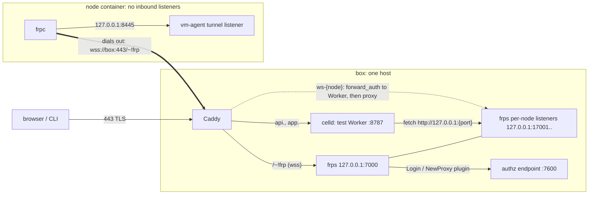

# Track B: can an open-source reverse tunnel replace Cloudflare Tunnel for control plane → node?

Spike, 2026-11-10. Throwaway research; nothing here is shippable code. Branch `sam/self-host-spike-track-2dgkck`.
Background: SAM idea `01M72M9AEB933ZY8269D376DKC` (section 3).

## Verdict: GO WITH CONDITIONS

frp (frps on the box, frpc on each node) works as the node transport for a celld-hosted control plane.
Every HTTP path SAM uses worked end to end against the **real vm-agent**, through #2615's loopback tunnel
listener, with per-node authorization enforced, over a single public port (443) and with automatic
recovery from every failure I injected.

The conditions are not about frp. They are about **celld's handling of WebSockets and long responses**:

1. **SAM's WebSocket proxy does not work on celld as written.** Returning a `fetch()`ed 101 response
   (`apps/api/src/index.ts:590,712,723`) makes celld send a 101 with no handshake headers. A Worker-side
   `WebSocketPair` bridge works but has two defects found here: **no backpressure** (box memory grows with
   whatever the node sends) and **no close propagation** when the tunnel dies (the browser socket stays
   open and silent). **Recommended fix, verified:** let Caddy carry node WebSockets. The Worker only
   decides auth and the upstream via `forward_auth`, and Caddy proxies the bytes to the node's frps
   loopback port. Both defects disappear on that path.
2. **celld cuts any Worker-proxied HTTP response at 120 s** (default `CELLD_FETCH_TIMEOUT_S`), even while
   data is flowing. Large downloads or long streams through the Worker need `CELLD_FETCH_TIMEOUT_S` raised
   (verified: 300 lifts it) or must also go through Caddy.
3. **frpc does not verify the server certificate unless told to.** Every node config must set
   `transport.tls.useSystemCa = true` (public cert on the box) or `trustedCaFile`.
4. Per-node credentials: use a dedicated per-node frp credential (like #2615's tunnel token), not the
   callback JWT, which expires and only renews via heartbeat.

What I did **not** prove: a real cloud VM over the internet (everything ran on one 2 vCPU / 3 GB machine with
nodes as Docker containers), the vm-agent's own WebSocket endpoints (they need control-plane JWTs; I used
an echo backend for WebSocket tests), or SAM's actual Worker code on celld (that is Track A).

## Setup (verified by running)

- celld 0.6.2 (`celld dev`, then re-checked on a production-mode node `celld --bucket s3://… --endpoint` on
  local pgsty/minio with the Worker deployed by `celld deploy`), frp 0.72.0, Caddy 2 (`tls internal`).
- Nodes: Alpine containers on the Docker bridge. node-a/node-b run an HTTP + WebSocket echo backend on
  container loopback (`backend/main.go`). **node-c runs the real vm-agent** built from `packages/vm-agent` at
  `main` (`cabd2fde8`, which includes PR #2615) with `VM_AGENT_TUNNEL_ENABLED=true`, main listener
  127.0.0.1:8080, tunnel listener 127.0.0.1:8445. From the box, ports 22/80/443/8080/8443/8444 on a node are
  closed. Nothing listens on the node's external interface.
- Test Worker `worker/index.js` proxies `/tcp/{node}/…` to `http://127.0.0.1:{port}` with SAM's shape
  (headers copied, `body`, `duplex: 'half'`, `redirect: 'manual'`, return the `fetch()` result).
- Re-run: `scripts/install-tools.sh`, `scripts/box-up.sh`, `scripts/node-up.sh node-a|node-b`,
  `scripts/node-vmagent-up.sh`, tests under `tests/`. Raw outputs in `evidence/`. Working log: `NOTES.md`.

Note: PR #2615 **merged to main at 12:23 UTC today** (`cabd2fde8`) while this spike ran. Line numbers below
are against that commit.

## Answers

### 1. Can a celld Worker fetch loopback and private addresses? — Yes, unrestricted (verified)

`evidence/q1-egress-dev-and-prod.txt`. Same result under `celld dev` and a production-mode node:
`127.0.0.1`, `127.0.0.2`, `localhost`, `[::1]`, Docker bridge `172.18.0.1`, eth0 `172.17.0.4`, and the
Worker's own listener all return 200. There is no egress filter and no knob for one, so loopback
gateways are reachable. That cuts both ways: SAM itself must keep any SSRF guards it relies on (none exist on
the node path today, `fetch-timeout.ts:50`).

Other egress facts: `fetch(…, {method: 'CONNECT'})` → `TypeError: Invalid HTTP method string`.
`cloudflare:sockets` `connect()` exists and reaches loopback. A Worker **can** set an arbitrary `Host` on a
plain `fetch()`, but celld **ignores** a custom `Host` on WebSocket-upgrade fetches (it uses the URL authority).
`*.localhost` names do not resolve.

### 2. WebSocket upgrade passthrough via fetch — No as written; yes with a workaround (verified)

| Shape | Result |
|---|---|
| `return await fetch(upgradeReq)` (SAM `index.ts:723`) | client gets `HTTP/1.1 101` with **no** `Upgrade`/`Connection`/`Sec-WebSocket-Accept` → rejected |
| `new Response(body, {status, headers, webSocket: res.webSocket})` (SAM `index.ts:590,712`) | same failure |
| Worker `WebSocketPair` bridge, no `waitUntil` | handshake OK, **no upstream frame ever delivered** |
| Bridge + `ctx.waitUntil(<until close>)` | works: text, binary, close 4001/4002 with reasons both ways |
| **Caddy `forward_auth` → Worker, Caddy proxies to frps port** | works: text, binary, close codes; 401 without auth; 404 unknown node |

The `fetch()`ed upstream socket itself works (`/wsupstream`: hello received, echo OK). Only the handover to the
client is broken. Track A confirmed that DO-originated WebSockets work on celld, so this is specific to a
socket obtained from an outbound `fetch()`. Identical on `celld dev` and a production node
(`evidence/prod-mode-recheck.txt`).

Bridge measurements (`evidence/q2-*.txt`):
- Held 330 s fully idle, then echo OK. 330 s of 5 s server ticks: 66/66, max gap 5014 ms. The documented
  "60 s idle stream expiry" did **not** apply.
- 1/4/16 MiB single frames: intact (bridge 99/271/818 ms vs direct 48/119/319 ms). 32 MiB burst in 64 KiB
  frames: 35 MiB/s bridge vs 54 MiB/s direct.
- **No backpressure.** Node floods 256 MiB to a client that stops reading for 20-25 s: the direct path blocks
  the node's writer for the whole pause. Through the bridge the node finishes in 2.4 s, and celld's worker RSS
  goes from 106 MiB to 444 MiB until the client drains. The documented "1 MiB WebSocket queue budget per
  isolate" was not enforced on this path. Risk: `cat` of a large file in a terminal plus a slow browser
  grows box memory without bound.
- **No close on tunnel loss.** SIGKILL frpc, kill frps, or partition the node: the browser-side socket
  stays open with no frames, **for the whole test** (20-45 s). Adding `error` listeners does not help:
  celld fires neither `close` nor `error` on the upstream when its TCP connection dies. Clean closes from the
  node do propagate. Same on a production-mode node.
- Caddy path, same tests (`evidence/q2-forward-auth-failure-and-backpressure.txt`): frpc killed → client
  gets `1006` within about 0.2 s. A 256 MiB flood to a paused reader blocks the node's writer (31 s), the same as
  direct.

### 3. Streaming, large bodies, throughput and latency (verified, one 2 vCPU host)

`evidence/q3-http-bench.txt`, frp's own TLS transport (`tcp` + TLS):

| Path | 1 GiB download | 1 GiB upload (chunked, `duplex: 'half'`) | `/health` p50/p95/p99 |
|---|---|---|---|
| raw loopback (no Worker, no tunnel) | 0.91 s (1130 MiB/s) | 5.5 s | 0.7/1.0/1.2 ms |
| Worker only | 1.24 s (828 MiB/s) | 5.6 s | 2.2/4.1/7.2 ms |
| tunnel only (frps→frpc) | 4.71 s (217 MiB/s) | 8.5 s | 2.7/4.9/8.0 ms |
| **Worker + tunnel** | **5.10 s (201 MiB/s)** | **9.3 s** | **3.0/4.4/5.6 ms** |

- sha256 of the 1 GiB upload matches on every path. The tunnel, not celld, is the bottleneck.
- Over **wss via Caddy** (the single-port setup in Q6), the Worker+tunnel 1 GiB download took 13.3 s
  (about 77 MiB/s), p50 3.3 ms (`evidence/q4-vhost-vs-tcp-over-wss.txt`). The extra TLS hop is costly on 2 vCPU.
  Over a real WAN the link will dominate (inferred).
- Streaming is unbuffered: lines written 1 s apart reach the client 4-13 ms later.
- Body limit: 1 GiB + 1 byte **with** Content-Length → immediate `413 request body too large`. **Chunked**
  → celld cuts the body after 1 GiB and the Worker's fetch errors (8.9 s in). The node has already received
  about 1 GiB of a truncated upload. `CELLD_MAX_REQUEST_BODY_BYTES` (default 1 GiB) governs it.
- **120 s cap:** every Worker-proxied response was cut at exactly 120.0 s (curl exit 18), whether idle or
  actively streaming. This held on dev and production nodes, with or without the tunnel. The same stream
  direct through frps ran 160 s. `CELLD_FETCH_TIMEOUT_S=300` let the 160 s stream complete, so the default is
  120 s. It is global per celld node (`evidence/q3-active-stream-160s.txt`).
- `celld dev` hot-reloads on any file change in the project and drops in-flight requests. Production deploys
  were not tested for in-flight behaviour.

### 4. Per-node routing — recommend (a) one TCP port per node (verified)

| Mode | Plain HTTP | WebSocket | Verdict |
|---|---|---|---|
| (a) tcp: frps binds `127.0.0.1:{leasePort}` per node | ✅ | ✅ (bridge or Caddy) | **recommended** |
| (b) http vhost on one loopback port, route by Host | ✅ (Worker sets `Host`) | ❌ celld ignores custom `Host` on upgrade → frps 404 | rejected on celld |
| (c) tcpmux (HTTP CONNECT) | curl ✅ | — | rejected: `fetch` refuses CONNECT; raw `cloudflare:sockets` would mean hand-writing HTTP + WebSocket |

(a) needs a port allocator (a D1 table with `UNIQUE(port)`, frps `allowPorts` as a second fence). In return it
is protocol-agnostic and the same upstream address works for Worker fetches and for Caddy (Q2 recommended
path). Plain-HTTP latency and throughput of tcp and vhost were indistinguishable.

### 5. Authorization via frps server plugin — works (verified)

`box/authz/server.mjs` handles `Login` and `NewProxy`. It checks an HMAC per-node token (stand-in for a SAM
credential) and a lease table `{nodeId → port, domain}`. NewProxy carries the login metas, so each proxy is
re-verified with no session state. `evidence/q5-authz.txt`:

- node-a with a valid token for itself claims node-b's port 17002 → **rejected** "node-a may only bind port
  17001, claimed 17002". node-b's domain → rejected. Node-a's token presented as `nodeId=node-b` → Login
  rejected. Proxy name not prefixed with its own id → rejected. Garbage token → rejected. Port 22 → rejected.
- node-b kept serving throughout. A second session for node-a claiming 17001 while node-a holds it gets
  frps "port already used", so a live slot cannot be hijacked.
- Only `tcp`, `http`, `tcpmux` types are allowed, so no `stcp`/`xtcp` visitor paths exist (inferred safe).
- Design notes (inferred): the shared `auth.token` is a fixed public value, and the plugin is the real gate.
  The plugin endpoint must not be reachable from the internet. If it is a Worker route, Caddy must not route
  it publicly, or frps should call it with a secret path segment.

### 6. Transport: wss on 443 behind a TLS reverse proxy — works, recommended (verified)

`box/caddy/Caddyfile`, `box/frps-wss.toml`, `node/frpc-wss-node-*.toml`, `evidence/q6-wss-tls.txt`:

- Caddy on 443 routes `/~!frp` to frps (bound to **127.0.0.1:7000**, `transport.tls.force = false`, because
  the only TLS layer is Caddy's). Everything else goes to celld. The box exposes one port. Port 7000 is closed
  from nodes. All three nodes, including the real vm-agent, ran over wss.
- TLS verification: with **no CA configured, frpc connects without verifying** (also true on the plain TLS
  transport: frps's auto-generated self-signed cert was accepted). With a wrong CA: `x509: certificate signed
  by unknown authority`. With the right CA: works. Source: frp `client/connector.go`
  (`NewClientTLSConfigWithSystemCA`). Production configs must set `useSystemCa = true` with a public cert.
- Cost: frps sees every client as coming from Caddy (`ip [http://box.spike.test]`), so node source IPs are
  not visible to frps. SAM gets node IPs from heartbeats anyway.

### 7. Failure behaviour (verified; probe = 10 Hz `/health`, bridged WS with 1 s ticks, 500 ms stream)

| Event | `/health` outage | In-flight HTTP stream | Bridged WS | Recovery |
|---|---|---|---|---|
| SIGKILL frpc (restart loop 1 s, like systemd) | **1.05 s** (502 from frps) | socket error | **zombie** (never closed) | frpc re-login 1.05 s after kill |
| SIGKILL frps, restart after 2 s | **6.7 s** | socket error | zombie | frpc reconnect backoff adds about 4.6 s; all 3 nodes re-registered the same ports |
| SIGKILL celld (both procs), restart after 1 s (`celld dev`) | **1.4 s** (ECONNREFUSED) | socket error | `1006` (process died) | tunnels unaffected |
| `docker restart` Caddy (carries all wss) | **2.4 s** | socket error | zombie | all 3 nodes re-logged in 2.6 s after the restart began |
| 20 s network partition of one node | **21.5 s** (requests **hang**, then 502) | hung 29 s, then error | zombie | 3.2 s after heal |
| Same frpc kill on the Caddy WS path | — | — | **`1006` in about 0.2 s** | — |

- Production-mode celld behaves the same for the frpc kill (`evidence/prod-mode-kill-frpc.txt`). Track C
  measured production celld restart at about 1 s to serve and about 10.9 s to first DO write (lease TTL).
- During a partition frps keeps the proxy registered, so requests hang rather than fail fast. frp's own
  heartbeat timeout (not measured) bounds it. SAM's per-request timeouts are what protects callers.
- frpc with `loginFailExit = false` retried while authz rejected it and came up by itself about 15 s after
  the lease was fixed.

### 8. Integration map (read from code only) — `evidence/integration-map.md`

The seam exists. `fetchNodeAgent` (`apps/api/src/services/node-agent.ts:270`) already reads `nodes.runtime`
per call and rewrites cf-container nodes to `http://localhost:{port}` (`:310-313`). A `reverse-tunnel`
rewrite to `http://127.0.0.1:{leasePort}` belongs there, selecting `transport` and the lease port in the same
query, so it adds no round trip. #2615 already routed the old inline builders through `getNodeBackendBaseUrl`
(`node-agent-readiness.ts:19`). Callers that bypass `fetchNodeAgent`: `index.ts:625` (browser `ws-{id}`
proxy), `task-runtime-liveness-node-probe.ts:94`. The snapshot upload relay (`session-snapshot-upload-relay.ts:243,389`)
hands the node URL to another VM, so it must be disabled or routed via the box for reverse-tunnel nodes.

Files a `reverse-tunnel` transport would touch:
- **Shared:** `packages/shared/src/types/workspace.ts:57` (`NodeTransport`).
- **D1:** an additive migration plus a `schema.ts` table `node_reverse_tunnel_leases(node_id, runtime_incarnation_id,
  port UNIQUE, credential_hash, status, …)`. It is shaped like `node_cloudflare_tunnels` (0230/0231) minus
  the account/zone/DNS columns.
- **API:**
  - New `services/node-reverse-tunnel-*.ts` (allocate, release, sweep).
  - `node-tunnel-config.ts` (`resolveManagedNodeTransport` `:98`).
  - `env.ts` (port range, box address).
  - `node-agent.ts:270`, `index.ts:430/625`, `task-runtime-liveness-node-probe.ts:87`,
    `session-snapshot-upload-relay.ts`.
  - A callback-only frps plugin route (mounted before `/api/nodes` session routes). It verifies the
    per-node credential and `remote_port === lease.port`.
- **Provisioning and lifecycle:**
  - `node-provisioning.ts:179-183` (resume branch hard-codes `'cloudflare-tunnel'`), `:268,276,677`.
  - `node-provisioning-cloud-init.ts:59,88`.
  - `node-lifecycle.ts:328` (Origin CA refusal) and `:414-417` (IP backfill keyed on `tunnelId`).
  - `strict-node-deletion.ts:234` and `scheduled/handler.ts:154`: release the lease. There is no external API
    call, unlike Cloudflare.
- **Cloud-init:** in `tunnel.ts`, `template-ingress.ts`, `variables.ts`, `validate.ts` and `generate.ts`, replace
  `CLOUDFLARED_RELEASES`, the cloudflared runcmds/unit and `tunnelReplacements` with frpc equivalents. Keep the
  pinned sha256 download pattern and `frpc.toml` with `useSystemCa`. `controlPlaneUrl` is already `https://`
  (`validate.ts:30`), so the box's Caddy endpoint serves both callbacks and wss.
- **WebSocket path on celld:** `index.ts:590,712,723` and the logs stream (`routes/nodes/diagnostics.ts:135`)
  need either the Caddy `forward_auth` route or a bridge. This is new work that exists only because of celld.
- **Carries over from #2615 unchanged (verified for the listener, read for the rest):**
  - The loopback tunnel listener and relayed-request marking. A real vm-agent behind frpc logged "Git credential
    request refused: bearerless request was relayed by a proxy".
  - `nodes.transport`, the drop-all-inbound firewall, `isTunnelMode`, `sam-wait-tunnel-listener`, the journal's
    per-incarnation ownership SQL, skipping the public-IP wait and A record, and Origin CA being optional.
  - The vm-agent needs **no change**.

### 9. Embedding the tunnel client in the vm-agent (inferred, not built)

- **frp as a library** (`github.com/fatedier/frp/client`, Apache-2.0):
  - Gains: one binary, no separate download, checksum or systemd unit. The agent can refresh its credential and
    reconnect in-process.
  - Costs: frp is a v0 module whose client API is not a stable public contract, it pulls in quic-go/kcp-go/etc.
    (the frpc binary is 17 MB vs vm-agent's 25 MB), and an frp bump becomes a vm-agent release and rollout.
- **jpillora/chisel** (MIT, SSH over WebSocket, usable as a library):
  - Gains: a smaller protocol surface and native `R:127.0.0.1:{port}:127.0.0.1:8445` reverse remotes.
  - Costs: authorization is a static users file with per-user remote regexes, so there is no per-request plugin
    hook. SAM would rewrite and reload that file on every node change.
- **WebSocket + hashicorp/yamux** (self-built):
  - Gains: auth natively with SAM credentials in the upgrade request, routing by node id in a header (works on
    celld; only `Host` is ignored on upgrades), one port. A small Go gateway on the box replaces frps.
  - Costs: SAM owns a security-sensitive protocol, keepalives, reconnection and backpressure, which is exactly
    the code that frp already gets right in the tests above. Do not build the gateway as a Durable Object: it
    would inherit the bridge defects found in Q2.
- **Recommendation: sidecar frpc for v1.** #2615 already built the slot: a pinned, checksummed binary as a
  systemd unit beside a loopback listener. Moving to embedded is easy later because the node side is just
  "dial out, expose 127.0.0.1:8445". Revisit only if binary distribution or credential rotation becomes painful.

## Recommended design

1. **Box:** Caddy (public cert, `useSystemCa` on nodes) on 443 → celld for `api.`/`app.`; `/~!frp` → frps on
   127.0.0.1. frps: `proxyBindAddr = 127.0.0.1`, `allowPorts` = SAM's lease range, Login/NewProxy plugin → SAM.
2. **Node:** #2615's shape unchanged, with `cloudflared` replaced by `frpc` (`transport.protocol = "wss"`,
   `useSystemCa = true`, `loginFailExit = false`, systemd `Restart=always`). One `tcp` proxy, `remotePort =
   leasePort`, `localPort = 8445`.
3. **Credential:** a per-node random frp credential minted at provisioning, its hash on the lease row, delivered
   by cloud-init like the cloudflared tunnel token, and valid for the node incarnation. The plugin checks the
   credential, the node status and `remote_port`.
4. **Control plane → node HTTP:** `fetchNodeAgent` rewrites reverse-tunnel nodes to `http://127.0.0.1:{leasePort}`.
   Raise `CELLD_FETCH_TIMEOUT_S` above the longest legitimate transfer, or move bulk transfers off the Worker.
5. **Browser → node WebSockets:** Caddy `forward_auth` to a Worker endpoint that authenticates and returns
   the upstream (and any headers to inject, such as the node JWT, via `copy_headers`). Caddy proxies the socket to
   `127.0.0.1:{leasePort}`. This avoids celld's broken passthrough, the missing backpressure and the zombie
   sockets. Fallback if that is rejected: the `WebSocketPair` + `waitUntil` bridge, plus an application-level
   liveness ping and an output cap.
6. **Lifecycle:** reuse #2615's journal and sweep pattern for lease release. Deletion frees the port. A node
   reconnecting after an frps restart reclaims its own port (verified).

## Open questions / not verified

- Real VMs over the internet (latency, NAT, MTU, a public Let's Encrypt cert). Everything here ran on one host.
- The vm-agent's own WebSocket endpoints (terminal, agent ACP, logs) through the tunnel. They need
  control-plane JWTs; WebSocket behaviour was measured with the echo backend.
- Whether the Caddy `forward_auth` path can carry everything SAM's proxy does today: port-proxy cookies,
  `Set-Cookie` stripping, `X-Forwarded-*`, management JWT injection, and per-request auth cost on reconnect storms.
  The mechanism works; the mapping is unproven.
- frps kick/disconnect of a deleted node's session (admin API on 127.0.0.1:7500 exists, not exercised), and
  frp's heartbeat-timeout bound during partitions.
- celld production deploy (`celld deploy`) behaviour for in-flight long requests.
- Whether celld will fix fetch-WebSocket passthrough, close propagation and backpressure, or whether the
  workerd merge changes it. Pull requests to celld are disabled; patches go by email.
- Scale: frps with hundreds of nodes and thousands of loopback listeners (not tested).

## Verified vs inferred

Verified by running: everything in Q1-Q7 tables and bullets unless marked "inferred". Read only: Q8 (code
survey at `cabd2fde8`) and Q9. The Caddy `forward_auth` WebSocket design is verified as a mechanism (auth,
echo, close codes, failure close, backpressure). Its fit with SAM's proxy features is inferred.
