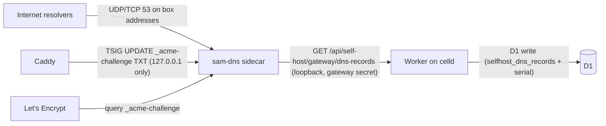

# Self-host: DNS on the box (multi-box step 1)

SAM task 01M7YQEZ0ACJG4FZX25HSPC1XM. Plan: idea 01M7V5DMWTXWDMCWA5T4YC9HC5, step 1 (approved by
Raphaël 2026-11-21, ask 01M7XCN74CVM6VVHA66CA25667). Coordinator task 01M7XCE59V5X0WTNF1X3NFZP5J,
channel `feature.selfhost-landing`.

## Problem

A self-host box still needs a cloud DNS service:

- Caddy gets the `*.SAM_DOMAIN` wildcard by DNS-01 through Google Cloud DNS
  (`SAM_TLS_MODE=dns-googleclouddns`, the VM service account holds `roles/dns.admin`).
- App deployments cannot work on a box at all. `upsertAppRouteDNSRecord`
  (`apps/api/src/services/dns-app-routes.ts`) writes each route's grey-cloud A record
  `r{n}-{svc}-{port}-{envId}.apps.SAM_DOMAIN` through the Cloudflare DNS API. A box has no
  Cloudflare zone, so the call fails and the release fetch returns 500. The operator's
  `*.SAM_DOMAIN` wildcard does not help: the record must point at the deployment node, not the box.

Goal: the operator delegates `SAM_DOMAIN` to the box once (NS + glue) and the box answers for it.

## Research findings

- DNS callers (all through `services/dns.ts` barrel):
  - app routes: `routes/deploy-release-callback.ts:331,353` (upsert), `:416` (stale cleanup),
    `routes/deployment-environments.ts:436`, `routes/nodes/delete.ts:62` (cleanup);
  - node backend records: `services/node-provisioning.ts:532` (skipped for tunnel ingress),
    `routes/node-heartbeat-ip.ts:104,113` (skipped for tunnel ingress, `applyHeartbeatIp`),
    deletes by stored id in `node-resource-lifecycle.ts`, `node-resource-deletion.ts`,
    `deployment-node-cleanup.ts`, `strict-node-dns-cleanup.ts`, `node-provisioning-race-cleanup.ts`,
    `routes/nodes/manual-deletion.ts`. Box nodes use the reverse tunnel, so these never create
    a record there; the seam still routes them so nothing on a box can call Cloudflare.
  - `cleanupWorkspaceDNSRecords` and `DNSService` have no callers outside `services/dns*`.
- Self-host-only extensions are installed by `withSelfHostBuild` (`apps/api/src/selfhost/build.ts`),
  which `apps/api/src/index.ts` never imports (speech, analytics, reverse tunnel). Rotation scope
  (#2952) uses the same idea (`encryption-key-fallback.ts`). The DNS seam follows it: a registry in
  shared code, filled only by the self-host build.
- Self-host-only D1 migrations: `apps/api/src/selfhost/*-migrations.ts` lists, linked after the
  shared ones by `scripts/selfhost/selfhost-migrations.ts`. Hosted SAM's schema does not change.
- Gateway routes (`selfhost/reverse-tunnel/gateway.ts`) authenticate box processes with
  `X-SAM-Gateway-Secret` and Caddy hides the prefix from the internet (`caddy/sam.d/frp.caddy`).
  sam-mx is the Go sidecar pattern: digest-pinned images, setcap for the low port, uid only, no
  other capability, read-only root, memory and pid limits.
- Egress fence (`scripts/selfhost/egress-fence.ts`) is an allowlist for celld's uid: loopback
  ports are refused unless listed. The DNS update port is denied by default; it must also be a
  reserved box listener and a `forbiddenLoopbackPorts` entry so a misconfiguration cannot open it,
  and `verify-fence` must probe it.
- frps authz (`reverse-tunnel/authz.ts`) allows one `tcp` proxy on the node's leased remote port
  only, so a node cannot reach other box loopback ports through the tunnel.
- Platform keys: generated once by `--init` (`scripts/selfhost/platform-keys.ts`), sealed into the
  bundle, rendered to box files (gateway.env) by every deploy, rotated by
  `scripts/selfhost/rotate-catalog.ts`. The TSIG key follows the same path, rendered to its own
  `dns.env` read only by Caddy and the DNS sidecar.
- Caddy module: `github.com/caddy-dns/rfc2136@v1.0.0` (libdns/rfc2136 v1.0.0, miekg/dns). certmagic
  uses AppendRecords (TSIG UPDATE, Insert TXT) and DeleteRecords (Remove TXT); never AXFR. It finds
  the zone with an SOA query to `resolvers`, so the loopback update listener also answers queries
  for the zone, and `propagation_timeout -1` avoids a hairpin query to the box's public address.

## Design

- `services/dns-provider.ts`: `installBoxDnsBackend()` / `boxDnsBackendFor(env)`. Returns null unless
  the self-host build installed a backend AND that backend accepts the env (`SAM_DNS_PROVIDER=box`).
  Each exported DNS primitive checks it first; on null the Cloudflare code runs unchanged.
- `selfhost/dns/`: D1 backend (`selfhost_dns_records`, `selfhost_dns_zone` serial bumped in the same
  batch as every write), names normalised to lowercase FQDNs inside `BASE_DOMAIN` (anything else is
  refused), long TTL (`SAM_DNS_RECORD_TTL_SECONDS`, default 3600), and the paged gateway route.
- `deploy/selfhost/sam-dns`: Go sidecar (miekg/dns). Polls the gateway route (one D1 read when the
  serial is unchanged), swaps the zone atomically after a complete paged read within a deadline.
  Static records: SOA, NS (`ns1.SAM_DOMAIN`), glue A, apex and `*.SAM_DOMAIN` A to the box address.
  Public listener: queries only. Update listener on 127.0.0.1: queries plus TSIG UPDATE of TXT
  records under `_acme-challenge.SAM_DOMAIN`, held in memory only.

## Threat model

New attack surface: a public UDP/TCP 53 listener, and a loopback RFC 2136 update channel.

- **Reflection / amplification.** Authoritative only, so the only answers are for our own small
  zone. No recursion (RA clear; REFUSED outside the zone). ANY answered minimally (RFC 8482: one
  HINFO-style record, or REFUSED over UDP). UDP answers truncated to the client's advertised
  EDNS size capped at 1232 bytes; larger answers set TC so the client must retry over TCP (no
  amplification without a handshake). Per-source-prefix response rate limit (token bucket, /24 IPv4
  and /56 IPv6, bounded table) drops or truncates the excess. TCP: connection cap, per-IP cap,
  idle and total deadlines, queries per connection.
- **Zone enumeration.** AXFR and IXFR are REFUSED on every listener (and NOTIFY). No DNSSEC, so no
  NSEC walking. The names (`ws-<id>`, `r<n>-<svc>-<port>-<envId>.apps`) are already visible in CT
  logs for routes with certificates; the IDs are not secrets and do not grant access.
- **Cache poisoning.** Not applicable to the server itself: it never sends queries, keeps no cache
  and accepts no data from responses. The data it serves comes only from D1 over the loopback
  gateway route (secret-authenticated) and from TSIG-signed updates on loopback. Resolvers that
  query it get answers with the AA bit for in-zone names only; out-of-zone queries are REFUSED, so
  it cannot be used to inject records for other zones (no additional-section records outside the
  zone are ever returned).
- **Forged RFC 2136 updates.** UPDATE is refused (REFUSED/NOTIMP) on the public listener before any
  parsing of the update section. The update listener binds 127.0.0.1 only (config refuses another
  address). Every UPDATE must carry a valid TSIG (HMAC-SHA256, 32-byte key, time fudge 300 s);
  unsigned or bad-MAC requests are refused. Accepted updates may only add or remove TXT records
  under `_acme-challenge.SAM_DOMAIN` (and `_acme-challenge.*.SAM_DOMAIN`), bounded in count and size,
  in memory only (they never reach D1), so a leaked key can at most issue certificates for
  `SAM_DOMAIN` names (the same power `roles/dns.admin` on the zone gives today), not redirect any
  name. The key is generated by SAM (platform key), sealed, rendered to a mode-0600 `dns.env` read
  by Caddy and the sidecar only, and rotatable with `selfhost:secrets rotate dns-update-key`.
- **Who can reach what.**
  - Agent VMs: reach the box only through frps (one TCP proxy on their leased port, authz.ts) and
    HTTPS through Caddy. They cannot reach the update port. They can query port 53 like anyone.
  - Worker code (celld uid): the egress fence denies every loopback port not on its allowlist; the
    update port is never on it, is a reserved box listener, and `verify-fence` probes it. The Worker
    writes records only through its own D1 code paths (deployment releases), as on Cloudflare.
  - Other box processes (Caddy, frps, sam-mx, key-agent, mail collector, object store) share the
    host network and could reach 127.0.0.1:update, but need the TSIG key, which only Caddy gets.
  - The gateway records route is loopback-only (Caddy 404s the prefix publicly) and secret-checked;
    it is read-only.
- **Accepted risk (review M1 on #2960):** sam-dns, like sam-mx, holds the shared gateway secret
  for its loopback sync route. A parser compromise would expose the other gateway routes. Same
  trade-off as sam-mx; per-sidecar credentials are tracked in idea 01M7YXTPZA414CAN0RF4KHGAVB.
- **The TSIG key equals certificate issuance for the whole domain** (any name, any ACME account),
  as `roles/dns.admin` does today. It cannot repoint names: updates are TXT under
  `_acme-challenge` only, and a challenge name never hides its parent from the wildcard.
- No new trust boundary beyond the plan: nothing outside the box can write records.

## Implementation checklist

### PR (a): Worker seam and record sync
- [x] `services/dns-provider.ts` registry; route every exported primitive in dns-core,
      dns-app-routes, dns-node-backend, dns-workspace through it (Cloudflare code unchanged)
- [x] `selfhost/dns/` D1 backend + migration (self-host list) + installed by `withSelfHostBuild`
- [x] Gateway route `GET /api/self-host/gateway/dns-records` (paged, serial, secret)
- [x] Tests: resolver through real entry for Cloudflare env, Cloudflare env + `SAM_DNS_PROVIDER=box`
      still Cloudflare (divergence), installed + box var -> box (convergence), installed without
      the var -> Cloudflare; Cloudflare request shapes unchanged; D1 backend on real SQLite;
      release callback -> D1 -> gateway route with more records than one page (rule 81).
      Divergence/convergence proven discriminating by surgical reverts (dns-provider.ts gate
      removed -> "stays on Cloudflare" red; shared code reading the var -> 3 divergence tests red;
      slice without installBoxDns -> slice red).
- [ ] Staging: Cloudflare path (workspace DNS record, app-route record created and resolves)
- Moved to PR (b): the box deploy writes `SAM_DNS_PROVIDER=box` when the `dns` compose profile is
  on (pattern of `inboundMailWorkerVars`), so the switch ships together with the server that
  answers for the records. PR (a) is inert on every deployment: nothing sets the var.

### PR (b): sidecar, Caddy, box proof
- [ ] `deploy/selfhost/sam-dns` Go sidecar (miekg/dns), tests incl. sync > one page, AXFR/IXFR
      refused, no recursion, ANY minimal, rate limit, UPDATE refused publicly, TSIG required on loopback
- [ ] compose service (profile `dns`), digest pins, dependabot + dependency-governance entries
- [ ] Caddy `tls/dns-rfc2136.caddy` + module build arg; Cloud DNS mode untouched
- [ ] TSIG platform key (`SAM_DNS_TSIG_SECRET`), dns.env rendering, rotation catalog entry
- [ ] Fence: update port reserved + forbidden + verify-fence probe
- [ ] Docs: deploy/selfhost/README.md + public self-hosting docs (delegation, NS/glue, ports, verify,
      switching an existing box)
- [ ] Disposable box proof (GCP sam-vm-control-plane-test): DNS-01 wildcard via own server, sign-in,
      app deployment resolves publicly, dig shows recursion + AXFR refused; cleanup recorded

## Acceptance criteria
- [ ] Cloudflare deployments: identical DNS API calls (tests + staging evidence)
- [ ] Box with `SAM_DNS_PROVIDER=box`: app-route records land in D1 and are served by sam-dns
- [ ] Wildcard certificate issued by DNS-01 against the box's own server, no Cloud DNS
- [ ] Recursion, AXFR, IXFR and public UPDATE refused (dig evidence)
- [ ] Existing Cloud DNS boxes keep working with no change

## References
- `.claude/rules/19-external-service-integration.md`, `74`, `81`, `62`, `41`/`50` (row isolation)
- `deploy/selfhost/sam-mx`, `apps/api/src/selfhost/reverse-tunnel/gateway.ts`
