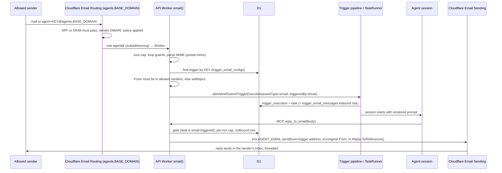

# Agent email addresses — first prototype

**Task:** 01M5J8R9VN49FEN19WCE16VZHN · **Branch:** `sam/giving-agents-email-addresses-16vzhn` · **Status:** draft PR [#2413](https://github.com/raphaeltm/simple-agent-manager/pull/2413); Astra's PR review addressed; staging end-to-end test passed on 2026-10-23 (see Notes); open question 5 waits on Raphaël

**Raphaël's constraints (2026-10-22):** plan first, get Astra High (profile `01M1P6Y4T0NANW8XGMHJHBS7AA`) to review the plan, build, ship to staging, test end to end, get Astra to review the PR. **The PR stays a draft. Do not merge it or mark it ready.** CI must be green.

## Problem

Agents can't receive or send email. Raphaël wants to give an agent an email address. Mail sent to that address starts an agent session, and the agent can answer by email.

## Prior design (what we already agreed)

The brainstorm was on 2026-05-21 (session `a9706d46-bcd2-4d3f-8366-2ee6556a0ab5`), recapped on 2026-07-15 (session `af33e708-edb3-4ac5-9443-935f9d404dd8`). It produced three linked ideas:

| Idea                                                                                  | Role                                                                                   |
| ------------------------------------------------------------------------------------- | -------------------------------------------------------------------------------------- |
| `01KS4X886T3NRKR3696H25A2AN` Cloudflare Email triggers and reply-capable SAM sessions | Phase 1: inbound email trigger. Phase 2: reply-only tool. Phase 3: profile-level send  |
| `01KS4X8CWMQFHYNJXJZ1MR7Q5M` SAM platform policy for MCP tool use                     | Enforces tool permissions on the server. Email reply/send is meant to be its first use |
| `01KS4Y3NV0Q51T0MQ6XG0GXD16` Provider interfaces for SAM subsystems                   | Email sits behind an `EmailProvider`. Cloudflare is the first implementation           |

Decisions Raphaël made explicitly (verbatim intent, from knowledge entity `Architecture`):

- Email is a trigger source. "You define a mailbox or something where the system defines one for you."
- A session started by an email may reply. Recipients are limited by default to the people on the original thread, plus addresses the user adds.
- Do not adopt the Cloudflare Agents SDK. Borrow its ideas only.
- Email goes behind a provider interface. Sending permission is enforced on the server by "SAM platform policy", never by prompt text.

## What this prototype covers (Phase 1 + a minimal Phase 2)

1. **Email trigger.** A new trigger type, `email`. When created, SAM assigns it an address: `agent+<key>@agents.<BASE_DOMAIN>`, for example `agent+k3j2h7m9q2xw4n8p@agents.sammy.party`.
2. **Inbound mail starts a session.** Email Routing delivers the message to the API Worker's new `email()` handler. The handler checks the message, then starts a normal trigger run through the existing `admitAndSubmitTriggerExecution` → `submitTriggeredTask` pipeline. The prompt is rendered from the trigger's template with new `{{email.*}}` variables.
3. **The agent can reply.** A new MCP tool, `reply_to_email`, works only in a task started by an email trigger. It sends exactly one recipient, the original sender, from the trigger's own address. It sets threading headers (`In-Reply-To`, `References`) and `Auto-Submitted: auto-replied`.
4. **The UI.** The Automation editor gets an **Email** start option with an "allowed senders" field. The trigger shows its address with a copy button.
5. **Deploy automation.** The deploy configures Email Routing and Email Sending for `agents.<BASE_DOMAIN>`. It does this only when the deploy token has the email permissions; otherwise the feature stays off.

### Deliberately NOT in this prototype (tracked as follow-ups in idea `01KS4X886T3NRKR3696H25A2AN`)

- **Continuing a thread in the same session.** Each inbound email starts a new session for now. Mail clients quote earlier messages, so the agent still sees the context.
- **Attachments.** Names, types and sizes are listed in the prompt. Contents are not stored.
- **Profile-level `send_email` to arbitrary addresses (Phase 3), and the generic SAM platform policy engine.** The reply tool hard-codes the one rule it needs. That rule is the first concrete requirement the policy engine must cover later.
- **Creating email triggers via MCP.** The MCP `create_trigger` allowlist stays as it is.
- **In-Worker DKIM verification.** This is a production gate; see Security.
- **Rotating an address, and showing rejected-email history in the UI.**

## Flow

## Research findings

### Cloudflare platform (checked 2026-10-22 against developers.cloudflare.com)

- **Email Routing (inbound)** is generally available and free. A rule can send mail to a Worker `email(message, env, ctx)` handler.
  - **Catch-all rules exist only on the zone apex**, not on subdomains.
  - **Subaddressing (RFC 5233) is supported.** With it on, `user+detail@` matches the `user@` rule, and `message.to` keeps the `+detail`. The setting is `support_subaddress`, changed via `PATCH /zones/{id}/email/routing`.
  - Up to 200 routing rules per domain. Up to 30 routing/sending domains per zone.
  - Inbound messages can be up to 25 MiB. `message.reply()` works only inside the handler, so it can't serve as the agent's later reply.
- **Email Sending (outbound)** is still **beta and needs Workers Paid**. 3,000 emails a month are included, then $0.35 per 1,000.
  - Binding: `[[send_email]] name = "..."`, then `env.X.send({ to, from, subject, text, html?, headers? })` returns `{ messageId }`.
  - `In-Reply-To`, `References` and `Auto-Submitted` are allowlisted headers. `Message-ID` is set by the platform.
  - At most 50 recipients and 5 MiB per message.
  - The sending domain or subdomain must be onboarded: `POST /zones/{id}/email/sending/subdomains`, then `GET .../{sid}/dns` lists the `cf-bounce` MX/SPF/DKIM and DMARC records to create.
- **Token permissions the deploy token needs** (none are in the self-host token list today): Zone → Email Routing Rules → Edit; Zone → Zone Settings → Edit (the zone's routing settings, including subaddressing); Email Sending → Edit. Zone DNS Edit is already present. Raphaël added all three to the staging deploy token on 2026-10-22.
- **(Superseded 2026-10-22: the deploy now turns routing on by naming the subdomain; see Notes.)** **Enabling routing is not something the deploy may do** (found in Astra's PR review): `POST /zones/{zone}/email/routing/dns` is documented as "Enable your Email Routing zone. Add and lock the necessary MX and SPF records", which writes and locks apex records. The only documented subdomain-only path is the dashboard (Email Routing → Settings → Subdomains), so an operator turns routing on for `mail.<BASE_DOMAIN>` once, by hand.
- **Workers do NOT see SPF/DKIM/DMARC results.** The Worker gets no `Authentication-Results`, and `ARC-Authentication-Results` has no verdicts. This is the open issue [cloudflare/workerd#6740](https://github.com/cloudflare/workerd/issues/6740), from May 2026. What we do know: Email Routing **rejects mail that fails both SPF and DKIM**, and mail that fails the sender domain's DMARC policy. A forged `From:` at a `p=none` domain therefore still gets through.

### Live infrastructure (read-only probes, 2026-10-22)

- **Staging** `sammy.party` (zone `ff189eb6d934a6c2b3f9f9595cafc256`):
  - Email Routing is `unconfigured` and `support_subaddress=false`.
  - There are no MX, SPF or DMARC records. `*.sammy.party` is a proxied CNAME to the API Worker. `mail.sammy.party` is unused.
  - The agents' read-only token gets `Authentication error` on routing rules and sending subdomains. Whether the **deploy** token has the email permissions is unknown; the deploy probe will log it.
- **Production** `simple-agent-manager.org`:
  - The **apex MX is `smtp.google.com` (Google Workspace)**. So the apex must never be touched, and apex catch-all routing is ruled out.
  - Email Routing is `unconfigured`. `mail.simple-agent-manager.org` is unused.

### Codebase

- **Trigger pipeline** (generic and reusable):
  - Admission: `apps/api/src/services/trigger-admission.ts:232` (`admitAndSubmitTriggerExecution`).
  - Submission: `trigger-submit.ts:83`.
  - The task ID equals the execution ID (`reserved-task-submission.ts:732-741`).
  - The incident trigger (`scheduled/incident-triggers.ts:310`) is the closest non-HTTP caller to copy.
- **Webhook trigger** is the template for source config: table `webhook_trigger_configs`, `services/webhook-trigger-store.ts`, `routes/trigger-webhooks.ts`, and the context builder in `webhook-trigger-payload.ts:118`. The source types are listed in:
  - `packages/shared/src/types/trigger.ts:12` (`TRIGGER_SOURCE_TYPES`) and `:33` (`TRIGGERED_BY_VALUES`);
  - `apps/api/src/schemas/triggers.ts:6`, which is hard-coded;
  - `services/trigger-create.ts:98-150`.
- **BLOCKER:** `task_submission_checkpoints.triggered_by` has a CHECK constraint, `('user','cron','webhook','github','incident','mcp')`, set in migration 0202 lines 47-49. Every trigger task writes this table. Migration 0202 already widened a CHECK on the same table: copy to a new table, rename the old one to an archive, recreate the indexes. No `DROP TABLE`, and nothing references this leaf table. **Plan:** do the same in migration 0204 to add `'email'`.
- **MCP:**
  - `tools/list` is static and unfiltered (`routes/mcp/index.ts:289`). All gating happens when a tool is called.
  - Templates to copy: `incident-tools.ts:34-62` (`requireTaskScope`) and `session-tools.ts:277`.
  - The token has a `taskId` and `projectId`. From the task ID, the tool reads the email provenance on the server.
- **Worker entry** `apps/api/src/index.ts:944` exports only `fetch` and `scheduled`. The file is exempt from the size check as existing tech debt; additions stay to about 3 lines.
- **Deploy config:** `scripts/deploy/sync-wrangler-config.ts` copies only an allowlist of binding kinds (`extractStaticBindings` `:408`, `getStaticApiWorkerBindings` `:1072`). The Artifacts auto-detect at `:455-515` is the precedent for a binding that is included only after a token probe.
- **Feature flag to the UI:** `GET /api/config/artifacts-enabled` (`index.ts:721`) is the precedent.
- **Runtime tunables** go in the admin settings registry, `services/admin-settings-registry.ts`. New scalar env vars are not allowed (`quality:runtime-tunables`), and the API Worker is close to its 340 text-binding limit.
- **Automation UI:**
  - Start kinds: `pages/automation/editor/steps-start-when.tsx` (`STARTS`), `editor/requests.ts:48,75`, `editor/state.ts`, `model.ts:30,197`.
  - `ui.tsx:42` (`START_META`) must list every kind, or `KindIcon` crashes.
  - `lib/automation-routes.ts:20`.
- **Run now / preview:** `routes/triggers/actions.ts` (`loadSourceConfig`) and `services/trigger-action-context.ts`.

## Design decisions (for review)

### D1. The address is a capability, plus a sender allowlist

- **Address format:** `agent+<key>@agents.<BASE_DOMAIN>`. The key is 16 random characters from Crockford base32 (lowercase), about 80 bits.
  - It is unique and stored in plain text, because users must be able to see it and every reply carries it in `From`.
  - This is the same trust model as webhook triggers, where the bearer secret is in the URL.
- **Allowed senders.** This is a required list of 1–20 exact addresses, lower-cased.
  - It defaults to the creator's account email.
  - The header `From:` mailbox must match an entry, or the handler calls `setReject("Sender not allowed")`. That rejection happens during SMTP, so it produces no backscatter.
- **Residual risk.** If the address leaks, someone can forge the `From` of an allowed sender whose domain has a weak DMARC policy. The Worker can't verify DKIM today. **Production gate:** verify an aligned DKIM signature in the Worker, or adopt Cloudflare verdicts once workerd#6740 is fixed. Tracked in the idea. Until then the PR stays draft and staging-only, as Raphaël asked.

### D2. Loop and abuse guards (inbound)

Each of these leads to a reject:

- `Auto-Submitted` present and not equal to `no`;
- `Precedence: bulk|list|junk`;
- a `List-Id` header;
- an empty or `MAILER-DAEMON`/`postmaster` envelope sender;
- `rawSize` above `agentEmail.maxInboundBytes` (default 5 MiB).

Outbound replies carry `Auto-Submitted: auto-replied` (RFC 3834). Vacation responders, and our own guard, therefore never answer them. This stops agent-to-agent ping-pong.

### D3. Reply tool: `reply_to_email`

- **Input:** `{ body: string }`, 1 to `agentEmail.maxReplyChars` characters (default 20,000). Plain text only.
- **Server-side gate:**
  - `tokenData.taskId` → the task row must have the caller's project and `triggered_by='email'`.
  - The task must have an accepted inbound `trigger_email_messages` row for its execution.
  - The trigger must still exist. A paused trigger may still reply; a deleted one may not.
- **Recipient:** pinned to the inbound `From`. Not `Reply-To`: honouring it would let one email point the agent at a third party. Reply-all is not supported.
- **Sender:** `From: "<trigger name>" <agent+key@mail…>`.
- **Subject:** `Re: <original subject>`.
- **Headers:** `In-Reply-To` is the original Message-ID. `References` is the original References plus its Message-ID, trimmed. `Auto-Submitted: auto-replied`.
- **Cap:** `agentEmail.maxRepliesPerRun` (default 5). It is enforced atomically: a conditional `INSERT … SELECT … WHERE (count) < cap` claims the outbound row, and the row is marked `sent` or `failed` after the provider call.

### D4. Provenance

`TRIGGER_SOURCE_TYPES` and `TRIGGERED_BY_VALUES` gain `'email'`. Migration 0204 widens the checkpoint CHECK, following the 0202 pattern. It also adds:

- `trigger_email_configs`: `trigger_id` (PK, FK cascade), `address_key` (UNIQUE), `allowed_senders_json`, timestamps.
- `trigger_email_messages`: metadata only, **no bodies**.
  - Columns: `id`, `trigger_id`, `project_id`, `trigger_execution_id`, `direction`, `status`, `reason`, `message_id`, `in_reply_to`, `references_header`, `from_address`, `to_address`, `subject`, `raw_size`, `provider_message_id`, `created_at`.
  - An inbound row is written once the email passes every check, before SMTP is answered (migration 0205 adds `payload_json`, `attempts`, `available_at` and `lease_token`; see "PR review outcome" below). It keeps what the prompt needs until the email is accepted or given up, then drops it. Mail refused by a check goes to structured logs only.

### D5. Provider interface (thin, concrete)

- `services/agent-email/provider.ts`: `interface AgentEmailSender { send(msg: OutboundAgentEmail): Promise<{ providerMessageId: string }> }`, with `createCloudflareAgentEmailSender(binding)`.
- `normalizeInboundEmail(raw, envelope)` returns a provider-neutral `InboundAgentEmail` via `postal-mime`. That is a new dependency: MIT, zero-dependency, and the parser Cloudflare documents for Workers.
- The trigger, the session model and the tools never touch Cloudflare types.

### D6. Feature availability

The Worker treats email as available when **the `AGENT_EMAIL` send binding is present**.

- `sync-wrangler-config.ts` adds `[[send_email]] name = "AGENT_EMAIL"` only when an email-permission probe with the deploy token passes. This matches the Artifacts precedent and fails closed.
- `GET /api/config/agent-email` returns `{ enabled, domain }` for the UI. Creating an email trigger while email is off returns 409 with a clear message.

### D7. Deploy step: `scripts/deploy/configure-agent-email.ts`

It is idempotent, runs before `sync-wrangler-config.ts`, and is unit-tested against a strict fake of the Cloudflare API. Superseded parts of the original plan are noted in "PR review outcome" below.

- **Probe.** If the token lacks routing or sending access, emit a `::notice` and do nothing.
- **(Superseded 2026-10-22, see Notes.)** **Routing must already be on for the subdomain.** The step never enables Email Routing. It checks that `agents.<BASE_DOMAIN>` has Cloudflare MX records (an operator enabled it in the dashboard) and otherwise skips with instructions.
- **Routing on by name (current).** When `agents.<BASE_DOMAIN>` has no Cloudflare MX records, the step calls `POST /email/routing/dns` with `{ name: "agents.<BASE_DOMAIN>" }`, never without a name (that enables the apex). The apex check runs straight after. In a zone new to Email Routing, Cloudflare also adds its SPF record and DKIM key at the apex, so that first deploy fails the check and the next completes (open question 5).
- **Configure:**
  - `PATCH /email/routing` to set `support_subaddress: true` when it is off;
  - upsert the literal rule `agent@agents.<BASE_DOMAIN>` → API Worker;
  - onboard the sending subdomain and create its DNS records, all under `agents.<BASE_DOMAIN>`.
- **Apex unchanged.** The apex's MX and SPF records are read before and after; any difference, including an addition, fails the deploy.
- **Marker only when sending works.** The marker (and so the send binding) is written only when Cloudflare reports the sending subdomain enabled, read after its DNS records exist. A subdomain still verifying is `pending`: the feature stays off until a later deploy.
- **Fail closed.** If the probe passed but configuration fails, the deploy goes red; it does not half-enable.

### D8. Tunables (admin settings registry)

- `agentEmail.maxInboundBytes` (5 MiB)
- `agentEmail.maxBodyChars` for the prompt (12,000)
- `agentEmail.maxReplyChars` (20,000)
- `agentEmail.maxRepliesPerRun` (5)
- Added during the build: the allowed-sender cap, the per-trigger hourly inbound limit, the loopback hourly limit, the processing lease, and (for durable intake) the attempt limit, retry backoff base and cap, and recovery batch size. All 12 are in `services/agent-email/setting-definitions.ts` and listed in the admin settings guide.

### D9. Run now / preview

- **Preview** renders the template with a sample email context.
- **Run now** returns 409 for email triggers: "Email triggers run when an email arrives." There is no inbound message to reply to.

### D10. Testing on staging without an external mailbox

- A superadmin-only **Admin → Agent email** card shows status (domain, enabled) and a **Send test email** form: From is any local part on the agent email domain, plus To, Subject and Body. It uses the same `AGENT_EMAIL` binding.
- Operators need it anyway to check deliverability. It lets the agent test the whole loop without a personal mailbox:
  1. The admin sends a test email to an email trigger whose allowed senders include the test From.
  2. A session starts.
  3. The agent replies by calling `reply_to_email`.
  4. The reply comes back in through Routing and is rejected by our `Auto-Submitted` guard. That rejection shows in `wrangler tail`, which proves delivery and the loop guard.
- Raphaël can then do a real acceptance test from his own inbox.

## Implementation checklist

- [x] Shared: add `'email'` to the source and provenance enums; add `EmailTriggerConfig`, `EmailTriggerConfigInput`, `EmailTemplateContext`, `CreateTriggerRequest.emailConfig`, `TriggerResponse.emailConfig`, and constants (address local part, key length, default limits)
- [x] Migration 0204: `trigger_email_configs` and `trigger_email_messages`, plus the checkpoint CHECK widening (0202 pattern); Drizzle schema; `pnpm quality:migration-safety`
- [x] Valibot: `sourceType` gets `email`; add `EmailConfigSchema` (allowed senders as lower-cased emails, 1–20)
- [x] `trigger-create.ts`: email validation and persistence (key generation; default allowed senders = creator email); 409 when email is unavailable
- [x] CRUD: attach `emailConfig` (address, allowed senders) in `enrichTrigger`; PATCH can update allowed senders
- [x] Inbound: `services/agent-email/inbound.ts` (parse, guards, lookup, allowlist, per-trigger rate limit, Message-ID dedup/lease, explicit admission outcomes) and the `email` export in `index.ts`
- [x] Context and template: `buildEmailContext` (`email.from/to/subject/text/receivedAt/messageId/attachments`); default prompt template; preview sample; Run now 409
- [x] Provider: `AgentEmailSender` plus the Cloudflare implementation; `Env.AGENT_EMAIL?: SendEmail`
- [x] MCP `reply_to_email`: definition, handler, dispatch, gate, pinned recipient, headers, atomic cap, audit row
- [x] Admin settings: `agentEmail.*` entries (max inbound bytes, max body chars, max reply chars, max replies per run, inbound per trigger per hour)
- [x] `GET /api/config/agent-email`; admin status + fixed loopback test (superadmin route + UI card; loopback receipt recorded in KV)
- [x] Deploy: `configure-agent-email.ts` (+ test) runs BEFORE `sync-wrangler-config.ts` and writes a marker; `sync-wrangler-config.ts` generates the `AGENT_EMAIL` send_email binding only from the marker (+ test); `agent_email` staging-only dispatch input on `deploy-staging.yml` → `deploy-reusable.yml`
- [x] Web: Email start kind across `automation-routes`/`model`/`ui`/`state`/`requests`/`steps-start-when`; allowed-senders field; address display with copy button; variable hints; hidden when email is unavailable
- [x] Docs: `apps/www` automation guide (email triggers); `self-hosting.mdx` optional email permissions; API reference
- [x] Tests (detailed under Acceptance criteria) and a Playwright visual audit of the editor and trigger detail at 375 and 1280 px

## Acceptance criteria

- [x] An email to an email trigger's address from an allowed sender starts exactly one task. The rendered prompt contains the sender, subject and body. Covered by a vertical-slice test through `handleInboundEmail` with real SQLite D1 and the real admission code, plus staging.
- [x] Mail from a sender not on the list, to an unknown or deleted key, auto-generated, list mail, or oversized mail is rejected, and no task is created. Each case is tested, and each test also asserts that the allowed path still works.
- [x] `reply_to_email` sends exactly one recipient (the original `From`) from the trigger address, with `In-Reply-To`/`References`/`Auto-Submitted`. It refuses non-email tasks, tasks from another project and deleted triggers. It enforces the per-run cap atomically. Tested against real SQLite, with a fake send binding that enforces the Cloudflare contract.
- [x] With no binding, or a token that lacks permissions, the deploy leaves email off, and the UI hides the Email option.
- [x] With the permissions, the deploy turns routing on for `agents.<BASE_DOMAIN>` by name, never for the apex, then sets subaddressing, the rule and the sending subdomain. Any change to the apex MX/SPF records (including an addition) fails the deploy. The send binding ships only once sending is verified. Tested against a strict fake of the CF API, including Google-MX, SPF-only and empty apexes. The fake models what staging showed: the first enable in a zone adds Cloudflare's SPF and DKIM at the apex, so a zone new to Email Routing fails its first deploy (open question 5).
- [x] An email that passes the checks is stored before SMTP is answered. A failed or crashed start is retried by SAM from storage, on the same trigger execution, with a fenced lease, exponential backoff and a give-up alert. Tested through the real handler and the real recovery sweep against SQLite.
- [x] Staging, end to end (2026-10-23, see Notes):
  1. Create an email trigger in the UI.
  2. Send a test email to it.
  3. A session starts.
  4. The agent replies with the tool.
  5. The reply is delivered back through routing, and the loopback status records it as `Auto-Submitted`.
- [x] CI is green, and Astra has reviewed the plan and the PR. (The PR stayed a draft until Raphaël approved merging on 2026-10-23.)

## Admin-run setup (2026-10-23, Raphaël: "Do it")

Answers open question 5. The deploy prepares everything that stays under `agents.<BASE_DOMAIN>`;
an admin turns agent email on from the admin panel, after seeing what Cloudflare will add to the
main domain.

### Checks done first

- **Send binding before the sending domain verifies.** The Workers send API defines send-time
  errors `E_SENDER_NOT_VERIFIED` and `E_SENDER_DOMAIN_NOT_AVAILABLE`, so the sender is checked when
  mail is sent, not at deploy. The deploy may add the binding while Cloudflare verifies.
- **Email Sending and the main domain.** Cloudflare's domain configuration page: Email Sending
  "creates DNS records on a `cf-bounce.` subdomain ... separate from the records used by Email
  Routing", and "Email Routing DNS records are configured on the root domain". Staging agrees:
  onboarding sending for `agents.sammy.party` left `sammy.party` unchanged. A live second-subdomain
  test was skipped: `sammy.party` already uses Email Routing, so it cannot show a zone new to it,
  and Cloudflare keeps sending records locked for the life of the configuration.

### Design

- **Deploy** (`configure-agent-email.ts`), only when the preview input is on and the token has the
  three permissions: onboard Email Sending for `agents.<BASE_DOMAIN>`, create its records (all under
  the subdomain), check the apex is unchanged, and write the marker. It never calls an Email
  Routing endpoint. `sync-wrangler-config.ts` then adds the `AGENT_EMAIL` send binding and an
  `AGENT_EMAIL_WORKER_NAME` var (the routing rule's target), even while sending still verifies.
- **On-switch:** a `platform_settings` row (`agent_email.setup`) that only the admin setup writes.
  Agent email is on only when the binding exists and that row names the current domain. Every
  check that read "binding present" reads this instead. (The per-isolate cache planned here was
  removed in Astra's admin-setup review, item A3: every check reads the D1 row.)
- **Admin setup** (`GET`/`POST /api/admin/agent-email/setup`, superadmin), run by the Worker with its
  `CF_API_TOKEN` (the same token as the deploy):
  - **Plan:** whether the zone already uses Email Routing, whether the subdomain's routing is on,
    whether sending is verified, and the main-domain records Cloudflare will add.
  - **Refuse** a zone new to Email Routing whose main domain already has MX or SPF records (what Cloudflare does to them is untested live).
  - **Consent:** in a zone new to Email Routing with a clean main domain, the admin must confirm the
    SPF record and DKIM key Cloudflare will add.
  - **Run:** turn routing on for the subdomain by name, check the main domain changed exactly as
    disclosed, turn on subaddressing, point the `agent@` rule at this Worker, then write the row.
- **Existing deployments:** staging already has routing configured by older deploys. After this
  change it stays off until an admin presses Enable once; the plan then needs no consent.
- **Production** stays off: its deploy never prepares agent email, so it has no binding.

### Checklist

- [x] Shared types for the setup plan and status
- [x] Deploy step prepares only, writes the marker while sending verifies; tests prove it never calls a routing endpoint
- [x] `sync-wrangler-config.ts` adds `AGENT_EMAIL_WORKER_NAME` with the binding; tests
- [x] Setup row store and the on-switch `isAgentEmailOn` (uncached since Astra's review); every former caller of the removed `isAgentEmailAvailable`, and the senders, now call it
- [x] Setup service and admin routes; tests against a strict fake Cloudflare (consent, refusal, unexpected apex change, pending MX, idempotent re-run, sending still verifying)
- [x] Vertical slice: binding present but not set up refuses inbound mail, replies and email automations
- [x] Admin panel: plan, consent and result states; component tests; Playwright audit at 375 and 1280
- [x] Docs: self-hosting, email triggers, API reference
- [x] Staging: deploy, admin Enable, loopback end to end, cleanup (at `4257c67da`; see the notes log.
      Later heads were deployed and checked, but their setup-run changes cannot be re-run once a
      zone is on)

### Implementation notes (2026-10-23)

- **Staging's zone flag.** With routing on for `agents.sammy.party` only, `GET /email/routing` reads
  `enabled: true, status: misconfigured` (no apex MX); the apex holds only Cloudflare's SPF record
  and the locked `cf2024-1._domainkey` key. So "the zone uses Email Routing" is read from that flag,
  and a re-run after `pending` plans `ready` without asking for consent again.
- **Main-domain check after enabling.** The apex may gain the disclosed SPF record and nothing else,
  and lose nothing. Gaining less than disclosed is accepted (a zone that used routing before gets
  nothing new). A failed check leaves agent email off and names what changed; Cloudflare has made
  the change by then, so running the setup again turns agent email on with the records as they are.
- **Cache (superseded).** This first version cached a present record for 60 s. Astra's admin-setup
  review (item A3) removed the cache: every check reads the D1 row. A missing or unreadable row
  turns agent email off at once. If D1 cannot be read, the read throws: the gates fail rather than
  proceed, and `GET /api/config/agent-email` reports agent email as off.
- **Errors.** Refusals and an unexpected main-domain change are `409`; a failed Cloudflare call is
  `502 CLOUDFLARE_ERROR` with Cloudflare's code and message.
- **Request budget.** A setup run in a zone new to Email Routing makes about 15 round trips (one D1
  read and write, the rest Cloudflare reads and writes, each a precondition the safety check
  needs). It is a one-time superadmin action, not a request path; the plan reuses what it read so
  the run does not read it again.
- **Runtime tunables.** `AGENT_EMAIL_WORKER_NAME` is a bootstrap exception: the deploy generates it
  with the binding, and an admin-editable value would route agent mail to another Worker.
- **Discrimination.** Each guard was reverted on its own and exactly its test went red: consent,
  the main-domain check (added and removed sides separately), refusal, rule matching, rule
  pagination, subaddressing, the zone-uses-routing branch, pending, binding, domain match, cache,
  outage handling, and in the panel the consent gate, the consent flag, the config write, the
  re-read after an error, and not reading the plan once on.

### Astra's review of the admin setup — task `01M5KVX8KDJ8VHKS3AY86SG7YP`, 2026-10-23

Review of `f830eeedc..0e64f921d` ([PR comment](https://github.com/raphaeltm/simple-agent-manager/pull/2413#issuecomment-6360290640)); Astra's runs passed 74/74 (API) and 20/20 (deploy).

1. **BLOCKER, fixed.** Two overlapping setups: the second saw the subdomain's new MX records,
   skipped the main-domain check and turned agent email on while the first rejected an unlisted
   apex MX; `pending` and retry paths dropped the original baseline. Now a run stores the main
   domain's MX/SPF records and the allowed additions in an attempt row
   (`agent_email.setup_attempt:<domain>`, first writer wins, compare-and-set to replace) before it
   changes anything. Every run, concurrent or later, plans and checks against that baseline; a
   difference makes the plan `changed`, which needs consent to the listed differences. Consent is
   bound to the plan by a SHA-256 `consentToken`, so consent given to one set of changes cannot
   carry over to another. Completing writes the on-switch and deletes the attempt in one batch.
   Tests reproduce the race with a held enable call (`agent-email-setup.test.ts`), plus a lost
   claim, a retry after `pending`, after a failed check, and after a late Cloudflare failure.
2. **OK.** Multiset comparison; `enabled: true` is read only to decide whether consent is needed,
   never to skip the check.
3. **SHOULD-FIX, fixed.** The per-isolate cache is gone: every gate reads the D1 row, so an outage
   fails the gates and an unreadable row is off at once. The readers are not per-request paths;
   the public config endpoint stays HTTP-cached.
4. **SHOULD-FIX, fixed.** DNS lists asked for 100 records. Both the API client and the deploy step
   now request Cloudflare's documented `per_page` maximum (5,000,000) and fail when
   `result_info.total_count` exceeds what was returned; both fakes paginate and report counts.
5. **SHOULD-FIX, fixed.** Subaddressing is zone-wide, so when it is off the plan lists it as a
   `zoneChanges` entry that needs consent; the panel no longer says nothing changes.

### Astra's re-review — task `01M5KYCPB2CXM6SKTHKNSC1G0E`, 2026-10-23

Review of `0e64f921d..f33329d45` ([PR comment](https://github.com/raphaeltm/simple-agent-manager/pull/2413#issuecomment-6360985212)); Astra's runs passed 91/91 (API) and 21/21 (deploy), and its two extra checks reproduced items 1 and 2.

1. **BLOCKER, fixed.** Runs sharing an attempt could still interleave: B passed its check, a
   delayed A then enabled routing and rejected an unlisted MX, and B finished and deleted the
   baseline. The attempt now carries a lease (`owner`, `leaseUntil`): a run takes it before
   changing Cloudflare and releases it on every exit except success, so one run at a time changes
   Cloudflare. Completing is conditioned on still owning the stored attempt, in one D1 batch
   (`INSERT ... SELECT ... WHERE EXISTS` plus a conditional `DELETE`), so a run whose lease lapsed
   and was taken over cannot turn agent email on. The lease is 20 Cloudflare API timeouts (10 min
   by default) and only lapses on its own if a Worker died mid-run.
2. **SHOULD-FIX, fixed.** Listed MX records keep their priority, which the panel shows and the
   consent token covers.
3. **OK** (cache removal). 4. **OK** (complete-or-fail DNS listing).
4. **SHOULD-FIX, fixed.** A zone change allowed for a run that stopped before making it stays
   listed (`allowed: true`), in the ready state too, without asking for consent again.

- Also fixed after staging deploy 39925606556 failed with "Cloudflare listed 0 of an unknown
  number of MX records": the deploy's `toEnvelope` dropped `result_info`. It keeps the counts now,
  and the deploy test's fake passes every answer through `toEnvelope`.

### Astra's verification — task `01M5M028GMDN071B6PMWJS9Q53`, 2026-10-23

Review of `f33329d45..4257c67da` ([PR comment](https://github.com/raphaeltm/simple-agent-manager/pull/2413#issuecomment-6361491393)).

1. **BLOCKER, fixed in `c7df05425`.** The lease's expiry was enforced only when a run started. The
   lease moved to `setup-lease.ts` (`SetupLease`). It is renewed by compare-and-set right before
   every Cloudflare write, and a renewal refuses once the lease lapsed or another run changed it.
   Completing also requires a live lease.
2. **SHOULD-FIX, fixed in `c7df05425`.** Attempt rows stored before the lease existed were
   unreadable. `owner` and `leaseUntil` now read as null when absent, and the exact stored text is
   kept for compare-and-set.

### Astra's verification — task `01M5M1Q7XVQD62XR8KJ1F6S42S`, 2026-10-23

Review of `4257c67da..c7df05425` ([PR comment](https://github.com/raphaeltm/simple-agent-manager/pull/2413#issuecomment-6361954833)); Astra's runs passed 98/98, and its two extra checks reproduced items 1 and 3.

1. **BLOCKER, fixed.** The run renewed its lease before listing the routing rules, so a run whose
   listing stalled past its lease could still create or repoint the rule after another run
   finished. `ensureRoutingRule` now takes a `beforeWrite` callback and calls it after the listing,
   right before its one write; the run passes `lease.renew()`.
2. **OK** (legacy attempt rows).
3. **BLOCKER, fixed.** Completion compared the lease against the Worker's clock, read before the D1
   batch, so a batch that reached D1 after the lease lapsed still turned agent email on and dropped
   the baseline. The batch's first statement now decides with D1's own clock
   (`julianday('now')`) and marks the attempt as finishing; the on-switch insert and the attempt
   delete key on that mark, so one decision governs both. The mark contains the run's lease owner,
   and an attempt without an owner cannot complete.

- Tests: "renews after listing the rules…" (create and repoint), "decides the lease by the
  database clock…" (the run's clock an hour behind D1's), and in `agent-email-setup-state.test.ts`
  "lets no attempt complete without a lease owner…". Each fix reverted on its own reddens exactly
  its tests: the renewal (the two rule-write cases), the D1 clock (the clock case), and the owner
  guard (the owner case).
- Also fixed, same class (found while checking the fixes, before Astra's next verification):
  `renew()` stamped the new lease from the Worker's clock before its own D1 write, so a renewal
  whose write returned late could leave the next Cloudflare write with little or none of the
  lease left. It now refuses unless at least half the new lease remains when the write returns.
  Test: "stops before its next Cloudflare change when renewing the lease stalled" (the first
  renewal's write returns six minutes late); removing the check reddens exactly that test.
- Also fixed: the Validate Deploy Scripts CI job had failed since `87c336d7c`. `configure-agent-email.ts`
  imports `packages/shared/src/dns-mail-records.ts`, outside the deploy tsconfig's `rootDir`
  (TS6059). That config does not emit, so its `rootDir` is now the repository root (`a7c83f31e`).

## Open questions for review

1. Is the capability address plus allowlist acceptable for a staging-only prototype, with DKIM verification as the production gate? Or must DKIM land in the prototype?
2. Should we widen `triggered_by` with the 0202 table swap, or reuse `'webhook'` for the prototype to avoid the migration?
3. Is the superadmin "Send test email" acceptable as a lasting diagnostic, or should it be avoided?
4. Is subaddressing (`agent+key@`) acceptable, versus a literal routing rule per address created at runtime (`key@`)? The latter needs a runtime token with Email Routing write, and is capped at 200 rules per domain.
5. **Open, for Raphaël (asked 2026-10-22).** The first time Email Routing is turned on in a zone, Cloudflare adds its SPF record (an ordinary, editable record) and a locked DKIM key (`cf2024-1._domainkey`) to the main domain, whichever subdomain is named. The deploy's apex check refuses that, so today a zone new to Email Routing fails its first agent email deploy and completes on the next. What it does to a main domain that already has an SPF record (production's Google Workspace) is unverified; a second SPF record would break SPF there. Options: (a) the deploy accepts exactly Cloudflare's records on a main domain without mail, and merges Cloudflare's `include:` into an existing SPF record; or (b) agent email stays off until an admin opts in with a deploy setting. The fresh-zone test in `scripts/quality/deploy-agent-email.test.ts` and the docs' "known preview limitation" change with the answer. Astra's final review rates today's behaviour a blocker and recommends (b), with automatic SPF merging left until a zone with its own SPF record has been tested.

## Plan review outcome — Astra High, task `01M5J9WS98ZJ4P7RTPJWYGCH2S`, 2026-10-22

**Verdict: approve with changes.** SAM returned only the tail of the review. These changes come from its summary and the findings that were readable. They supersede the matching parts of D1–D10 above.

1. **BLOCKER: binding presence is not readiness.** Previously, D6 shipped the binding before D7 had configured anything.
   - **Change:** `configure-agent-email.ts` now runs **before** `sync-wrangler-config.ts`. It writes `.wrangler/agent-email-domain` only after routing, subaddressing, the rule and sending have all been verified.
   - `sync-wrangler-config.ts` generates the `[[send_email]] AGENT_EMAIL` binding only from that marker. The binding is not declared at the top level, so Wrangler never sees a top-level binding that is missing from an environment.
   - Creating triggers, ingesting mail and sending replies are all gated on the binding.
2. **SHOULD-FIX: durable inbound deduplication and recovery, and explicit admission outcomes.**
   - **Change:** each inbound row has a unique `(trigger_id, message_id)` and a `processing` → `accepted`/`rejected`/`failed` status, with a lease.
   - A retried delivery of an accepted message is acknowledged without starting a second task. A `failed` row, or a stale `processing` row, is retried.
   - Each admission result maps to an explicit outcome: submitted → accept; skipped (paused or concurrency) → `setReject` with a plain reason; a submission error → throw, which is a temporary SMTP failure so the sender's server retries.
   - A message with no `Message-ID` is rejected.
   - **Superseded by the PR review (B1, B3):** a submission error no longer throws. The email is stored before SMTP is answered and SAM retries it from storage; see "PR review outcome" below.
3. **SHOULD-FIX: loopback must use a routed sender.**
   - **Change:** the diagnostic is now a fixed, bounded **loopback**. It sends a fixed test message from the routed address `agent+loopback@mail.<BASE_DOMAIN>` to one existing email-trigger address.
   - Mail arriving at `agent+loopback@` is recorded as loopback status (KV) and nothing more.
   - There is no free-form From, To or body. It is superadmin only and rate-limited.
4. **SHOULD-FIX: apex protection must be unconditional.**
   - **Change:** every DNS write the deploy step makes must be `mail.<BASE_DOMAIN>` itself or a name under it, or the step throws.
   - Pre-existing apex MX records are compared before and after, whatever the zone's routing state.
   - **Tightened by the PR review (B2):** the step no longer enables routing at all, and any apex MX/SPF difference, including an addition, fails the deploy.
5. **SHOULD-FIX: staging-only activation.**
   - **Change:** a new boolean input `agent_email` on `deploy-staging.yml`, default `false`, is passed to `deploy-reusable.yml`. The configure step only attempts setup when it is true.
   - `deploy.yml` (production) never sets it. Production therefore cannot activate agent email until in-Worker sender authentication lands.
6. **SHOULD-FIX: input and header validation.**
   - **Change:** strict parsing of `Message-ID`, `In-Reply-To` and `References`: angle-bracket IDs only, with a count cap and a length cap.
   - CR/LF are stripped from every value placed in outbound headers or the subject. The subject length is capped. Display names are sanitized.
7. **SHOULD-FIX: bounded abuse controls.** **Change:** a per-trigger inbound rate limit in KV, admin setting `agentEmail.inboundPerTriggerPerHour` (default 20). Failed send attempts also count against the per-run reply cap.
8. **SHOULD-FIX: migration needs populated-upgrade coverage.** **Change:** a migration test applies 0204 to a database that already holds checkpoint rows. It asserts that every row and index survives, that `'email'` is accepted and that an unknown value is still rejected.

**Answers to the open questions:**

1. Defer DKIM, but for isolated staging only. It stays a production gate.
2. Widen `triggered_by` using the 0202 pattern.
3. A narrow loopback only.
4. Keep subaddressing.

## PR review outcome — Astra High, task `01M5JJJCX7XF7TY9QHWE2QBHAF`, 2026-10-22

Review of `f633d9b41` ([PR comment](https://github.com/raphaeltm/simple-agent-manager/pull/2413#issuecomment-6349941893); it cites the pre-rewrite hash `2f00dbf29` of the same tree). Three blockers and four should-fix items, all addressed:

1. **B1: a takeover did not resume the reserved execution or fence the old attempt.** A crash between reserving the execution and creating the task left an orphaned queued execution holding the run slot, and a slow attempt could overwrite its successor.
   - **Fix (`b26f33979`):** the stable execution id is created with the inbound row. `admitAndSubmitTriggerExecution` takes a caller-assigned `executionId` and resumes it (a failed one is requeued), and submission converges per execution id. Each attempt holds a lease token, and every write it makes to the row is fenced on that token.
2. **B2: apex protection checked after the mutation, and allowed additions.**
   - **Fix (`d369e70b0`):** the deploy never calls the zone-level enable endpoint. Routing for `mail.<BASE_DOMAIN>` is a one-time dashboard step. Any apex MX/SPF difference, additions included, fails the deploy; empty, SPF-only, Google and Cloudflare apexes are all tested unchanged.
3. **B3: "a throw is a temporary SMTP failure" was never established.**
   - **Fix (`b26f33979`):** the handler no longer relies on it. An email that passes the checks is stored with its prompt input before SMTP is answered (migration 0205), and SAM retries it from storage in the 5-minute cron (`agent-email/recovery.ts`), with exponential backoff, an attempt limit, a give-up error log and an operator alert. The handler throws only when that store fails, before SAM owns the email.
4. **S4: a failed acceptance write blocked replies.**
   - **Fix (`b26f33979`):** `reply_to_email` finds the inbound email by the task's execution id, not by its status. The sweep repairs the status once the lease expires.
5. **S5: the readiness marker was written while sending was still verifying.**
   - **Fix (`d369e70b0`):** sending status is read after the DNS records exist. A verifying subdomain is `pending` and writes no marker, so nothing is advertised until a later deploy finds it enabled.
6. **S6: `References` could exceed Cloudflare's 2,048-byte header limit.**
   - **Fix (`d4a0e41ac`):** the oldest IDs are dropped until the value fits in UTF-8 bytes, always keeping the current Message-ID; the fake send binding measures bytes.
7. **S7: the UI implied verified senders and did not say the address must stay private.**
   - **Fix (`95ba7ad7a`, `0b4fc7969`):** the copy says senders are matched by From address, that SAM cannot verify the sender yet, and to keep the address private.

### Re-review — Astra High, task `01M5JP7DXCF0CDV4QCHF72BK91`, 2026-10-22

Review of `142d1463a` ([PR comment](https://github.com/raphaeltm/simple-agent-manager/pull/2413#issuecomment-6351355936)): findings 2–7 fixed, finding 1 incomplete. One blocker and two should-fix items, all addressed:

1. **BLOCKER: the email lease did not fence execution writes or late task creation.**
   - A slow attempt could pass `beforeSubmit`, lose its lease, and create its task after the email was given up and another email took the slot.
   - An old attempt could mark a newer owner's unlinked execution failed.
   - **Fix:** admission's requeue and failure writes require the attempt's `emailLease`.
   - The trigger task insert refuses an execution whose inbound email is rejected, in the same statement.
   - Rows that hang off the task (status event, checkpoint, execution link) are written only with the task. A refused insert raises an explicit error instead of relying on foreign keys; the SQLite test schema has none.
2. **SHOULD-FIX: giving up did not reconcile the task or the execution.**
   - **Fix:** every rejection goes through `closeDelivery`, one batch:
     - it accepts the email if its task exists;
     - otherwise it rejects the email and fails an execution its attempts left `queued`, releasing the run slot without waiting for the stale-execution cleanup.
3. **SHOULD-FIX: a hung submission could stall the sweep, and alerts waited for the batch.**
   - **Fix:** the sweep waits for one attempt at most its lease, then moves on.
   - Operators are alerted as soon as an email is given up: before the batch for exhausted emails, and right after an in-batch give-up.
   - The alert test now checks delivery to an operator at the NotificationService boundary, not a KV key.

Every new guard was proven discriminating. Test teardown now restores spies and timers, so one failing test cannot cascade into the next. The GitHub inbox has the same pre-existing late-task race: `tasks/backlog/2026-10-22-github-trigger-late-task-after-exhaustion.md`.

### Verification — Astra High, task `01M5JS6YCDW8Y88P0DPN0S68QN`, 2026-10-22

Review of `4e4bca278` ([PR comment](https://github.com/raphaeltm/simple-agent-manager/pull/2413#issuecomment-6352072371)). R2 and R3 fixed; Astra's run of the two test files passed 74/74. R1 was not fully fixed. One should-fix item remained:

- **SHOULD-FIX: the first reservation of an email's execution was unfenced.** An attempt that stalled before reserving could reserve after the email was given up. That left a `queued` execution holding the run slot until the stale-execution cleanup.
  - **Fix (`ace021f86`):** the reservation insert requires the attempt's email lease. A reservation refused for that reason returns a failed admission, and nothing is recorded as skipped.
  - **Test:** an attempt paused just before its reservation batch; the email given up; the attempt resumed. Nothing is reserved, and the trigger's next email gets the slot. Removing the lease condition, or the lost-lease branch, fails exactly this test.

The reviewer's session went to sleep after posting instead of completing its task, so the durable wait never fired; the result was found on the PR.

### Final review — Astra High, task `01M5K7GQY79T253AVX9QWJ1WHN`, 2026-10-23

Review of `ace021f86..a95d42851` and the staging end-to-end evidence ([PR comment](https://github.com/raphaeltm/simple-agent-manager/pull/2413#issuecomment-6355578077)). Astra's run of the deploy suite passed 22/22.

1. **BLOCKER: the deploy cannot promise apex isolation in a zone new to Email Routing.** The named enable still turns zone-wide routing on and adds Cloudflare's SPF and DKIM at the apex. The checks stop that run but cannot undo the change, and a retry accepts the changed baseline. Astra's fix: gate that first enable, before the call, on an explicit opt-in. **Open:** this is open question 5, for Raphaël.
2. **OK:** the 81058 tolerance covers only DNS record creation and that one code; 81053 and other errors still fail, with no retry loop.
3. **NIT (fixed):** the staging workflow's `agent_email` input still said `mail.BASE_DOMAIN`.
4. **SHOULD-FIX (fixed): the 81058 test leaned on the fake folding whitespace and case,** which no staging evidence supports.
   - The fake now equates only a TXT value stored as quoted strings with the joined value, which is what deploy run 39882259188 showed.
   - The 81058 test now has the identical record appear between the step's lookup and its create.
   - An unrelated create error (403, code 10000) still fails the deploy, beside the 81053 control.
   - The deploy step itself lowercased TXT payloads before comparing, so a DKIM key differing only in case counted as present. TXT payloads now compare byte for byte once joined, and a test covers the case-only difference.
   - Each guard was removed once and turned exactly its own tests red.

Astra's recommendation for question 5: an explicit admin opt-in before the first enable in a zone new to Email Routing, with no dashboard step. Automatic SPF merging should wait until a zone with its own SPF record has been tested.

## Notes / log

Commit hashes written before 2026-10-23 04:30Z are from before the rebase onto `main`; the PR description maps them to the rebased commits.

- 2026-10-22: Research complete. Astra plan review: approve-with-changes (above). Building with those changes.
- 2026-10-22: API, deploy and docs built and pushed (commits b04d612d8, 3aeacb6e5, 874bd6f96, ed1eddcfb, ee02e4134).
- 2026-10-22: Security review (0 critical, 1 high, 2 medium, 2 low) fixed in 46a6b900b and e73f6a4e3: delivery lease and takeover that never starts an email twice; a submitted email whose bookkeeping fails reports success; unparseable mail rejected; loopback sender check and rate limit; linear-time HTML to text (the regex version went quadratic on hostile markup, and bounding its input dropped the text of mail with long styles); DMARC advice in the docs.
- 2026-10-22: Cloudflare review (1 high, 3 medium, 2 low) fixed in e73f6a4e3: apex guard covers MX and SPF, fails on any change to existing records or a non-Cloudflare addition, reports Cloudflare additions; reports a still-verifying sending subdomain; `addresses` comment; docs. Open: confirm the Email Sending permission's scope in the token picker, and what Cloudflare does after a thrown `email()` handler (verify on staging, then update the comment in `inbound.ts`).
- 2026-10-22: Staging blocked on the deploy token's email permissions (run 39823114470 logged Zone Settings 403). Asked Raphaël to add them; waiting.
- 2026-10-22: UI committed (4be1e4c08): Email start hidden when agent email is off (the builder had shown it disabled; hidden matches the plan and keeps production free of an unusable option), address + copy on the automation page, admin panel with loopback test and Refresh. Web 4,486/4,486, Playwright 14/14 at 375 and 1280 px; screenshots opened and checked.
- 2026-10-22: Reviews: constitution (1 medium fixed), doc sync (1 medium + 1 low fixed; it also led to fixing MCP update_trigger clearing webhook/email profiles), task-completion validator PASS (no critical/high).
- 2026-10-22: Test review (2 high, 1 medium, 1 low) and UI review (3 low) addressed in 0fd6559d9, ac7f1e0a3 and 4a00e8ca1.
- 2026-10-22: Draft PR #2413 opened. The branch history was rewritten once to rename identifiers that gitleaks flagged as generic API keys (`KEY_ALPHABET` and test fixtures); hashes above are the current ones.
- 2026-10-22: Raphaël confirmed the three token permissions. Astra's PR review (above) addressed in d4a0e41ac, 95ba7ad7a, 0b4fc7969, d369e70b0 and b26f33979; give-up alert asserted in 142d1463a. API suite at b26f33979: 13,170 passed, 0 failed, 2 skipped (925 files). Staging needs the one-time dashboard step for `mail.sammy.party` before the end-to-end test.
- 2026-10-22: Raphaël: self-hosters must not need a dashboard step. Research: Cloudflare support (quoted in cloudflare/terraform-provider-cloudflare#5890) says `POST /zones/{zone}/email/routing/dns` with a subdomain `name` configures that subdomain, while no body enables the apex. The deploy step went back to making that call (a56ed3346).
- 2026-10-22: Staging test (deploy run 39866499256 @a56ed3346), from DNS snapshots before and after:
  - **Intended:** the call configured `mail.sammy.party`: 3 locked MX records and an SPF record. The subdomain status is `ready`.
  - **Unintended:** it also turned Email Routing on for the whole `sammy.party` zone, which is now `misconfigured` because the apex has no MX. It added an apex SPF record (`v=spf1 include:_spf.mx.cloudflare.net ~all`) and an apex DKIM record (`cf2024-1._domainkey.sammy.party`).
  - The apex guard caught the SPF change and failed the deploy before anything else ran, so no Worker was deployed.
  - Cloudflare's domain-configuration docs say Email Routing records live on the root domain, and an existing SPF must be merged rather than duplicated.
  - The agents' Cloudflare token cannot remove these records.
- 2026-10-22: Raphaël: agent email always lives on a dedicated `agents.<BASE_DOMAIN>` subdomain. Renamed from `mail.` (shared and deploy constants, tests, docs, UI evidence).
- Open question to Raphaël: for a main domain that has its own mail (production's Google Workspace), should the deploy merge Cloudflare's SPF entry into the existing SPF record, or leave agent email off there until an admin opts in? Now open question 5, which also covers zones new to Email Routing.
- 2026-10-23: Deploy run 39882794526 (`a75043bcc`, `agent_email=true`) configured `agents.sammy.party`: routing turned on by name (3 locked MX records and an SPF record), subaddressing, the `agent@` rule, and Email Sending (`cf-bounce` MX/SPF/DKIM and `_dmarc` records). The apex was unchanged during the run, because the earlier `mail.` attempt had already turned routing on for the zone.
- 2026-10-23: Staging end-to-end test passed, as the smoke user in Test Project 1 (`.tmp/staging-agent-email-e2e.cjs`, not committed):
  - Created an email automation through the UI with the Claude MCP Test profile (trigger `01M5K6CHHAFVKJYFSMBK5F1CVZ`, address `agent+er78z8jx245bfdtt@agents.sammy.party`, allowed senders `agent+loopback@agents.sammy.party` and the smoke user), with no console errors.
  - Sent the admin loopback test at 01:38:13Z. The inbound row was stored and `accepted` at 01:38:14Z; execution `01M5K6H7AFBTVTNEPTN6JH1W75` (`eventType: email`) started task `01M5K6H7AFBTVTNEPTN6JH1W75` with `triggered_by = 'email'` and the rendered email prompt.
  - The agent called `reply_to_email`: the outbound row is `sent` to `agent+loopback@agents.sammy.party`, subject `Re: SAM agent email loopback test …`, `References` = the inbound Message-ID, provider Message-ID `<j8L0f2bHXvgUaqwzMByAbJ3xzhrr2se8Yi5I@agents.sammy.party>`, at 01:45:18Z. The task completed.
  - The reply came back through Email Routing: Admin → Integrations → Agent email shows **Last reply received** at 01:45:18Z from the automation's address, `Auto-Submitted: auto-replied`, `In-Reply-To` = the inbound Message-ID.
  - Cleanup: deleted the automation (its config and message rows went with it), the workspace and the node. No VM nodes are live on staging.
  - Finding: the profile is Instant (`cf-container`), but the run provisioned a Hetzner VM. Every trigger type does this; it predates this PR. Filed `tasks/backlog/2026-10-23-automations-ignore-instant-profile-runtime.md`.
  - Finding: the automation page's personal-key banner repeated one sentence for two credentials. Unrelated; filed `tasks/backlog/2026-10-23-credential-warning-lines-indistinguishable.md`.
- 2026-10-23: The deploy tests' fake Cloudflare left a zone's routing off and its apex untouched when a subdomain was enabled, which staging disproved. It now turns the zone on and adds Cloudflare's apex SPF and DKIM on the first enable; 10 tests that started from a fresh zone failed against it, and now start from a zone already using Email Routing. A new test records today's fresh-zone behavior (first deploy fails the apex check, the next completes). The self-hosting and email trigger docs no longer say the main domain's routing stays off, and describe the limitation.
- 2026-10-23: Astra's final review (above): the blocker is open question 5; the nit and the should-fix are fixed.
- 2026-10-23: `main` gained `0204_agent_model_access.sql` (#2414), so the branch was rebased. This branch's `0204_agent_email_triggers.sql` keeps its name: staging applied it as `d1_migrations` id 233 (and `0205_agent_email_durable_intake.sql` as 234) before #2414's 0204 (id 235). Renaming it would replay its `CREATE TABLE` statements on staging. The pair is allowlisted in `scripts/quality/check-migration-ordering.ts`, as earlier PRs did. The two 0204 migrations touch different tables.
  - Conflicts resolved during the rebase: `reply_to_email` now registers in `main`'s new `MCP_TOOL_HANDLERS` table instead of the `index.ts` switch.
  - The admin settings categories keep both `AI models` and `Email`. The registry has 68 settings: 44 at the merge base, 12 from #2414 and 12 for agent email.
  - The self-hosting and admin settings guides keep both new paragraphs and sections.
- 2026-10-23: The vertical slice's happy path now sends `reply_to_email` as a JSON-RPC `tools/call` to the real MCP route, covering the registration the rebase moved into `MCP_TOOL_HANDLERS`. Removing the table entry turns exactly that test red. `createMemoryKv` now takes the value type as a string or as `{ type }`, as KV does.
- 2026-10-23: Staging after the rebase. Deploy run 39900785297 at `549bfd28f`:
  - The step logged `Agent email configured for agents.sammy.party (0 Cloudflare write(s))`, and the zone's DNS was unchanged.
  - Both databases logged `No migrations to apply!`.
  - The end-to-end test passed again on that deploy. Automation `01M5KHQNWV71DVSNR5H0FQ3KGT` started task `01M5KHRA4KQ3MQ4QB9EQYNN6PJ`, and the reply came back at 05:06:37Z, `Auto-Submitted`, with `In-Reply-To` equal to the sent Message-ID.
  - The automation, workspace `01M5KJ32S1PN0QJZTWKBK485BM` and VM node `01M5KHRXXDF2F8V6CAPF2CFSZK` were deleted afterwards.
- 2026-10-23: Staging, admin-run setup. Deploy runs: [39921563140](https://github.com/raphaeltm/simple-agent-manager/actions/runs/39921563140) at `fa7bd1a84` prepared agent email with 0 Cloudflare writes, and `GET /api/config/agent-email` returned `{"enabled":false,"domain":null}` with the binding deployed. [39925606556](https://github.com/raphaeltm/simple-agent-manager/actions/runs/39925606556) at `f33329d45` failed on the new complete-listing guard (`toEnvelope` dropped `result_info`), fixed in `18d0050d7`; [39926644695](https://github.com/raphaeltm/simple-agent-manager/actions/runs/39926644695) then succeeded. [39929123192](https://github.com/raphaeltm/simple-agent-manager/actions/runs/39929123192) at `4257c67da`: prepared with 0 Cloudflare writes, no migrations.
  - End-to-end on `4257c67da` (`.tmp/staging-agent-email-e2e.mjs`, smoke user, Test Project 1):
    - Before: config off, admin status off, plan `ready` with nothing to allow (real Cloudflare reads, DNS listings with `result_info`).
    - Admin → Integrations → Agent email → **Turn on agent email**: status `On — agents.sammy.party`, 0 console errors, 0 failed requests. D1 holds the `agent_email.setup` row (09:22:04Z, by the smoke user) and no attempt row. All 24 zone DNS records match the snapshot taken before; routing settings unchanged.
    - An email automation created through the UI (trigger `01M5M14R71ZHPPTJ4QTSGTNDG0`, `agent+25ffbvgbnp677hhy@agents.sammy.party`); the "By email" start was offered right after turning on.
    - Loopback sent at 09:24:00Z; inbound stored and `accepted` at 09:24:01Z (1 attempt); task `01M5M1639STBHXR7QSJQMYN20W`, `triggered_by = 'email'`, prompt rendered from the email.
    - Reply `sent` at 09:31:14Z; **Last reply received** at 09:31:16Z from the automation's address, `Auto-Submitted: auto-replied`, `In-Reply-To` = `<0aVz2oBrxy8Us4KihGcro9afDfK7WwL9QoaA@agents.sammy.party>`. Task `completed`.
    - Cleanup: automation, workspace `01M5M1C6MACTDQHR0NQ7XC95X6` and node `01M5M16SHXJ63HJ8EQQR6Z6KDF` deleted.
  - `c7df05425` (lease renewal, live-lease completion, legacy attempt rows) only changes the setup run. Staging is already on and there is no off switch, so its setup run was not repeated live; it is covered by the unit tests and their discrimination checks.
- 2026-10-23: Staging on the later heads. [39934960292](https://github.com/raphaeltm/simple-agent-manager/actions/runs/39934960292) at `07992163f` and [39937575731](https://github.com/raphaeltm/simple-agent-manager/actions/runs/39937575731) at `799a8b704`: both prepared agent email with 0 Cloudflare writes, applied no migrations, and passed the smoke tests. After each, as the smoke user: `GET /api/config/agent-email` returned `{"enabled":true,"domain":"agents.sammy.party"}`, the admin status was on with the loopback record kept, and the setup plan was `on`. On `799a8b704`, Admin → Integrations → Agent email read `On — agents.sammy.party` in the browser, with 0 dialogs, 0 console errors and 0 failed requests. The setup run itself was not repeated, for the reason above.
- 2026-10-23: Astra's verifications `01M5M2R2EABJZDF8NQ4JGYG9W1` (`c7df05425..07992163f`) and `01M5M37JZF488MPXECZE7R2NSW` (`07992163f..799a8b704`) found nothing. CI on `799a8b704`: 25 checks passed and 8 were skipped by path.
- 2026-10-23: Raphaël asked whether SPF/DKIM are checked. Cloudflare rejects mail that fails both SPF and DKIM, fails the sender's DMARC policy, or comes from a sender on a block list. It does not pass the verdicts to the Worker (cloudflare/workerd#6740), so SAM matches only the `From:` address. He chose to rely on Cloudflare's checks for now and approved merging.
- 2026-10-23: Production stays off after the merge. Production deploys never prepare agent email: `deploy.yml` passes no `agent_email`. Public DNS for `simple-agent-manager.org` shows MX `1 smtp.google.com` (Google Workspace), no SPF record, no DMARC record, and a `cf2024-1._domainkey` key. The setup refuses a main domain with its own mail unless the zone already uses Email Routing (`inspect` in `setup.ts`), so turning it on in production needs a decision from Raphaël first.
